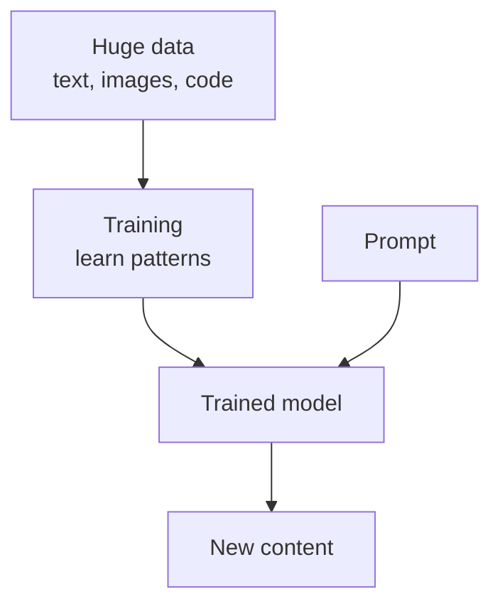
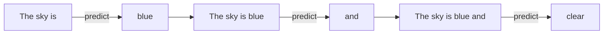
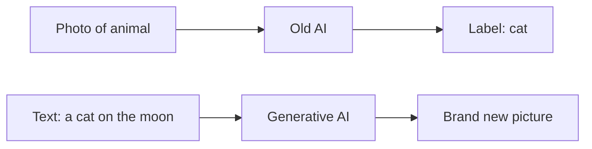

# What is Generative AI?

> **Step 3: Generative AI and the Transformer Architecture** · ⏱️ 14 min read · [Read original](https://outcomeschool.com/blog/what-is-generative-ai)

## TL;DR
Generative AI creates new content (text, images, audio, video, code) that did not exist before. It learns patterns from huge amounts of examples during training, and a text model writes by predicting the next word again and again. It is powerful but can hallucinate, so important facts must be checked.

## Key Concepts
- **Generative AI** — Generative (create) + AI (computer doing tasks needing human intelligence): AI that creates new content on its own.
- **Generate** — create something that did not exist before. A calculator giving 4 for 2+2 is a fixed rule, not generating; drawing a cat riding a bicycle on the moon is.
- **Old AI ("the AI that decides")** — looks at input, picks a label/decision from fixed options.
- **Training** — reading huge numbers of examples to learn patterns (not memorizing word for word).
- **Model** — the trained brain holding learned patterns.
- **LLM** — Large (learned from large text, many internal settings) Language (understands/creates human language) Model. ChatGPT, Claude, Gemini models are LLMs.
- **Prompt** — plain-words request to the model.
- **Decoder** — the part that does the writing.
- **Temperature, Top-k, Top-p** — settings controlling playing safe vs taking a chance on a surprising word.
- **Hallucination** — made-up facts that sound right.

## How It Works

### Old AI vs Generative AI

| Old AI (decides) | Generative AI (creates) |
|---|---|
| Looks at input, picks a label | Looks at input, produces new content |
| "Is this a cat or dog?" | "Draw me a new cat." |
| Chooses from fixed options | Creates what did not exist |
| Output is a decision | Output is text, image, audio, video |

Examples of old AI: spam or not, cat in photo or not, positive/negative review. Both rest on Machine Learning.

### How it learns
Like a child reading thousands of storybooks: learns which words go together, how sentences flow, how stories begin and end. For text, trained on large parts of internet writing (books, articles, sites); it learns which words follow which, how ideas connect, style and structure. Images: trained on pictures with descriptions, learns what "cat", "bicycle", "moon" look like and can combine them in unseen ways.

### How it creates
Predict next word repeatedly (autoregressive generation): "The sky is" gives "blue", then "and", then "clear"... Never a whole paragraph in one shot; each step looks at everything so far. Images, audio, video use similar spirit with different methods.

### What it can create
Text (emails, stories, articles, summaries), images (paintings, photos, logos), audio (music, human-like voice), video (short clips), code.

### Complete flow
Huge data, then training, then trained model, then prompt, then new content.

### Everyday use
Chat assistants, writing help (emails, grammar, summaries), image creation, coding help, customer support chatbots.

### Limitations
- Can be wrong (hallucination), so verify.
- No true understanding or feelings; just patterns.
- Learns from human data, so absorbs biases and mistakes.
- Needs a good, clear prompt.
Use it as a smart helper, not a source of final truth.

### FAQ
- Copies training data? No; learns patterns.
- LLM = GenAI? No; LLM is a text/language model powering many GenAI tools.
- ChatGPT GenAI? Yes.
- Safe vs surprising word? Temperature, Top-k, Top-p.
- Built on ML? Yes.

## Diagram(s)

### Complete flow

### Next-word generation

### Old AI vs Generative AI

## Trade-offs & Pitfalls
- Hallucination, bias from data, lack of true understanding, prompt dependence.

## Key Takeaways
- GenAI creates new content; old AI decides/labels.
- It learns patterns from massive data, not memorized text.
- Text generation = repeated next-word prediction (decoder, autoregressive).
- Trained brain = model; text model = LLM.
- Flow: data, training, model, prompt, output.
- Always verify important facts.
