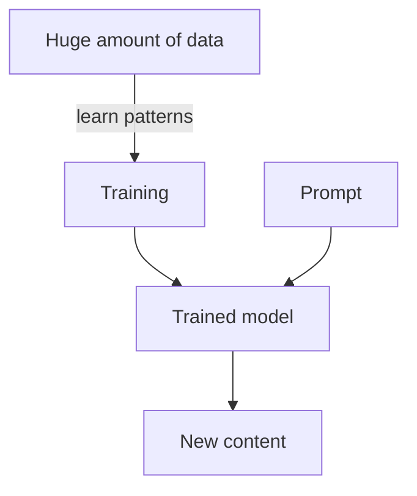

# What is Generative AI?

> **Step 3: Generative AI and the Transformer Architecture** · ⏱️ 14 min read · [Read original](https://outcomeschool.com/blog/what-is-generative-ai)

## TL;DR
Generative AI is AI that creates new content (text, images, audio, video, code) that did not exist before. It learns patterns from huge amounts of examples and, for text, generates by predicting the next word again and again.

## Key Concepts
- **Generate** — create something that did not exist before, not copy an old answer.
- **Training** — the stage where the AI reads massive data and learns patterns (not memorizing word for word).
- **Model** — the trained "brain" that results from training.
- **LLM** — a Large Language Model: a trained model that works mainly with text and language.
- **Prompt** — the plain-words request given to the model.
- **Autoregressive generation** — creating output one word at a time, feeding back what has been written.
- **Temperature, Top-k, Top-p** — settings controlling whether the model plays safe or picks a surprising word.
- **Hallucination** — confident but made-up, false output.

## How It Works
**Old AI vs Generative AI**

| Old AI (decides) | Generative AI (creates) |
|---|---|
| Looks at input and picks a label | Looks at input and produces new content |
| "Is this a cat or a dog?" | "Draw me a new cat." |
| Chooses from fixed options | Creates something new |
| Output is a decision | Output is text, image, audio or video |

**Learning.** Like a child reading thousands of storybooks, the AI sees a huge amount of examples (books, articles, websites; or images with descriptions) and learns patterns: which words follow which, how ideas connect, style and structure. It can later mix learned patterns to produce things it never saw, e.g. a cat riding a bicycle on the moon.

**Creating text.** The decoder predicts the next word given what exists so far: "The sky is" gives "blue", then "and", then "clear", and so on until done. It never writes a whole paragraph in one shot.

**What it can create:** text, images, audio (music, voice), video, code.

**Limitations**
- Can be wrong and hallucinate; always verify important facts.
- Does not truly understand; it is good at patterns.
- Learns from human data, so it can pick up biases.
- Answer quality depends on a clear prompt.

## Diagram

## Key Takeaways
- Generative AI creates; older AI mostly labels or decides.
- It learns patterns from data rather than memorizing and copying.
- Text generation is repeated next-word prediction.
- An LLM is the text-focused kind of model within Generative AI.
- Treat it as a smart helper, not a source of final truth.
