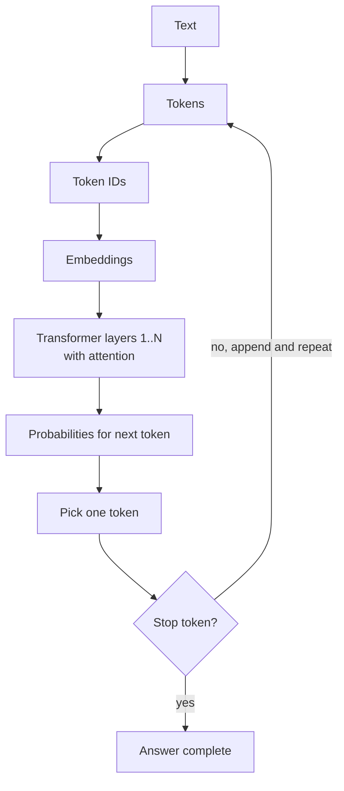
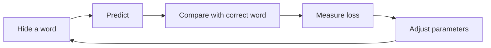
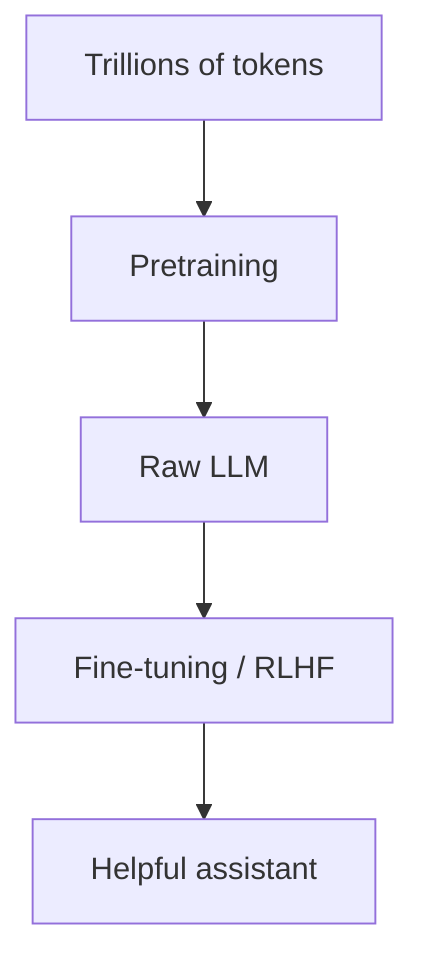

# How does an LLM work?

> **Step 3: Generative AI and the Transformer Architecture** · ⏱️ 18 min read · [Read original](https://outcomeschool.com/blog/large-language-model-llm)

## TL;DR
An LLM predicts the next token. Text becomes tokens, token IDs and embeddings, flows through stacked Transformer layers using attention, and a probability over next tokens is produced; the chosen token is appended and the loop repeats. It is pretrained with next-token prediction on huge text, then fine-tuned to be helpful. It has a context window limit and can hallucinate.

## Key Concepts
- **LLM** — Large (huge text corpus: web, books, articles, code; billions of **parameters**), Language (human languages), Model (learns patterns from examples, not rules). Analogy: child reading thousands of storybooks.
- **Token** — small chunk of text (word, part of word, character). "I love learning" gives "I", " love", " learn", "ing".
- **Token ID** — number per token (example: [40, 1842, 4673, 278]; IDs are illustrative, each LLM has its own vocabulary). **Tokenization** = splitting text.
- **Embedding** — list of numbers representing a token's meaning; similar words get similar vectors (king/queen close, apple far). Learned in training, not set by hand. Token ID itself carries no meaning.
- **Transformer** — architecture introduced 2017 ("Attention Is All You Need"); sees all words at once, unlike earlier models that read word by word and lost track.
- **Attention** — each word looks at itself and earlier words to decide which matter.
- **Autoregression** — feeding own output back in.
- **Loss** — gap between prediction and correct word.
- **Pretraining / fine-tuning**, **RLHF**, **context window**, **hallucination**, **RAG**.

## How It Works

### Next-word prediction
Given "The sky is", the LLM outputs a probability per candidate: blue 70%, clear 15%, grey 10%, falling 5%; then picks one (see Top-k / Top-p sampling). It really predicts tokens; "word" is a simplification.

### Pipeline
1. Tokenize text. 2. Map to token IDs. 3. Embeddings. 4. Stack of N Transformer layers, each refining understanding. 5. Prediction for next token.

### Attention example
"The animal did not cross the street because it was too tired": "it" attends strongly to "animal" (a street can't be tired). Every word does this over itself and previous words.

### Generating an answer
Predict, append, predict again until a special **stop token**. "The capital of France is" gives "Paris", then ".", then [stop]. This is why answers appear one word at a time.

### Training (next-word game)
Parameters start random. Loop: hide last word of a real sentence ("The sun rises in the" / "east"); LLM predicts (e.g. "banana"); compare with correct word to get loss; adjust parameters via backpropagation and gradient descent; repeat over trillions of tokens. No manual labeling: the text supplies questions and answers.

### Pretraining vs fine-tuning

| Stage | What | Result |
|---|---|---|
| Pretraining | Next-word prediction on massive internet text, books, code | Raw text-completion model with language and world knowledge |
| Fine-tuning | Train on curated examples (instruction following, helpful, honest, safe); e.g. RLHF where humans rate answers | Helpful assistant |

### Context window
Maximum tokens visible at once (short-term memory), covering question and answer. E.g. 100,000 tokens. Longer chats: oldest text is dropped or shortened, so the LLM forgets the start. Modern windows are large (books, codebases) but limited.

### Hallucination
Confident but wrong/made-up output. LLM predicts likely-sounding words, doesn't look up facts or verify truth (e.g. invents a plausible book title). Verify names, numbers, dates, quotes. Mitigation: **RAG** fetches facts from trusted sources and gives them to the LLM.

### Applications
AI assistants, writing help, coding help, translation, summarization, customer support, search with direct answers.

### FAQ
- Look up facts in a DB? No.
- Words or tokens? Tokens.
- Why one word at a time? It truly generates that way until stop token.
- Who labels data? Nobody; next word is in the text.
- Why forget chat start? Context window.

## Diagram(s)

### Generation loop

### Training loop

### Two-stage training

## Trade-offs & Pitfalls
- Hallucination; verify facts.
- Finite context window causes forgetting.
- Pretrained model alone is not an assistant.

## Key Takeaways
- LLM = next-token predictor with probabilities.
- Text to tokens to IDs to embeddings to Transformer to next token.
- Attention lets words relate to each other ("it" to "animal").
- Generation is an autoregressive loop ending at a stop token.
- Pretraining (self-supervised) then fine-tuning/RLHF.
- Context window bounds what it can see.
- RAG reduces hallucination.
