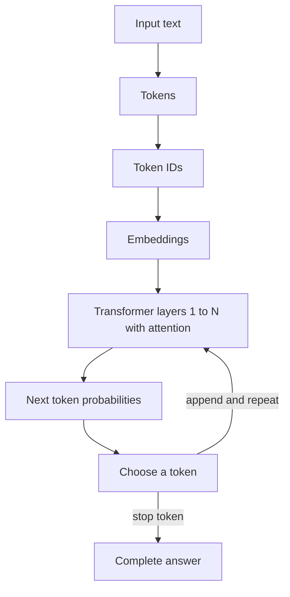

# How does an LLM work?

> **Step 3: Generative AI and the Transformer Architecture** · ⏱️ 18 min read · [Read original](https://outcomeschool.com/blog/large-language-model-llm)

## TL;DR
An LLM works by predicting the next token. It turns text into tokens and embeddings, passes them through stacked Transformer layers that use attention, and repeats the prediction token by token to write full answers.

## Key Concepts
- **LLM** — Large Language Model: learned from huge text, with billions of parameters.
- **Parameters** — the internal numbers adjusted during learning.
- **Token / token ID** — a chunk of text (word, subword, character) and its number. E.g. "I love learning" becomes "I", " love", " learn", "ing".
- **Embedding** — list of numbers representing a token's meaning; similar meanings get similar numbers, learned during training.
- **Transformer** — architecture (2017, "Attention Is All You Need") that looks at all words at once.
- **Attention** — each word looks at itself and earlier words and decides which matter. "it" attends to "animal" in "The animal did not cross the street because it was too tired."
- **Autoregression** — feeding its own output back in as input.
- **Context window** — max tokens the LLM can see at once; older text falls out.
- **Hallucination** — confident but false output.

## How It Works
**Prediction.** The LLM assigns a probability to many possible next tokens (e.g. blue 70%, clear 15%, grey 10%, falling 5%) and chooses one.

**Generation loop.** Predict one token, append, predict again, until a special stop token. "The capital of France is" gives "Paris", then ".", then stop.

**Training (next-word prediction game)**
1. Take real text, hide the last word.
2. The LLM predicts (at first random nonsense).
3. Compare with the correct word; the gap is the **loss**.
4. Adjust parameters via backpropagation and gradient descent.
5. Repeat on trillions of tokens. No manual labels: the text supplies the answers.

**Two stages**

| Stage | Purpose |
|---|---|
| Pretraining | Next-word prediction on massive text; gives raw knowledge, but only a text completer |
| Fine-tuning | Train on curated examples to follow instructions and be helpful, honest, safe (e.g. RLHF, learning from human ratings) |

**Hallucination.** The model predicts likely-sounding text and does not look up facts, so it can invent plausible but false things (e.g. a nonexistent book title). RAG reduces this by fetching facts from trusted sources first.

**Applications:** assistants, writing, coding, translation, summarization, customer support, search.

## Diagram

## Key Takeaways
- An LLM fundamentally predicts the next token, repeated many times.
- Tokens become IDs, then embeddings that carry meaning.
- Attention lets words relate to each other; Transformer layers are stacked.
- Pretraining builds knowledge, fine-tuning makes it a useful assistant.
- The context window limits what it can "remember"; hallucinations are a consequence of pattern prediction, so verify facts.
