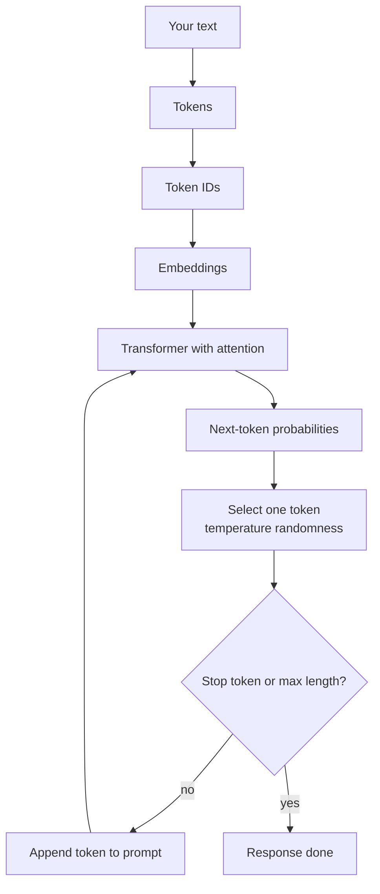

# Inside ChatGPT: What Happens After You Hit Enter

> **Step 3: Generative AI and the Transformer Architecture** · ⏱️ 3 min read · [Read original](https://outcomeschool.substack.com/p/inside-chatgpt-what-happens-after)

## TL;DR
ChatGPT (an interface to an LLM) does not think through your question; it plays a one-token-at-a-time probability game: tokenize, convert to IDs and embeddings, run Transformer attention, predict next-token probabilities, pick one, append, repeat until stop.

## Key Concepts
- **Token** — smallest unit processed: full word, subword piece or punctuation. Used because language is messy: common words fast, rare words as subwords, plus typos, slang, code, emojis.
- **Token ID** — number per token.
- **Embedding** — high-dimensional vector (hundreds of numbers) capturing meaning; similar words cluster, relationships preserved, "math with meaning".
- **Transformer / Attention** — each word looks at every other word for context.
- **Temperature** — controls randomness in token choice.

## How It Works
1. **Tokens**: "What is machine learning?" becomes ["What","is","machine","learning","?"].
2. **Numbers**: IDs e.g. [102, 2, 834, 919, 43]; then embeddings supply context (king/queen, Paris/France).
3. **Transformer**: attention on "The animal didn't cross the road because it was too tired": for "it" it looks at "animal" and "road" and decides "animal". Prompt becomes a context-aware representation.
4. **Predict next token**: probability distribution over the 50,000+ token vocabulary. For "Machine learning is": "a" 32%, "the" 18%, "an" 11%, "used" 8%, "powerful" 6%. One is selected using the probabilities plus temperature randomness (picks "a").
5. **Repeat**: append token ("Machine learning is a" gives "field" 28%, "branch" 15%, "subset" 12%, "type" 10%; picks "field"). Stops on stop token or max response length.

Loop: read everything so far, predict likely next token, add it, repeat. Feels like intelligence but is sophisticated pattern matching.

## Diagram(s)

### From prompt to answer

## Trade-offs & Pitfalls
- Not reading or reasoning in a human way; output is probabilistic pattern matching.

## Key Takeaways
- ChatGPT is an interface; the LLM does the work.
- Text, tokens, IDs, embeddings, Transformer layers, next-token probabilities.
- Attention resolves references like "it".
- One token selected per loop, influenced by temperature.
- Ends at stop token or max length.
