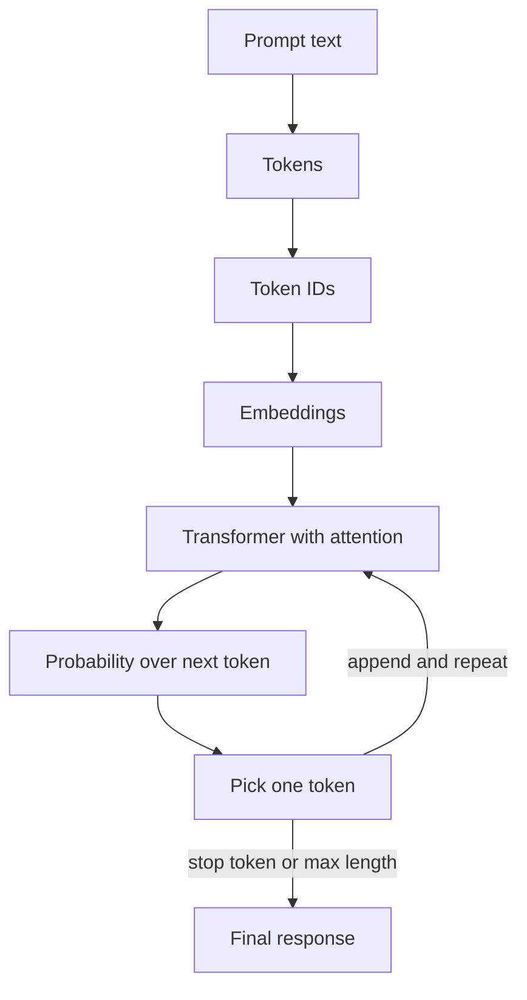

# Inside ChatGPT: What Happens After You Hit Enter

> **Step 3: Generative AI and the Transformer Architecture** · ⏱️ 3 min read · [Read original](https://outcomeschool.substack.com/p/inside-chatgpt-what-happens-after)

## TL;DR
ChatGPT is an interface to a large language model that does not "think" through your question; it plays a probability game, predicting one token at a time in a loop. This note walks through the pipeline from text to tokens to the final response.

## Key Concepts
- **Token** — smallest unit the model processes: a word, a word piece or punctuation.
- **Token ID** — the number assigned to each token.
- **Embedding** — high-dimensional vector capturing the meaning of a token; similar words cluster together.
- **Transformer** — the neural network architecture that processes the tokens.
- **Attention** — lets each token look at every other token to understand context.
- **Temperature** — controls the randomness when choosing among likely tokens.

## How It Works
1. **Tokenize** — "What is machine learning?" becomes `["What", "is", "machine", "learning", "?"]`. Tokens handle common words, rare words (as subwords), typos, slang, code and emojis consistently.
2. **Token IDs and embeddings** — each token maps to a number, then to an embedding vector so the model can "do math with meaning".
3. **Transformer reads the prompt** — attention resolves context. In "The animal didn't cross the road because it was too tired", "it" attends back to "animal", not "road".
4. **Predict next token** — the model outputs a probability distribution over its whole vocabulary (50,000+ tokens). E.g. after "Machine learning is": "a" 32%, "the" 18%, "an" 11%. One token is picked, with some randomness from temperature.
5. **Repeat** — append the chosen token and run again, until a stop token or the maximum length is hit.

The loop: read everything so far, predict the likely next token, add it, repeat.

## Diagram

## Key Takeaways
- The model sees tokens, not words.
- Output is generated one token at a time, each prediction conditioned on everything so far.
- Attention is how context is understood.
- Temperature adds controlled randomness to token selection.
- It feels like intelligence but is sophisticated pattern matching: one token, one prediction, one loop.
