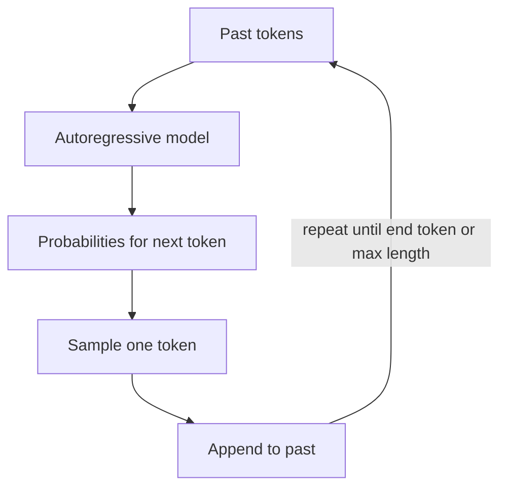
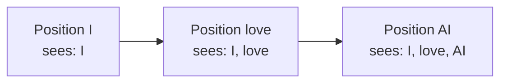
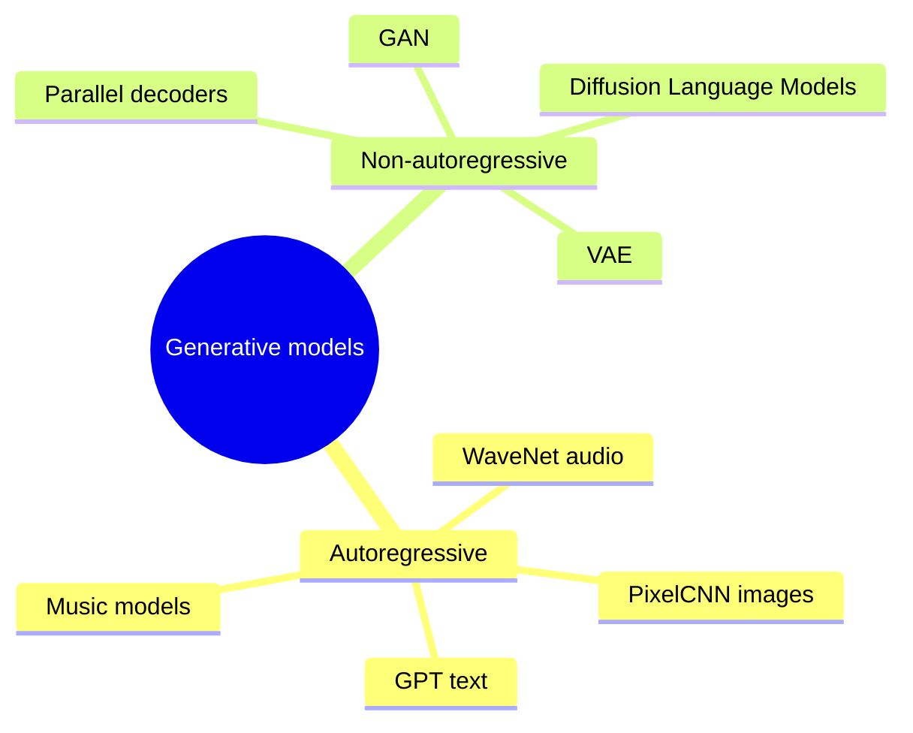

# What are Autoregressive Models?

> **Step 3: Generative AI and the Transformer Architecture** · ⏱️ 20 min read · [Read original](https://outcomeschool.com/blog/autoregressive-models)

## TL;DR
An autoregressive model generates one token at a time, predicting the next from all previous tokens (chain rule of probability), then appends it and repeats. This gives high-quality, fluent output with simple next-token training, but sequential, slow generation; causal masking enforces the rule in training and KV Cache removes redundant compute at inference.

## Key Concepts
- **Token** — small piece of text (word, subword, character).
- **Autoregressive** — Auto (self: own outputs become input) + Regressive (predict from past values, like tomorrow's temperature from last 7 days).
- **Chain rule of probability** — joint probability = product of conditionals.
- **Sampling** — picking a token from the distribution; **greedy decoding** (highest prob) vs **temperature sampling** (more random).
- **Causal masking** — hides future tokens in attention.
- **KV Cache** — stored Keys and Values of past tokens.
- **Error compounding** — early wrong token corrupts all later ones.

## How It Works

### Idea and math
"I love AI": see "I", predict "love"; see "I love", predict "AI"; see all, predict end marker. Used by ChatGPT (text), WaveNet (audio), PixelCNN (pixels).
$$P(x_1,\dots,x_n)=P(x_1)\,P(x_2|x_1)\,P(x_3|x_1,x_2)\cdots P(x_n|x_1,\dots,x_{n-1})$$
$x_i$ tokens, $|$ means "given". Example: P("I love AI") = P("I")·P("love"|"I")·P("AI"|"I","love"). The model is trained to answer "given everything so far, what is the next token's probability?".

### Generation loop
Feed past, model gives probabilities for every next token, sample one, append, repeat until end token or max length.
```python
past = [start]
while not done:
    probs = model(past); nxt = sample(probs); past += [nxt]
    done = (nxt == end)
```
One model run per token (100 tokens = 100 runs): high quality but cannot parallelize across tokens. Enables token streaming.

### Numeric example (vocab: I, love, AI, code, <end>; greedy)
- After "I": I .05, love **.60**, AI .15, code .15, end .05 gives "love".
- After "I love": AI **.70** (others .05, .05, .15, .05) gives "AI".
- After "I love AI": end **.80** (others .05 each) gives end; stop.
- Sentence probability (assume P("I")=0.20): 0.20 × 0.60 × 0.70 × 0.80 = 0.0672. Built one token at a time, never computed jointly.

### Why GPT-style models are autoregressive
Generative Pre-trained Transformer is autoregressive by design; Claude, Gemini, LLaMA too: decoder-only Transformers trained purely on next-token prediction. Prompt is the starting past; predict, append, repeat until stop.

### Causal masking
During training the model sees the full sentence but must not peek at future tokens (else it copies answers). Attention scores for future positions set to negative infinity, so softmax gives 0 weight. Mask for "I love AI" (1 = allowed, 0 = blocked): rows "I": [1,0,0]; "love": [1,1,0]; "AI": [1,1,1] (triangular). At inference there is no future token, so the rule holds naturally.

### KV Cache
Without it, each step recomputes Keys and Values for all past tokens. Cache past K and V; compute only the new token's. For 1,000 tokens: 1+2+...+1000 = 500,500 units vs about 1,000 units. Works because the past doesn't change between steps.

### Autoregressive vs non-autoregressive

| Aspect | Autoregressive | Non-autoregressive |
|---|---|---|
| Order | One token at a time, left to right | Many tokens in parallel |
| Dependence | All previous tokens | Limited/none on other generated tokens |
| Speed | Slow (one run per token) | Fast |
| Quality | Generally higher, fluent | Generally lower, repeated/off-topic tokens possible |
| Training | Simple next-token | More complex objectives |
| Examples | GPT, WaveNet, PixelCNN | Some translation models, parallel decoders |

VAEs and GANs are non-autoregressive (whole output at once). Diffusion Language Models fill and refine the whole sentence in parallel.

### Popular examples
GPT family (text); PixelCNN (pixel by pixel from pixels above/left); WaveNet (audio samples; 16,000 samples/sec means 16,000 runs per second of audio, slow but high quality); music models (note by note). Anything laid out as a sequence.

### Pros and cons
- Pros: coherent fluent output; simplest training objective; flexible length; one model does translation, summarization, QA, code.
- Cons: slow; wait grows with length (1,000 tokens about 10x longer than 100); error compounding (wrong token 5 conditions tokens 6, 7, 8...); no parallelization (token t+1 needs t).
- Mitigations: KV Cache, speculative decoding (Medusa, EAGLE), better sampling. The core quality-vs-speed trade-off remains.

### FAQ
- Stops at end marker or max length.
- Longer answers take longer: one run per token.
- Greedy = highest-probability token each step.
- One wrong token can spoil the rest (error compounding).

## Diagram(s)

### Generation loop


### Causal mask for 3 tokens


### Autoregressive taxonomy


## Trade-offs & Pitfalls
- Sequential, slow decoding; latency grows with length.
- Error compounding from early mistakes.
- Cannot parallelize generation (training can, via masking).

## Key Takeaways
- Autoregressive = predict next token from all previous ones, feeding outputs back.
- Math: chain rule product of conditionals.
- GPT-style LLMs are decoder-only, trained on next-token prediction.
- Causal masking prevents peeking at the future in training.
- KV Cache turns about 500,500 units of work into about 1,000 for 1,000 tokens.
- Quality and simplicity cost speed; non-autoregressive is faster but usually lower quality.
- Works for any sequence: text, pixels, audio, notes.
