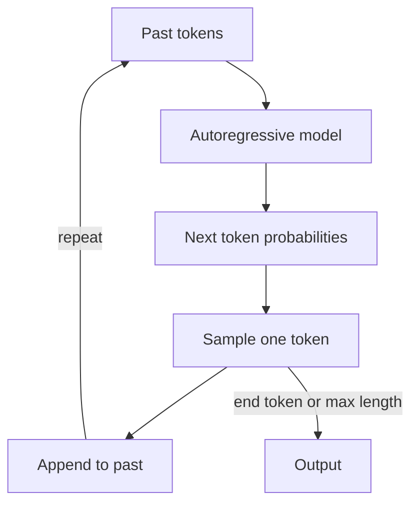

# What are Autoregressive Models?

> **Step 3: Generative AI and the Transformer Architecture** · ⏱️ 20 min read · [Read original](https://outcomeschool.com/blog/autoregressive-models)

## TL;DR
An autoregressive model generates one piece (token, pixel, audio sample) at a time, predicting the next from everything generated so far. This is how GPT-style models write text: high quality, but slow and sequential.

## Key Concepts
- **Autoregressive** — "auto" (self) + "regressive" (predict from past values): the model feeds its own outputs back as input.
- **Chain rule of probability** — joint probability of a sequence as a product of conditionals.
- **Sampling** — picking one token from the predicted distribution (greedy picks the highest; temperature sampling is more random).
- **Causal masking** — hides future tokens during training so the model cannot peek.
- **KV Cache** — stores Keys and Values of past tokens for reuse.
- **Non-autoregressive** — generates many tokens in parallel.

## How It Works
**Chain rule**

$$P(x_1,\dots,x_n)=P(x_1)\,P(x_2\mid x_1)\cdots P(x_n\mid x_1,\dots,x_{n-1})$$

Each term asks: given everything so far, what is the next token's probability?

**Generation loop:** feed the past, get next-token probabilities, sample one, append, repeat until an end token or max length. Generating 100 tokens means 100 model runs.

**Numeric example** (vocab: I, love, AI, code, end): P(love | I)=0.60, P(AI | I, love)=0.70, P(end | I, love, AI)=0.80; with P(I)=0.20 the sentence probability is $0.20 \times 0.60 \times 0.70 \times 0.80 = 0.0672$.

**GPT-style models** are decoder-only Transformers trained purely on next-token prediction. Claude, Gemini and LLaMA are likewise autoregressive.

**Causal masking.** In training the model sees the whole sentence, so attention scores for future positions are set to negative infinity; after softmax they become 0. A lower-triangular mask results (1 = allowed, 0 = blocked). At inference there is no future token, so the rule is natural.

**KV Cache.** Without it, step $t$ recomputes K and V for all $t$ past tokens: about $1+2+\dots+1000 = 500{,}500$ units for 1,000 tokens. With it, only the new token's K and V are computed: about 1,000 units.

| Aspect | Autoregressive | Non-Autoregressive |
|---|---|---|
| Order | One token at a time | Many tokens in parallel |
| Dependence | All previous tokens | Limited or none |
| Speed | Slow | Fast |
| Quality | Generally higher | Generally lower |
| Examples | GPT, WaveNet, PixelCNN | Some translation models, VAE, GAN, diffusion LMs |

**Beyond text:** PixelCNN (pixel by pixel), WaveNet (16,000 samples per second of audio), music models. Anything laid out as a sequence.

**Pros:** coherent output, simple objective, flexible length, one model for many tasks. **Cons:** slow, longer output takes proportionally longer, early errors compound, cannot parallelize. Mitigations: KV Cache, speculative decoding.

## Diagram

## Key Takeaways
- Autoregressive means predicting the next token from all previous ones, looping on its own output.
- The chain rule turns sequence probability into a product of next-token probabilities.
- Causal masking enforces the no-peeking rule in training; KV Cache removes redundant work at inference.
- Trade-off: high quality and simple training versus slow, sequential generation.
- The idea applies to any sequence: text, pixels, audio, notes.
