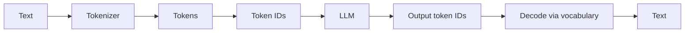

# Tokenization in LLMs

> **Step 3: Generative AI and the Transformer Architecture** · ⏱️ 18 min read · [Read original](https://outcomeschool.com/blog/tokenization-in-llms)

## TL;DR
Tokenization breaks text into small pieces (tokens) and converts each to a number (token ID), because LLMs only work with numbers. Modern LLMs use subword tokenization, with vocabularies built by Byte Pair Encoding (BPE).

## Key Concepts
- **Tokenizer** — program converting text to tokens/IDs and back; each LLM has its own.
- **Token** — smallest unit the model works with: word, subword, character, punctuation, or a word with its leading space (" love"). Rule of thumb for English: about 4 characters, or 0.75 word.
- **Vocabulary** — complete list of known tokens, each with a unique **token ID**.
- **BPE** — builds the vocabulary by repeatedly merging the most frequent adjacent pair.
- **Byte-level BPE** — starts from the 256 byte values so nothing is ever unknown.
- **Special tokens** — signals, not words: end of text, beginning of text, padding, chat markers.
- **Decoding** — token IDs back to text.

## How It Works
**Three approaches**

| | Character | Word | Subword |
|---|---|---|---|
| Vocabulary size | Very small | Very large | Medium (50k to 200k) |
| Tokens per sentence | Very many | Few | Few |
| Unknown word problem | Never | Often (`<UNK>`) | Never |
| Meaning per token | Very little | Full | Good |
| Used in modern LLMs | No | No | Yes |

Subword keeps common words whole ("learning") and splits rare ones ("tokenization" into "token" + "ization"), so related words share pieces.

**BPE example.** Counts: hug x10, pug x5, hugs x5. Start with characters h, u, g, p, s.
1. Most frequent pair u+g (20), merge into `ug`.
2. Then h+ug (15), merge into `hug`.
3. Then tie p+ug and hug+s (5 each); a fixed rule picks p+ug into `pug`.

Merges are saved as ordered rules. New text is split to characters and rules are applied in order: "pugs" becomes `pug`, `s`, IDs [7, 4], even though "pugs" was never in training. The tokenizer is trained separately and frozen before the LLM is trained.

**Vocabulary size trade-off.** Bigger vocabulary means fewer tokens per sentence but a heavier model; smaller means lighter model but longer sequences.

**Decoding.** The model outputs token IDs; the tokenizer looks them up in reverse and joins them. This is why half-words can appear while streaming.

**Code (tiktoken):** `encoding.encode("I love learning")` gives IDs; `encoding.decode(ids)` returns the text.

**Practical effects**
- Counting letters ("strawberry"): the model sees pieces, not letters.
- Math: "12345" split as "123" + "45".
- Cost and limits: context window and pricing are per token.
- Other languages: mostly-English tokenizers use many more tokens for Hindi, Tamil, Japanese.
- Code: indentation spaces are tokens too.

## Diagram

## Key Takeaways
- Models need numbers; the tokenizer bridges text and numbers.
- Subword tokenization balances vocabulary size, sequence length and unknown words.
- BPE merges the most frequent pair repeatedly and stores the merge rules in order.
- The model never sees inside a token, which explains letter-counting and digit-math failures.
- Token count drives cost, context limits, and unequal treatment of non-English text.
