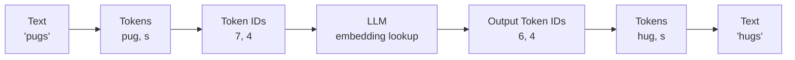
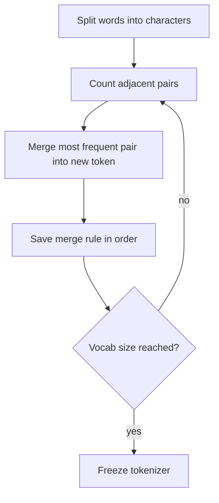

# Tokenization in LLMs

> **Step 3: Generative AI and the Transformer Architecture** · ⏱️ 18 min read · [Read original](https://outcomeschool.com/blog/tokenization-in-llms)

## TL;DR
Tokenization breaks text into small pieces (tokens) and maps each to an integer Token ID, because an LLM only does math on numbers. Modern LLMs use subword tokenization, with Byte Pair Encoding (BPE) building the vocabulary by repeatedly merging the most frequent adjacent pair. It decides what fits in the context window and what it costs, and it explains many LLM quirks (letter counting, digit math, non-English cost).

## Key Concepts
- **Tokenizer** — program converting text to tokens/IDs and back; every LLM has its own.
- **Token** — smallest unit the model works with: a word, part of a word, a character, punctuation, or a word plus its leading space (e.g. " love"). Rule of thumb for English: 1 token is about 4 characters, about 0.75 word (100 tokens is about 75 words).
- **Vocabulary** — complete list of tokens the tokenizer knows; the model picks one token from it at every generation step.
- **Token ID** — unique serial number of a token in the vocabulary.
- **`<UNK>`** — unknown token used by word-level tokenizers for out-of-list words.
- **BPE** — algorithm that starts from single characters and repeatedly merges the most frequent adjacent pair.
- **Byte-level BPE** — starting list is all 256 byte values (GPT-style), so nothing is ever unknown (any language, emoji, symbol).
- **Special tokens** — signals, not words: `<|endoftext|>`/`<eos>` (stop generating), `<bos>` (start), padding (equalise input lengths in a batch), chat markers (who said what). Added on purpose, never from splitting normal text.
- **Context window** — max tokens the model reads at once.

## How It Works

### Why tokenize
- Model = multiplications, additions, comparisons: needs numbers, we have text.
- Model also needs a fixed list of pieces it can output. Too big a list: slow, heavy model. Too small: sentences become long chains of tiny pieces. So: what is the right piece size?

### Three approaches
| | Character-level | Word-level | Subword-level |
|---|---|---|---|
| Known-list size | Very small | Very large | Medium (50k-200k) |
| Tokens per sentence | Very many | Few | Few |
| Unknown word problem | Never | Often | Never |
| Meaning per token | Very little | Full | Good |
| Used in modern LLMs | No | No | Yes |

- **Character**: "learning" is 8 tokens; 100 words is about 500 tokens; "l" alone carries no meaning, so the model must work hard to learn that l-e-a-r-n means learn.
- **Word**: split on spaces; "tokenization" missing from list becomes `<UNK>`; "learn/learning/learned/learner" are unrelated tokens learned from scratch; list never ends (names, languages, code, new words).
- **Subword**: common words stay whole ("the", "learning"); rare ones split into common pieces ("tokenization" -> "token"+"ization"; "unbelievable" -> "un"+"believ"+"able"). Pieces like "ization" reuse learning across "organization", "civilization". Downside: splits can look unnatural.

### BPE building the vocabulary (worked example)
Training counts: hug x10, pug x5, hugs x5.
0. Characters: start vocab h,u,g,p,s (5).
1. Pair counts: h+u=15, u+g=20, p+u=5, g+s=5. Merge u+g -> `ug` (6 tokens). Words: h ug (10), p ug (5), h ug s (5).
2. h+ug=15, p+ug=5, ug+s=5. Merge -> `hug` (7).
3. p+ug=5, hug+s=5 tie, fixed rule breaks it; merge p+ug -> `pug` (8).
- Continue until target vocab size (e.g. 100,000). Each merge saved as ordered rule: 1. u+g->ug, 2. h+ug->hug, 3. p+ug->pug.
- **Encoding new text** = no counting; split into characters and apply rules in order. "pugs": p,u,g,s -> p,ug,s -> (rule 2 no match) -> pug,s. "pugs" was never in training yet gets meaningful tokens.
- Tokenizer is trained separately, before the LLM, then frozen; the LLM never changes it.

### Vocabulary, IDs, decoding
- Example vocab: h0, u1, g2, p3, s4, ug5, hug6, pug7. "pugs" -> ["pug","s"] -> [7,4] goes into the LLM.
- Vocab size tradeoff: bigger = fewer tokens per sentence but heavier model (bigger output choice each step); smaller = lighter model but longer sequences.
- Each Token ID later looks up an embedding (next topic).
- **Decoding**: LLM outputs Token IDs one at a time; reverse lookup and join: [6,4] -> ["hug","s"] -> "hugs". This is why streamed answers sometimes show half a word (token boundary).

### Code (tiktoken, `cl100k_base`, about 100k vocab)
```python
enc = tiktoken.get_encoding("cl100k_base")
ids = enc.encode("I love learning")   # [40, 3021, 6975]
enc.decode(ids)                        # "I love learning"
```
Per-ID decode shows `[I]`, `[ love]`, `[ learning]`: the space is attached to the next word. IDs differ across tokenizers.

### Effects in practice
- **Counting letters** ("r" in "strawberry"): tokens like "str","aw","berry"; model never sees letters, guesses from memory.
- **Math**: "12345" -> "123"+"45", harder than digit-by-digit.
- **Cost and limits**: context window and per-token pricing both depend on token count.
- **Other languages**: tokenizers are mostly trained on English; Hindi/Tamil/Japanese take several times more tokens, so more cost and a faster-filled window.
- **Code**: spaces/indentation are tokens (4 spaces may be 1 or 4 tokens) affecting code reading/writing.

## Diagrams

### Text to model and back


### BPE training loop


## Trade-offs & Pitfalls
Works well:
- No unknown-word problem; short sequences for common text; related words share pieces so learning is faster; one vocabulary for text, code, many languages.

Fails:
- Tasks needing individual letters (counting, reversing words).
- Math on long numbers (digits grouped unnaturally).
- Underrepresented languages: more tokens, higher cost, less context room.
- Odd split points can confuse the model.

## Key Takeaways
- The model sees Token IDs, never text; the model cannot look inside a token.
- Subword tokenization is the middle path between huge word vocabularies and long character sequences.
- BPE: merge the most frequent adjacent pair repeatedly, save rules in order, replay them to encode new text.
- Tokenizer is trained first and frozen; each LLM has its own, so IDs differ across models.
- Vocab size trades sequence length against model weight; byte-level BPE guarantees no unknowns.
- Token count drives context limits and price; about 4 characters or 0.75 word per English token.
- Letter counting, digit math and non-English cost problems all stem from tokenization.
