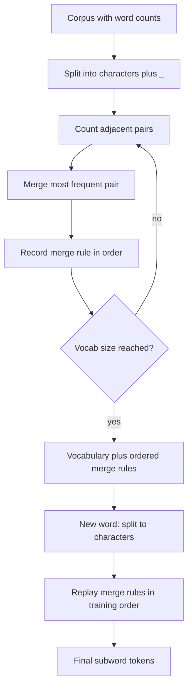

# What is Byte Pair Encoding (BPE) in LLMs?

> **Step 3: Generative AI and the Transformer Architecture** · ⏱️ 12 min read · [Read original](https://outcomeschool.com/blog/bpe-in-llms)

## TL;DR
BPE is the tokenization algorithm used by most modern LLMs. It starts from single characters and repeatedly merges the most frequent adjacent pair, building a vocabulary of common subwords. New text is tokenized by replaying the learned merge rules in order, so no word is ever unknown.

## Key Concepts
- **Tokenization** — breaking text into tokens, each then converted to a number (chocolate-bar analogy: break the bar into pieces).
- **Subword** — vocabulary piece between character and word: full words ("the"), parts ("ing","un","tion"), or single characters.
- **End-of-word symbol `_`** — appended to each word so word ends are known.
- **Merge rules** — ordered list of merges learned during training; saved with the vocabulary.
- **Vocabulary size** — target chosen in advance; typically 32,000-256,000 (LLaMA 3 about 128K, Gemma about 256K).

## How It Works

### Why not words or characters
- **Word-level**: model must know every word (hundreds of thousands in English, plus names, technical terms, misspellings, new words). Unseen "ChatGPT"/"tokenization" becomes one "unknown" token and loses all meaning.
- **Character-level**: no unknown words (26 letters plus digits/punctuation/spaces), but tokens are too small: a 10-word sentence becomes 50+ tokens, training is slow, and "l" carries little meaning.
- BPE gives the middle ground. Analogy: shorthand — you notice "ing"/"tion" are frequent and create shortcuts, automatically.

### Training example
Corpus counts: low 5, lower 2, newest 6, widest 3.
1. **Start with characters** plus `_`: `l o w _`(5), `l o w e r _`(2), `n e w e s t _`(6), `w i d e s t _`(3). Vocab {l,o,w,e,r,n,s,t,i,d,_}.
2. **Find most frequent pair**: "e s"=9 (newest 6 + widest 3), "s t"=9, "t _"=9, "l o"=7, "o w"=7. Merge "e s" -> `es`.
3. **Merge and update**: `n e w es t _`, `w i d es t _`; vocab gains `es`.
4. **Repeat**: "es t"=9 -> `est`. Later merges could be "est _"->"est_", "l o"->"lo", "lo w"->"low". Each merge adds one token and represents text with fewer, larger pieces.
5. **Stop** at desired vocab size. Final vocab mixes full common words ("the","is","and"), common subwords ("ing","tion","est","un"), and single characters for rare combinations.

### Tokenizing new text
- After training you have a vocabulary plus an **ordered merge list**. New text is NOT looked up greedily; the same merges are replayed in training order.
- "lowest": l o w e s t -> rule 1 (e s->es): l o w es t -> rule 2 (es t->est): l o w est -> rule 3 (l o->lo): lo w est -> rule 4 (lo w->low): low est. Result ["low","est"].
- "newer" -> ["new","er"]. Rare "widestness": common merges (es, est) fire where they match; leftovers stay as smaller known pieces.
- **Why order matters**: different merge orders (or greedy longest-match) can give different tokenizations than the model expects; replaying in order is consistent every time.
- Never fully unknown; worst case falls back to single characters (rare for common languages).

## Diagrams

### BPE training and use

### Evolution of "newest"

## Trade-offs & Pitfalls
- Greedy longest-match lookup is wrong for BPE; must replay merges in order.
- Vocabulary size is fixed in advance and is a design choice (larger = fewer tokens per text).
- Models use BPE variants; core idea is the same.

## Why BPE Is Used
- Handles unknown words by splitting into known pieces.
- Compact vocabulary (32k-256k) instead of millions of word entries.
- Balances meaning and efficiency: common words single tokens, rare words split.
- Works across languages/scripts/code with the same algorithm (it works at character level).

## FAQ
- Better than word-level? Yes: unseen words split into known pieces rather than one "unknown" token.
- Why not characters only? Too many tiny tokens (10 words -> 50+), slow training, little meaning per token.
- Vocab size? 32k-256k, chosen in advance; merging continues until reached.
- Greedy longest-match? No; replay merges in learned order.
- Can BPE fail on a word? No; worst case falls back to characters.

## Key Takeaways
- BPE = start from characters, merge most frequent adjacent pair, repeat until target vocab size.
- Output is a vocabulary plus an ordered list of merge rules.
- Encoding new text replays merges in training order, not greedy matching.
- Sits between word-level (unknown words) and character-level (too long) tokenization.
- Vocab sizes: 32k-256k (LLaMA 3 about 128K, Gemma about 256K).
- No word is ever truly unknown; worst case is single characters.
- After tokenization, the Transformer takes over.
