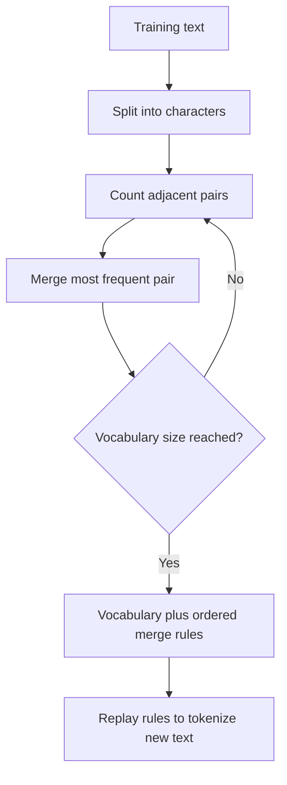

# What is Byte Pair Encoding (BPE) in LLMs?

> **Step 3: Generative AI and the Transformer Architecture** · ⏱️ 12 min read · [Read original](https://outcomeschool.com/blog/bpe-in-llms)

## TL;DR
BPE is a tokenization algorithm that breaks text into pieces between characters and words (subwords). It starts from characters and repeatedly merges the most frequent adjacent pair until reaching a chosen vocabulary size.

## Key Concepts
- **Word-level tokenization** — one token per word; needs every word and fails on unseen ones (unknown token).
- **Character-level tokenization** — one token per character; no unknowns but sequences are very long and tokens carry little meaning.
- **BPE** — merges frequent pairs to build a subword vocabulary.
- **Subword** — full words ("the"), parts ("ing", "tion") or single characters.
- **Merge rules** — ordered list of merges saved after training.
- **Vocabulary size** — chosen in advance; modern LLMs use roughly 32,000 to 256,000 (LLaMA 3 about 128K, Gemma about 256K).

## How It Works
**Training example.** Words: low x5, lower x2, newest x6, widest x3, each split into characters with an end-of-word symbol `_`.

1. Start vocabulary = single characters plus `_`.
2. Count adjacent pairs: "e s", "s t", "t _" each 9; "l o", "o w" each 7. Merge "e s" into `es`.
3. Update words, recount: "es t" is 9, so merge into `est`.
4. Keep going (next could be `est_`, `lo`, `low`), each merge adds one vocabulary entry and shortens sequences.
5. Stop at the desired vocabulary size.

Final vocabulary mixes common words, common subwords and single characters.

**Tokenizing new text.** BPE replays the merge rules in the exact order learned, not a greedy longest-match lookup. "lowest": l o w e s t, then es, then est, then lo, then low, giving `["low", "est"]`. Order matters because different orders yield different tokenizations. Unseen words fall back to smaller pieces, worst case characters.

**Why modern LLMs use it**
- Handles unknown words.
- Compact vocabulary instead of millions of entries.
- Balances meaning (common words whole) and efficiency (rare words split).
- Works across languages and code with the same algorithm.

## Diagram

## Key Takeaways
- BPE sits between word-level and character-level tokenization.
- Training = repeatedly merge the most frequent adjacent pair.
- Tokenization = replay saved merge rules in training order.
- No word is truly unknown; worst case falls back to characters.
- Most modern LLMs use BPE or a variant.
