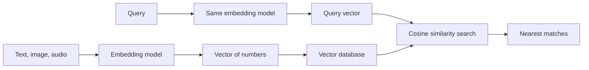

# What are Embeddings?

> **Step 3: Generative AI and the Transformer Architecture** · ⏱️ 19 min read · [Read original](https://outcomeschool.com/blog/what-are-embeddings)

## TL;DR
An embedding is a list of numbers (a vector) that represents meaning, arranged so similar things get similar numbers. Computers are bad at comparing meaning but excellent at comparing numbers, so embeddings make semantic search, RAG and recommendations possible.

## Key Concepts
- **Embedding / vector** — meaning translated into a list of numbers; the two terms are used interchangeably here.
- **Dimension** — one number in the list. Typical sentence embeddings have 384 to 3072.
- **Embedding model** — trained model that produces the numbers; no single dimension has a nameable meaning.
- **Cosine similarity** — compares the angle between two vectors, ignoring length; range -1 to 1.
- **Vector database** — stores embeddings and finds nearest ones fast.

## How It Works
**The problem.** "How do I reset my password?" and "I forgot my login details." share no key words, yet mean the same. "The bank of the river" and "visit the bank" share a word but differ in meaning. Letter matching gets both backwards.

**Two-number intuition.** Score fruit by sweetness and size: Apple [7,5], Banana [8,5], Lemon [1,3], Watermelon [6,10]. Apple and Banana land close, Lemon far. Meaning became position, and position can be measured. Two numbers cannot separate lemon from lime, so real embeddings need many dimensions.

**Closeness.** Cosine similarity: small angle means similar, right angle unrelated, opposite means opposite. Angle is preferred over distance because vector length often reflects irrelevant things like text length. In practice modern models give unrelated sentences about 0.1 to 0.3 and related ones about 0.7 to 0.9, so compare scores against each other.

**Where they come from.** The model learns from the principle that words in similar contexts mean similar things ("you shall know a word by the company it keeps"): "tea" and "coffee" appear in the same kinds of sentences, so they land close; "bicycle" lands far.

**Word math.** king - man + woman lands near queen; Paris - France + Italy lands near Rome. These relationships emerge, not programmed.

**Beyond words:** documents, images, audio, products and users. Some models share one space for text and images, enabling image search by sentence without labels.

**Uses:** semantic search, RAG, recommendations, clustering feedback, duplicate detection, classification.

**Pitfalls**
- Embeddings from different models are not comparable; changing the model means rebuilding all stored embeddings.
- Similar is not correct: "medicine is safe" and "is not safe" can be close.
- Inherit bias from training text.
- Frozen in time; new words and internal jargon have poor positions.
- Long text loses detail, so chunk documents.

## Diagram

## Key Takeaways
- An embedding is meaning as a vector; similar meaning gives nearby vectors.
- Cosine similarity measures angle, and scores should be compared relatively.
- Embeddings are learned from context, not hand-designed.
- Never mix embeddings from different models.
- Close in meaning does not mean correct.
