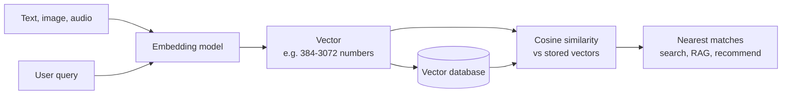
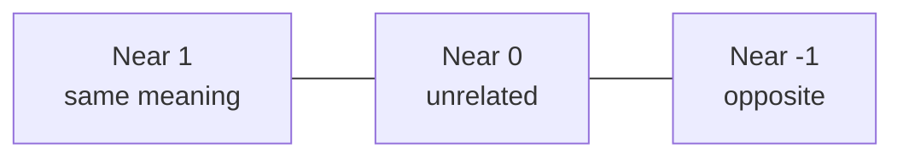

# What are Embeddings?

> **Step 3: Generative AI and the Transformer Architecture** · ⏱️ 19 min read · [Read original](https://outcomeschool.com/blog/what-are-embeddings)

## TL;DR
An embedding is a list of numbers (a vector) representing the meaning of something, arranged so similar meanings get similar numbers. Computers can't compare meaning but excel at comparing numbers, so placing things as points in a number space lets us measure closeness (usually with cosine similarity). It powers semantic search, RAG, recommendations and more.

## Key Concepts
- **Embedding / vector** — same thing here: a list of numbers placing an item in a space ("to embed" = place inside a space).
- **Dimension** — one number in the list. Typical sentence embeddings: 384-3072. No single dimension has a nameable meaning (dim 42 is not "formality"); meaning is spread across all.
- **Embedding model** — trained model that outputs the vector for a piece of text (not hand-written).
- **Cosine similarity** — compares the angle between two arrows, ignoring length; score -1 to 1.
- **Vector database** — stores embeddings and finds nearest ones fast.
- **RAG** — Retrieval-Augmented Generation: answer using our own documents.

## How It Works

### The problem
- Plain letter matching gets meaning backwards: "How do I reset my password?" vs "I forgot my login details." share no key words (look unrelated) while "The bank of the river was muddy" vs "I need to visit the bank today" share "bank" (look related) but differ in meaning.
- Fix: give the computer meaning as numbers.

### Two-number example
Score fruits on sweetness and size (0-10): Apple [7,5], Banana [8,5], Lemon [1,3], Watermelon [6,10]. Plotted, Apple and Banana land together, Lemon far away. "Most like apple?" = nearest point to [7,5] = Banana [8,5]. Meaning became position; position can be measured.

### Why many dimensions
- Two numbers fail: lemon and lime would get nearly identical scores (no color number). Language also carries thing/action, formal/casual, positive/negative, topic, etc.
- 2D = sheet, 3D = room, 768D = can't picture, and no need: similar is close, different is far, distance math works for any dimensionality.
- In the fruit example we chose the axes; in real embeddings the trained model decides.

### Measuring closeness
- Plain distance (ruler): Apple-Banana = 1 unit.
- **Cosine similarity** (more common): think arrows from the origin; only angle matters. Small angle = similar, right angle = unrelated, opposite = opposite meaning. Score near 1 = same, near 0 = unrelated, near -1 = opposite.
- Why angle over distance: arrow length often reflects text length, which we don't care about (2-line and 2-page answers on the same topic should match).
- Caveat: modern text models give unrelated pairs about 0.1-0.3, related about 0.7-0.9; compare scores against each other, not raw values.
- Search = embed the query, find the stored embedding with highest cosine similarity.

### Where embeddings come from
- Produced by an embedding model trained on huge text with one pattern: words in similar situations mean similar things ("You shall know a word by the company it keeps", Firth 1957).
- Example: "tea" and "coffee" appear in the same contexts (drunk, poured, cups, mornings), so they land close; "bicycle" lands far. Nobody explains a word to the model.
- (Related: contrastive learning pulls similar things together and pushes different apart.)

### Word arithmetic
- king - man + woman is close to queen (subtract male, add female).
- Paris - France + Italy is close to Rome (strip country, keep "capital of", apply to Italy).
- Gender and capital-city concepts were never programmed; they emerge from how people write.

### Not only words
- Words/sentences, whole documents, images, audio (same song, same accent), products and users (recommend nearest products to a shopper).
- Multimodal models share one space: a cat photo and "a cat sitting on a chair" land together, so you can search unlabeled photos by typing a sentence.

### Uses
| Use | How |
|---|---|
| Semantic search | match meaning not words (fixes the password example) |
| RAG | embed documents and question, fetch closest chunks, give to the AI |
| Recommendations | nearest neighbours in embedding space |
| Grouping | cluster customer feedback without predefined categories |
| Duplicates | differently worded tickets for the same bug sit close |
| Classification | nearest category examples |

Millions of embeddings: checking every one is too slow, hence vector databases.

## Diagram

### From meaning to search

### Cosine similarity scale

## Trade-offs & Pitfalls
- **Never mix embeddings from different models** — each has a private space; comparisons look fine but mean nothing. Changing model means rebuilding every stored embedding.
- **Similar is not correct** — topic similarity only; no fact-checking or negation ("The medicine is safe" vs "is not safe" can be very close).
- **Bias** from human training text (matters in hiring, lending).
- **Frozen in time** — new words or internal jargon have no good position.
- **Long text loses detail** — one vector for 20 pages is a blur; chunk documents and embed pieces (rerankers recover precision).
- Alternative when these hurt: Vectorless RAG (model picks section via document structure).
- Rule: one model for everything, rebuild on change, close does not mean correct.

## Key Takeaways
- Embedding = meaning as a vector; similar meaning = nearby points.
- Embedding and vector are the same thing here; dimensions are unnamed.
- Cosine similarity compares direction (angle), score -1 to 1, interpret relatively.
- Learned from context: words in similar situations get similar vectors.
- Anything can be embedded; shared spaces enable text-to-image search.
- Powers semantic search, RAG, recommendations, clustering, dedupe, classification.
- Don't mix models; close does not equal correct; negation is missed.
