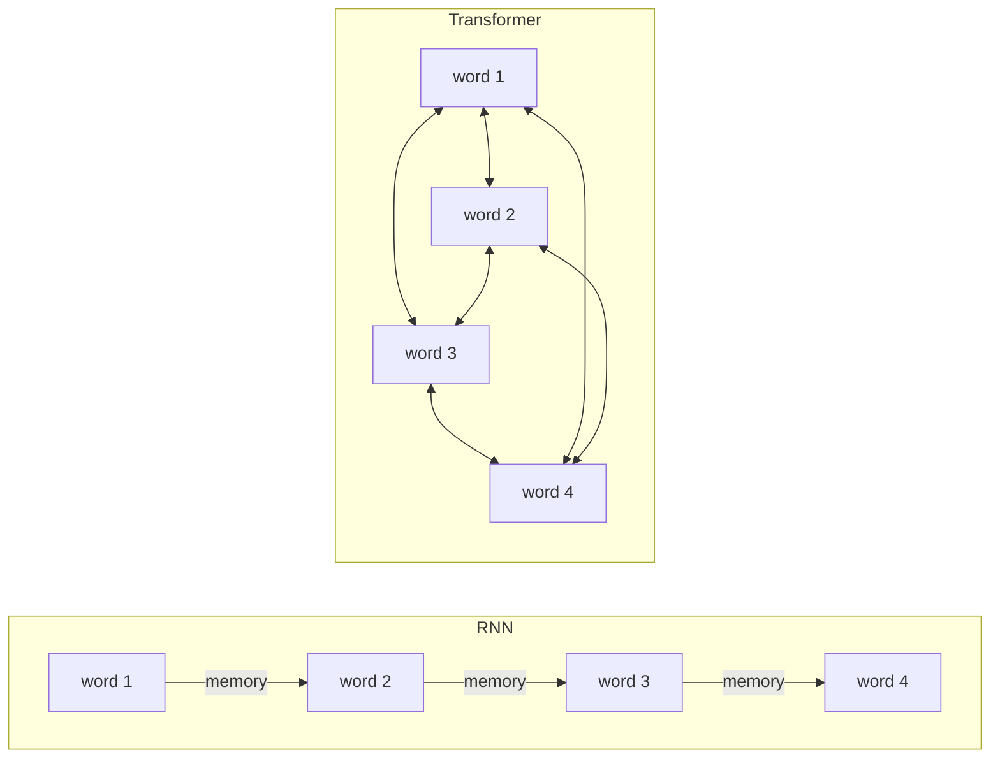
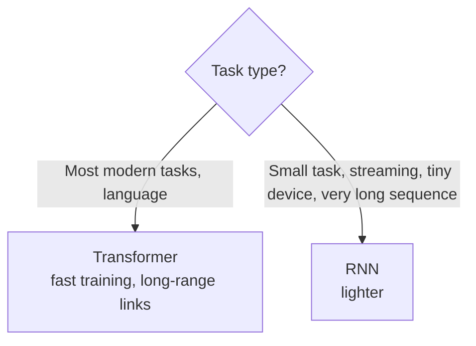

# How do RNNs and Transformers differ?

> **Step 3: Generative AI and the Transformer Architecture** · ⏱️ 8 min read · [Read original](https://outcomeschool.com/blog/how-do-rnns-and-transformers-differ)

## TL;DR
An RNN reads a sequence one step at a time carrying a fading memory; a Transformer reads the whole sequence at once with attention so every word can look directly at every other word. This makes Transformers fast to train and strong at long-range links, which is why they dominate modern models.

## Key Concepts
- **Sequence** — ordered data (words in a sentence, time series values).
- **RNN (Recurrent Neural Network)** — processes step by step, left to right, combining the current word with a memory.
- **Hidden state** — the memory passed from step to step.
- **Transformer** — reads all words together, using attention.
- **Attention** — mechanism letting each word focus directly on any other word regardless of distance.

## How It Works

### RNN
- At each step: current word + hidden state -> updated memory -> next step.
- Each step must wait for the previous one (needs that memory).
- Problems: (1) slow, cannot parallelise, so slow training; (2) forgets long-range information, e.g. "The cat, which we found last summer near the old house, was ___" — by the blank, memory of "cat" has faded.

### Transformer
- No step-by-step; sees all words together, each word attends directly to any other.
- Parallel processing means fast training; long-range links easy (last word looks straight at the first).
- Two parts (encoder and decoder) covered in a separate blog.

### Side by side
| Point | RNN | Transformer |
|---|---|---|
| How it reads | One step at a time | All words at once |
| Training speed | Slow, steps wait | Fast, parallel |
| Long-range links | Fade over distance | Strong via attention |
| Memory of past | Single fading hidden state | Direct attention to any word |
| Cost on long sequences | Grows gently with length | Grows quickly (every word looks at every word) |
| Main use today | Small or streaming tasks | Most modern language and vision models |

## Diagram

### Sequential vs parallel reading

### Which to use

## Trade-offs & Pitfalls
- Use a Transformer for most modern tasks (language); use an RNN for smaller tasks, data arriving piece by piece, tiny devices, or very long sequences where all-to-all attention is expensive.
- Transformers are not always cheaper: attention cost grows quickly with length. Flash Attention (hardware-level cost reduction) and Sliding Window Attention (each word sees only neighbours) cut this.
- RNNs are not obsolete.

## Key Takeaways
- RNN: sequential, fading hidden-state memory, slow training, weak long-range links.
- Transformer: parallel, attention to every word, fast training, strong long-range links.
- Transformer cost grows quickly with length; RNN cost grows gently.
- LLMs use Transformers because they train fast and handle long-range dependencies.
- RNNs still fit streaming, small and tiny-device settings.
