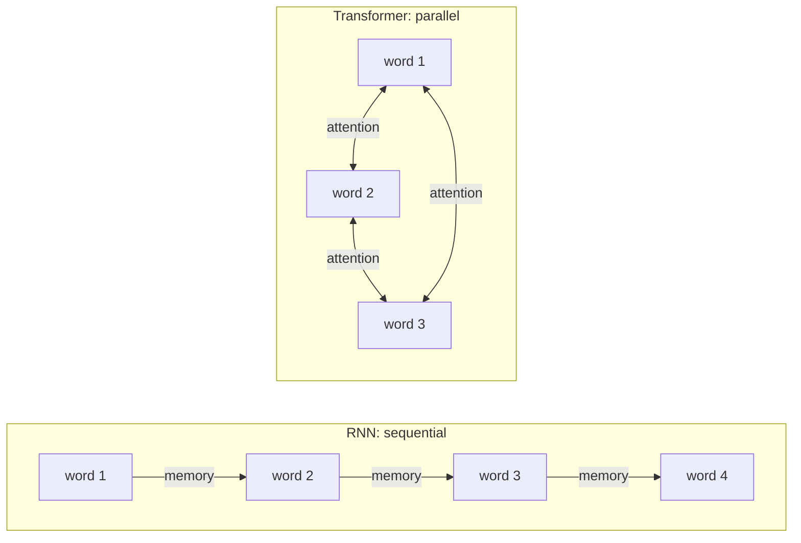

# How do RNNs and Transformers differ?

> **Step 3: Generative AI and the Transformer Architecture** · ⏱️ 8 min read · [Read original](https://outcomeschool.com/blog/how-do-rnns-and-transformers-differ)

## TL;DR
An RNN reads a sequence one step at a time carrying a fading memory; a Transformer reads the whole sequence at once and uses attention so every word can look directly at every other word. That makes Transformers fast to train and strong at long-range links, which is why they dominate today.

## Key Concepts
- **Sequence** — data in order, like words in a sentence or a time series.
- **RNN (Recurrent Neural Network)** — processes step by step, combining the current word with a hidden state (memory) passed to the next step.
- **Hidden state** — the single memory an RNN carries forward.
- **Transformer** — reads everything together using attention.
- **Attention** — lets each word focus directly on any other word, however far.

## How It Works
**RNN problems**
- Slow: each step waits for the previous one, so no parallel processing and slow training.
- Forgets long-range information: in "The cat, which we found last summer near the old house, was ___", the memory of "cat" has faded by the blank.

**Transformer fix:** all words processed in parallel, and the last word can look straight back at the first.

| Point | RNN | Transformer |
|---|---|---|
| How it reads | One step at a time | All words at once |
| Training speed | Slow, sequential | Fast, parallel |
| Long-range links | Fade over distance | Strong via attention |
| Memory of past | Single fading hidden state | Direct attention to any word |
| Cost on long sequences | Grows gently | Grows quickly (every word looks at every word) |
| Main use today | Small or streaming tasks | Most modern language and vision models |

**When to use which**
- Transformer: most modern tasks, especially language (LLMs).
- RNN: smaller tasks, streaming data arriving piece by piece, tiny devices, or very long sequences where all-to-all attention is expensive.
- Attention cost is reduced by techniques like Flash Attention and Sliding Window Attention.

## Diagram

## Key Takeaways
- RNN = step by step with fading memory; Transformer = all at once with attention.
- Parallelism makes Transformers much faster to train.
- Attention gives direct long-range connections.
- Transformer attention cost grows quickly with sequence length.
- RNNs still fit small, streaming or tiny-device use cases.
