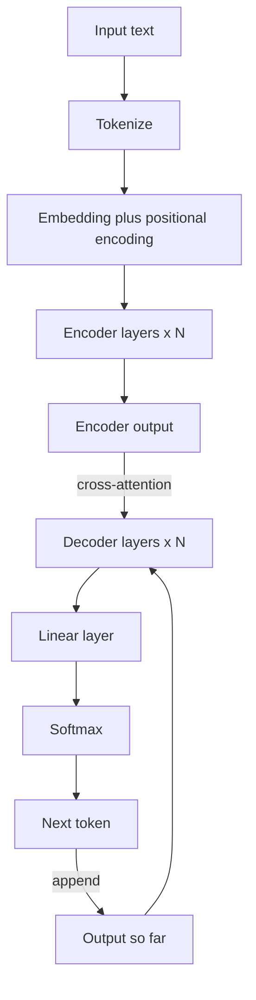

# How Does the Transformer Architecture Work?

> **Step 3: Generative AI and the Transformer Architecture** · ⏱️ 20 min read · [Read original](https://outcomeschool.com/blog/decoding-transformer-architecture)

## TL;DR
The Transformer (2017, "Attention Is All You Need") is a tokens-in, tokens-out architecture behind every modern LLM. It processes all tokens in parallel and uses attention so each token can look at every other token, fixing the forgetting and slowness of older sequential models.

## Key Concepts
- **Encoder / Decoder** — encoder reads and understands the input; decoder generates the output.
- **Embedding + positional encoding** — meaning vector plus a position signal, added together.
- **Query, Key, Value** — what a word looks for, what it offers, and the information it carries.
- **Multi-head attention** — several attention heads in parallel, each capturing a different relationship.
- **Feed-forward network** — refines each token's representation independently.
- **Residual connection** — $\text{output} = \text{sublayer}(x) + x$, preserving information.
- **Layer normalization** — keeps numbers in a stable range.
- **Transformer block (layer)** — one multi-head attention sub-layer plus one feed-forward sub-layer.
- **Causal masking** — decoder cannot see future tokens.
- **Cross-attention** — decoder queries the encoder output.

## How It Works
1. **Tokenize and embed** — text to tokens to vectors.
2. **Add positional encoding** — otherwise "I love AI" and "AI love I" look the same, since tokens are processed together (like seat numbers in a theater).
3. **Attention** — compare Query with Keys via dot product, scale by $\sqrt{d_k}$, softmax to probabilities, take the weighted mix of Values. "it" in "The cat sat on the mat because it was tired" attends to "cat".
4. **Multi-head attention** — heads run in parallel, outputs combined.
5. **Feed-forward + residual + layer norm** in every sub-layer.
6. **Stack layers** — the output of one block feeds the next. Original Transformer: 6 layers each side; GPT-3 (175B): 96. Stacking differs from multi-head, which is parallel inside one layer.
7. **Encoder layer:** self-attention + feed-forward.
8. **Decoder layer:** masked self-attention + cross-attention (Q from decoder; K and V from encoder) + feed-forward.
9. **Picking the next word:** linear layer gives a score per vocabulary word, softmax gives probabilities (e.g. "adore" 0.72, "aime" 0.15), then pick (greedy or via temperature, top-k, top-p).

**Translation example:** "I love learning" is encoded, then the decoder generates start, "J'", "adore", "apprendre", end.

**Three variants**

| Variant | Example | Use |
|---|---|---|
| Encoder-only | BERT | Classification, sentiment, finding answers |
| Decoder-only | GPT | Text generation, code, chat (most modern LLMs) |
| Encoder-decoder | T5, original Transformer | Translation, summarization |

## Diagram

## Key Takeaways
- Transformers fix RNN forgetting and slowness via parallel processing and direct attention.
- Each block is attention + feed-forward, wrapped in residual connections and layer norm.
- Decoder adds causal masking and cross-attention to the encoder.
- Output = linear layer + softmax over the vocabulary.
- Power comes from parallelism, no long-range forgetting, scalability and versatility.
