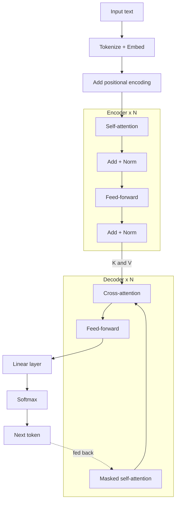
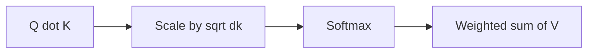

# How Does the Transformer Architecture Work?

> **Step 3: Generative AI and the Transformer Architecture** · ⏱️ 20 min read · [Read original](https://outcomeschool.com/blog/decoding-transformer-architecture)

## TL;DR
The Transformer (2017, "Attention Is All You Need", Google) is a tokens-in, tokens-out machine that processes all tokens in parallel and lets each token attend to every other. It stacks identical blocks (multi-head attention + feed-forward, with residuals and layer norm) in an encoder and decoder, and powers every modern LLM.

## Key Concepts
- **Token / Embedding** — text piece; vector "fingerprint" (similar meaning = similar vector, e.g. happy ~ joyful, far from car).
- **Positional encoding** — position vector added to each embedding so word order is known ("I love AI" vs "AI love I").
- **Attention** — each word decides how much to focus on every other word. **Q** = what it looks for, **K** = what it offers, **V** = information it carries.
- **Multi-head attention** — many attention heads in parallel, each capturing a different relationship (subject-verb, adjective-noun); outputs combined.
- **Feed-forward network (FFN)** — refines each word individually, same network for every word.
- **Residual connection** — $\text{output} = \text{sub-layer}(x) + x$; keeps original information.
- **Layer normalization** — keeps numbers in a stable range; stabilises training.
- **Transformer block / layer** — one multi-head attention + one FFN (with residual + layer norm). "96 layers" = 96 blocks stacked.
- **Causal masking** — decoder cannot see future tokens.
- **Parameters** — numbers learned in training.

## How It Works

### Why it was needed
Older models read word by word: (1) forgetting — by word 50, word 1 is weak; (2) slowness — each word waits for the previous. Transformer: all tokens at once, direct token-to-token links, parallel training.

### Two halves
Encoder reads and understands (reader making notes); decoder generates (writer using notes).

### Step 1-2: words to numbers, plus order
- Tokenize ("I love learning" -> 3 tokens), embed each. Positional encoding is added (seat numbers in a theatre) so each token vector encodes meaning and position.

### Step 3: Attention
Example: "The cat sat on the mat because it was tired." — "it" should focus on "cat".
1. Compare each Query with all Keys via dot product -> attention scores.
2. Scale by $\sqrt{d_k}$ to keep range manageable.
3. Softmax -> probabilities summing to 1.
4. Weighted mix of Values.

$$
\text{Attention}(Q,K,V)=\text{softmax}\!\left(\frac{QK^\top}{\sqrt{d_k}}\right)V
$$

Attention lets each token borrow information from relevant tokens. Multi-head = team of editors (grammar, facts, flow) on the same text.

### Step 4-5: FFN, residuals, normalization
FFN deepens each word's understanding (sharpens signal, removes noise). Residual and layer norm follow every sub-layer in encoder and decoder.

### Step 6: Stacking
Original Transformer: 6 layers in encoder and decoder; GPT-3 (175B) has 96. Stacking is sequential (output of one is input of next), unlike multi-head which is parallel inside one attention sub-layer. Each layer is like another re-read of a book.

### Step 7: Encoder
Each layer = self-attention + FFN (each with residual + norm). Example "I love learning": layer 1, "love" notices "I" subject, "learning" object; layer 2, combined meaning of the thought; layer 6, deep context-aware representation. Output goes to the decoder.

### Step 8: Decoder
Each layer has three parts:
- **Masked self-attention** — looks only at previous output words ("love" sees "I" not "learning").
- **Cross-attention** — bridge to encoder: Query from decoder, Key and Value from encoder output.
- **FFN**.

**Picking the next word**: linear layer gives a score per vocabulary word (e.g. 50,000) -> softmax -> probabilities. Example after "J'": adore 0.72, aime 0.15, mange 0.01... picks "adore" (greedy for simplicity; in practice temperature, top-k, top-p sampling control creativity).

### Step 9: Full flow, translating "I love learning"
- Encoder: tokenize, embed, add positions, 6 encoder layers -> rich representation.
- Decoder: start token -> "J'" (nothing to look back at; cross-attention to encoder) -> ["start","J'"] -> "adore" -> ["start","J'","adore"] -> "apprendre" -> "end" token. Output "J'adore apprendre".

### Three variants
| Variant | Example | Use |
|---|---|---|
| Encoder-only | BERT | spam classification, sentiment, finding answers in text |
| Decoder-only | GPT | text generation, QA, code, chat; behind most modern LLMs |
| Encoder-decoder | T5, original | translation, summarization |

## Diagrams

### Data flow in encoder-decoder

### Attention steps

## Trade-offs & Pitfalls
- Greedy highest-probability is only the simplest picking strategy.
- Multi-head attention is not the same as stacking layers.
- Decoders can't see future tokens because they don't exist yet.

## Why It Is Powerful
- Parallel processing (even decoder during training) -> fast training on huge data.
- No long-range forgetting: word 1 is as accessible as word 1000.
- Scalability: more layers, heads, data give better models (billions of parameters).
- Versatility: translation, QA, generation, code, summarization.

## Key Takeaways
- Transformer = tokens in, tokens out; embedding + positional encoding feed the stack.
- Attention (Q, K, V, scale, softmax) lets every token use relevant context; multi-head gives multiple perspectives.
- Block = attention + FFN, wrapped by residual connections and layer norm; stacked N times.
- Decoder adds masked self-attention and cross-attention (Q from decoder, K/V from encoder), then linear + softmax.
- Encoder-only (BERT) understands, decoder-only (GPT) generates, encoder-decoder (T5) transforms.
- GPT uses only the decoder; most modern LLMs are decoder-only.
- Sampling (temperature, top-k, top-p) rather than always argmax in practice.
