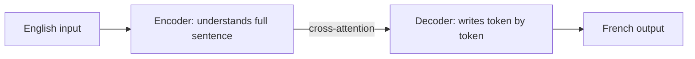

# Encoder vs Decoder in Transformers

> **Step 3: Generative AI and the Transformer Architecture** · ⏱️ 11 min read · [Read original](https://outcomeschool.com/blog/encoder-vs-decoder-in-transformers)

## TL;DR
A Transformer is built from two blocks: the Encoder, which reads and understands the whole input in both directions, and the Decoder, which writes output one token at a time looking only backward. Using one or both gives three Transformer types suited to different tasks.

## Key Concepts
- **Encoder** — understands the input; every token sees all others (left and right) via self-attention.
- **Decoder** — generates output token by token, left to right; a causal mask hides future tokens.
- **Self-attention** — tokens looking at each other.
- **Cross-attention** — the bridge carrying the encoder's understanding into the decoder.
- **Autoregressive** — each new token depends on the ones before it.

## How It Works
**Encoder.** In "The bank of the river was muddy", "bank" is ambiguous; reading "river" later resolves it, which is why looking both ways matters. It only understands; it writes nothing.

**Decoder.** Writing "The sky is blue": when guessing "blue" it sees "The", "sky", "is" only. Steps: start predicts "The", then "sky", "is", "blue".

| Point | Encoder | Decoder |
|---|---|---|
| Main job | Understand the input | Generate the output |
| How it reads | All tokens at once | One token at a time |
| Direction | Both (left and right) | Backward only |
| Good for | Understanding tasks | Writing tasks |
| Example | BERT | Models behind ChatGPT, Claude |

**Three types**
1. **Encoder-only** (BERT) — sentiment, embeddings for search.
2. **Decoder-only** (ChatGPT, Claude, Gemini) — generation and chat.
3. **Encoder-decoder** (T5) — convert one text into another, e.g. translation "I love AI" to "J'aime l'IA", summarization.

**Choosing:** understand, generate, or convert? Most chat models are decoder-only because a large decoder learns to understand and write at once.

## Diagram

## Key Takeaways
- Encoder reads everything at once in both directions; decoder writes forward-only.
- Causal masking is what keeps the decoder from seeing the future.
- Encoder-only for understanding, decoder-only for generation, encoder-decoder for text-to-text conversion.
- Cross-attention connects the two halves.
- Today's chat LLMs are mostly decoder-only.
