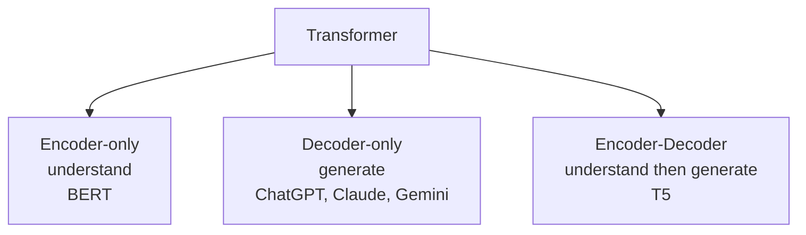
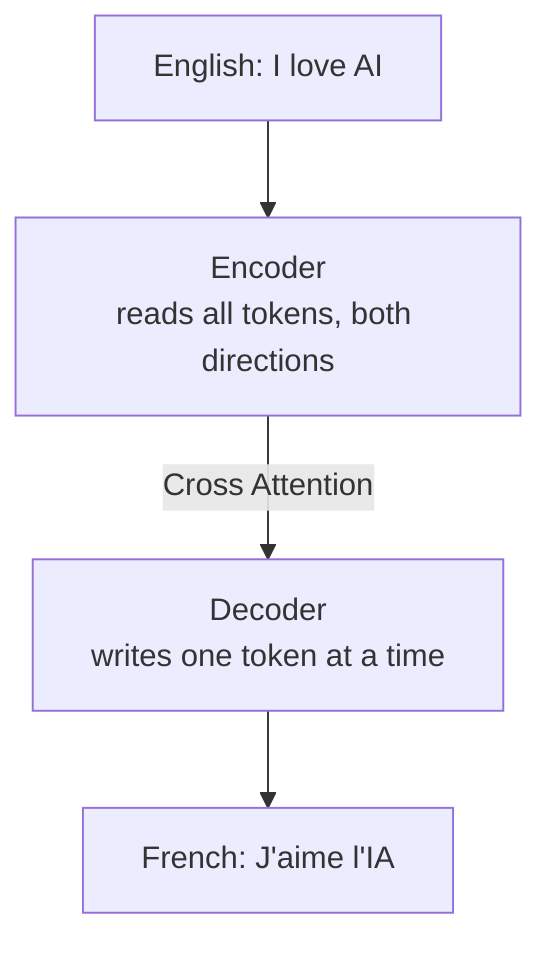
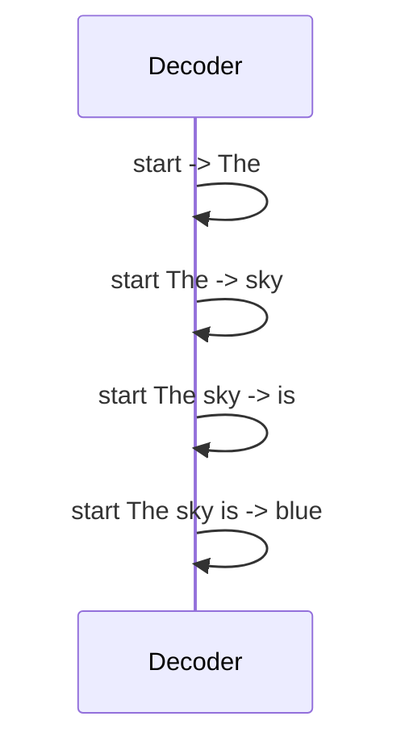

# Encoder vs Decoder in Transformers

> **Step 3: Generative AI and the Transformer Architecture** · ⏱️ 11 min read · [Read original](https://outcomeschool.com/blog/encoder-vs-decoder-in-transformers)

## TL;DR
The Encoder reads the whole input at once in both directions to understand it; the Decoder generates output one token at a time, looking only backward. Using one or both gives three Transformer types (encoder-only, decoder-only, encoder-decoder), each suited to a different job.

## Key Concepts
- **Transformer** — architecture behind most modern language AI (ChatGPT, Claude, Gemini); strong at relationships between words. Built from Encoder and Decoder blocks.
- **Token** — small piece of text, usually a word or part of one ("I love AI" = "I","love","AI"); split by a tokenization algorithm (e.g. BPE).
- **Encoder** — understands; sees all tokens at once, left and right, via Self Attention.
- **Decoder** — writes token by token, left to right, only seeing earlier tokens; future hidden by a **causal mask**.
- **Autoregressive** — each new token depends on those before it.
- **Cross Attention** — bridge carrying encoder understanding into the decoder.

## How It Works

### Encoder
- Takes all input tokens together and builds rich meaning per token. A careful reader; writes nothing new.
- Why both directions: "The bank of the river was muddy" — "bank" is ambiguous until the later word "river" is read.

### Decoder
- Writes the answer token by token. Can't see future tokens (not written yet; the token being predicted is hidden).
- Example "The sky is blue": predicting "blue" it sees "The","sky","is" only.
- Steps: `<start>` -> "The" -> "sky" -> "is" -> "blue", each seeing only prior words.

### The one big difference
Encoder: reader, looks both directions. Decoder: writer, looks only backward.

### Three types
1. **Encoder-only** — pure understanding: sentiment of a review, embeddings for search. Example: BERT (also basis for ColBERT retrieval).
2. **Decoder-only** — pure generation. Most modern chat models (ChatGPT, Claude, Gemini).
3. **Encoder-Decoder** — understand first, then write; e.g. translation English->French ("I love AI" -> "J'aime l'IA"). Example: T5. Cross Attention links them.

### Comparison
| Point | Encoder | Decoder |
|---|---|---|
| Main job | Understand input | Generate output |
| How it reads | All tokens at once | One token at a time |
| Direction | Both (left and right) | Backward only (past) |
| Good for | Understanding tasks | Writing tasks |
| Example | BERT | Models behind ChatGPT, Claude |

### When to use which
- Understand text (classify reviews, search) -> encoder-only.
- Generate text (chat, writing) -> decoder-only.
- Convert one text to another (translation, summarization) -> encoder-decoder.
- Ask: understand, generate, or convert?

## Diagrams

### Three Transformer types

### Encoder-decoder translation

### Decoder step by step

## Trade-offs & Pitfalls
- BERT (encoder-only) cannot generate text like ChatGPT.
- Decoder-only dominates chat because a good writer must also understand; a large decoder learns both at once.

## Key Takeaways
- Encoder = reader (bidirectional, parallel, understanding); decoder = writer (causal, token by token, autoregressive).
- Three variants: encoder-only (BERT), decoder-only (GPT-style chat models), encoder-decoder (T5).
- Choose by task: understand, generate, or convert.
- Cross Attention is the encoder-to-decoder bridge.
- ChatGPT is decoder-only; large decoders learn understanding too.
