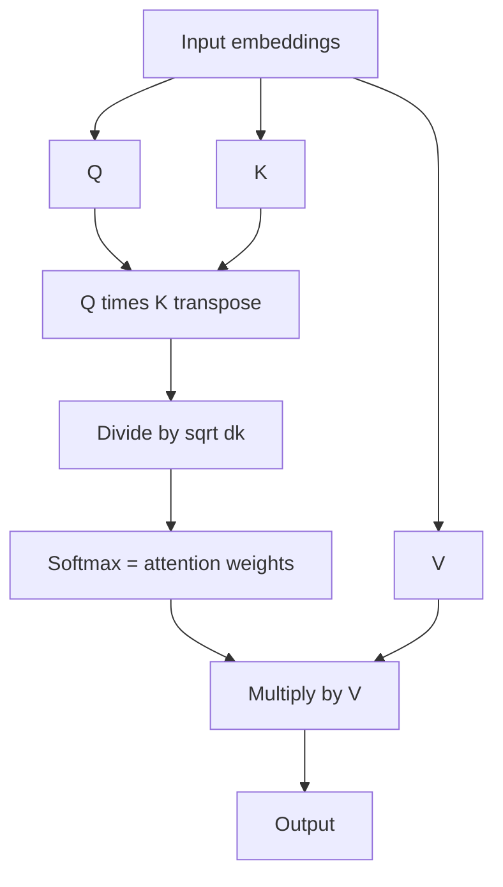
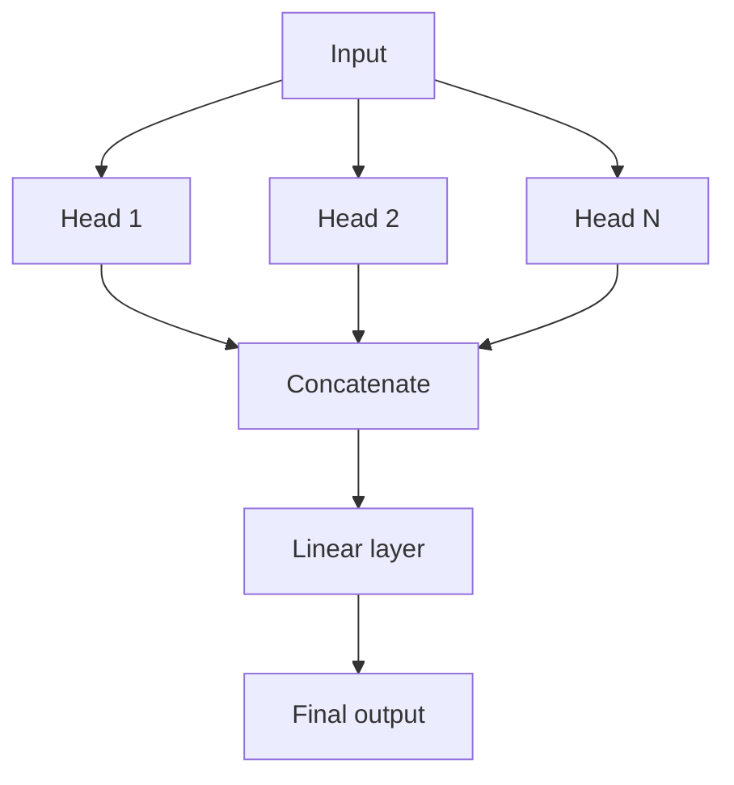

# What is Self Attention in Transformers?

> **Step 3: Generative AI and the Transformer Architecture** · ⏱️ 14 min read · [Read original](https://outcomeschool.com/blog/self-attention-in-transformers)

## TL;DR
Self Attention lets every token in a sequence look at every other token (including itself) to decide which matter for its meaning. Q, K and V are all derived from the same sequence; the output is a context-enriched vector per token. It is the core of BERT, GPT and all modern LLMs.

## Key Concepts
- **Self Attention** = Self + Attention: each token decides how much to focus on the others in the same sequence.
- **Query (Q)** — what this token is looking for. **Key (K)** — what it offers. **Value (V)** — the information it carries.
- **W_Q, W_K, W_V** — weight matrices learned in training; $Q=XW_Q$, $K=XW_K$, $V=XW_V$.
- **Self vs Cross Attention** — Self: Q, K, V from the same sequence. Cross: Q from one sequence, K and V from another.
- **Masked Self Attention** — decoder variant hiding future tokens.
- **Attention sink** — because each row must sum to 1, a token with nothing worth attending to still gives away attention; first tokens end up acting as sinks.
- Library analogy: Query = topic searched, Key = label on each book, Value = content of the book.

## How It Works

### Why needed
"The animal did not cross the street because it was too **tired**" -> "it" = animal. Swap to "too **wide**" -> "it" = street. Context words steer what "it" refers to; the model does this by letting each word attend to others in the same sentence. Without it, "it" is a generic token.

### Steps
1. Embeddings for each token.
2. $Q=XW_Q,\; K=XW_K,\; V=XW_V$.
3. Scores $=QK^\top$ (transpose so shapes align); higher = stronger Query-Key match.
4. Scale by $\sqrt{d_k}$ (key dimension) so softmax doesn't go extreme and gradients don't vanish.
5. Softmax: each row sums to 1.
6. Multiply by V -> context-enriched output.

$$\text{Attention}(Q,K,V)=\text{softmax}\!\left(\frac{QK^\top}{\sqrt{d_k}}\right)V$$

### Example: "I love AI"
Weights for token "I": I 0.070, love 0.707, AI 0.223 (7% self, 70.7% love, 22.3% AI). Full matrix (rows sum to 1):

| from \ to | I | love | AI |
|---|---|---|---|
| I | 0.070 | 0.707 | 0.223 |
| love | 0.333 | 0.333 | 0.333 |
| AI | 0.168 | 0.533 | 0.299 |

Output for I = 0.070 V(I) + 0.707 V(love) + 0.223 V(AI): heavily influenced by "love". All tokens computed at once.

### Why it works so well
- **Parallelization** — all tokens at once (vs RNN/LSTM one by one); fast on GPUs.
- **Long-range dependencies** — direct links, no decay with distance; cost is the price (long-context models use Sliding Window Attention, looking only at nearby tokens).
- **Contextual understanding** — same word gets different representations in different sentences.
- **Flexibility** — long sequences, complex relationships.

### Multi-Head Self Attention
One Q/K/V set can't capture all relationship types. Run attention N times in parallel, each head with its own $W_Q,W_K,W_V$ (e.g. subject-object, verb tense, long-range dependencies); concatenate outputs, pass through a linear layer.

### Where used
- Encoder: every layer; every input token sees every other.
- Decoder: Masked Self Attention; each token sees itself and earlier tokens only.

## Diagrams

### Self Attention flow

### Multi-head

## Trade-offs & Pitfalls
- All-pairs attention is costly on long sequences (hence sliding window).
- Attention sinks: rows must sum to 1 even when nothing is relevant.
- Weight matrices are learned, not fixed.

## FAQ
- Self vs Cross? Same sequence vs two sequences.
- Like RNN, one by one? No, parallel.
- Token attends to itself? Yes.
- Why masked in decoder? Future tokens must not be visible.
- Are W matrices fixed? No, learned.

## Key Takeaways
- Self Attention: Q, K, V from the same sequence.
- Formula: softmax(QK^T / sqrt(d_k)) V.
- Rows of weights sum to 1; output is a weighted mix of Values.
- Parallel, direct long-range links, contextual meaning.
- Multi-head runs several in parallel, concatenates, applies a linear layer.
- Encoder uses it bidirectionally; decoder uses masked version.
