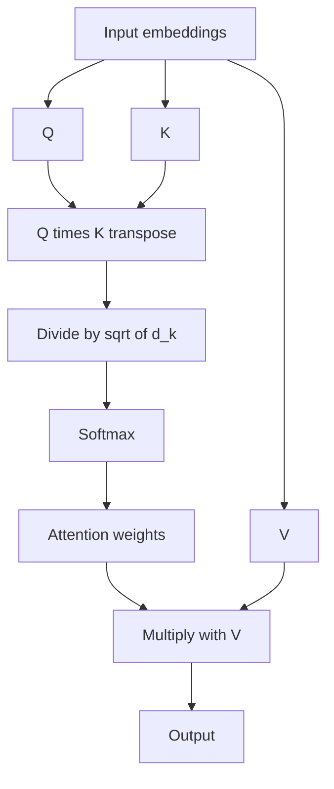

# What is Self Attention in Transformers?

> **Step 3: Generative AI and the Transformer Architecture** · ⏱️ 14 min read · [Read original](https://outcomeschool.com/blog/self-attention-in-transformers)

## TL;DR
Self attention lets every token in a sequence look at every other token (and itself) in the same sequence to build a context-aware representation. It is the core idea behind every modern LLM.

## Key Concepts
- **Self attention** — attention where Q, K and V all come from the same sequence (in cross attention, Q comes from one sequence and K, V from another).
- **Query (Q)** — what this token is looking for.
- **Key (K)** — what this token offers.
- **Value (V)** — the information it carries.
- **Attention weights** — softmax probabilities; each row sums to 1.
- **Multi-head self attention** — several self-attentions in parallel, each with its own $W_Q, W_K, W_V$.
- **Masked self attention** — decoder variant that hides future tokens.

## How It Works
**Motivation.** "The animal did not cross the street because it was too tired" versus "...too wide". Changing one word flips what "it" refers to (animal vs street). Self attention lets the model weigh surrounding words to resolve this.

**Steps**
1. Start with input embeddings $X$.
2. Project: $Q = XW_Q$, $K = XW_K$, $V = XW_V$ (weights learned in training).
3. Scores: $QK^T$ (higher means stronger match).
4. Scale by $\sqrt{d_k}$ to keep softmax stable and avoid tiny gradients.
5. Softmax to get attention weights.
6. Multiply by $V$ for the output.

$$\text{Attention}(Q,K,V)=\text{softmax}\!\left(\frac{QK^T}{\sqrt{d_k}}\right)V$$

**Library analogy:** Query = topic searched, Key = book label, Value = book content.

**Example ("I love AI").** For token "I", illustrative weights: itself 0.070, love 0.707, AI 0.223. Output for "I" = $0.070\,V_I + 0.707\,V_{love} + 0.223\,V_{AI}$, heavily influenced by "love". Because rows must sum to 1, early tokens can end up as attention sinks.

**Why it works:** parallelization (fast on GPUs), direct long-range dependencies with no decay (costly, so long-context models may use sliding window attention), contextual meaning per sentence, flexibility.

**Multi-head:** heads may specialize (subject-object, verb tense, long-range links); outputs are concatenated and passed through a linear layer.

**Where used:** encoder (full self attention) and decoder (masked self attention: tokens see themselves and the past only). BERT, GPT and others rely on it.

## Diagram

## Key Takeaways
- Self attention = Q, K, V from the same sequence.
- Formula: softmax of scaled $QK^T$, times $V$.
- Each token's output is a weighted mix of all tokens' Values.
- It enables parallel training and direct long-range links.
- Multi-head runs many in parallel; masked self attention is for decoders.
