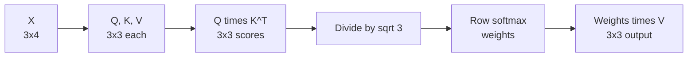

# How Does Attention Work? The Math Behind Q, K, and V

> **Step 3: Generative AI and the Transformer Architecture** · ⏱️ 14 min read · [Read original](https://outcomeschool.com/blog/math-behind-attention-qkv)

## TL;DR
Attention compares each word's Query with every word's Key to get scores, scales and softmaxes them into weights, and uses the weights to mix Values. This note follows the blog's full numeric example for "I love AI".

## Key Concepts
- **Formula**: $\text{Attention}(Q,K,V)=\text{softmax}\!\left(\frac{QK^\top}{\sqrt{d_k}}\right)V$ — Q query matrix, K key matrix, V value matrix, $K^\top$ transpose, $d_k$ key dimension.
- Idea: compare what each word looks for (Query) with what others offer (Key), then collect the information (Value) from the most relevant words.
- **Weight matrices** $W_Q, W_K, W_V$ are learned in training (hand-picked here only for illustration).

## How It Works (numeric walk-through)

### 1. Words to vectors
Embeddings ($d_{emb}=4$): I = [1,0,1,0], love = [0,1,0,1], AI = [1,1,0,0]. Stack into $X$ (3x4; row = word).

### 2. Create Q, K, V
$Q=XW_Q$, $K=XW_K$, $V=XW_V$, each W of shape 4x3 ($d_k=3$).

$W_Q$ rows: [1,0,1],[0,1,0],[1,0,0],[0,1,1]. $W_K$: [0,1,0],[1,0,1],[0,0,1],[1,1,0]. $W_V$: [1,0,0],[0,1,0],[0,0,1],[1,1,0].

| Word | Q | K | V |
|---|---|---|---|
| I | [2,0,1] | [0,1,1] | [1,0,1] |
| love | [0,2,1] | [2,1,1] | [1,2,0] |
| AI | [1,1,1] | [1,1,1] | [1,1,0] |

### 3. Scores $QK^\top$
Transpose swaps rows and columns. Result:

| from \ to | I | love | AI |
|---|---|---|---|
| I | 1 | 5 | 3 |
| love | 3 | 3 | 3 |
| AI | 2 | 4 | 3 |

"I" finds "love" most relevant (5); "love" gives equal 3s; "AI" favours "love" (4).

### 4. Scale by $\sqrt{d_k}=\sqrt3=1.732$
| from \ to | I | love | AI |
|---|---|---|---|
| I | 0.577 | 2.887 | 1.732 |
| love | 1.732 | 1.732 | 1.732 |
| AI | 1.155 | 2.309 | 1.732 |

Why: huge dot products make softmax extreme (near 0/1), hurting learning. Order preserved, values smaller.

### 5. Softmax per row
$\text{softmax}(x_i)=\dfrac{e^{x_i}}{\sum_j e^{x_j}}$ (e is about 2.718).
- Row I: e^.577=1.781, e^2.887=17.940, e^1.732=5.651, sum 25.372 -> 0.070, 0.707, 0.223.
- Row love: all equal -> 0.333 each.
- Row AI: 3.174, 10.063, 5.651, sum 18.888 -> 0.168, 0.533, 0.299.

Each row sums to 1: I gives 70.7% to love, 22.3% to AI, 7.0% to itself; AI gives 53.3% to love, 29.9% self, 16.8% to I.

### 6. Output = weights x V
- I: [1.000, 1.637, 0.070]
- love: [1.000, 1.000, 0.333]
- AI: [1.000, 1.365, 0.168]

Each output is a weighted blend of all Values; "I" is dominated by the Value of "love". Output carries context from all words by relevance.

## Diagram

### Pipeline

## Trade-offs & Pitfalls
- Real models use much larger dimensions (512, 1024, or more) with learned weights; the computation runs once per head in parallel (multi-head attention).
- Scaling doesn't change which word gets most attention, only the magnitude.

## FAQ
- Weights hand-set? No, learned.
- Does scaling change ranking? No.
- Why rows sum to 1? Softmax per row.
- Output only about the word itself? No, mix of all Values.
- Real LLMs same computation? Yes, bigger dimensions, many heads.

## Key Takeaways
- Six steps: X -> Q,K,V -> $QK^\top$ -> scale -> softmax -> times V.
- Scores are dot products between queries and keys.
- Scaling by $\sqrt{d_k}$ prevents extreme softmax.
- Softmax rows are probability distributions summing to 1.
- Output vectors are context-aware mixtures of Values.
- Same math underlies every LLM.
