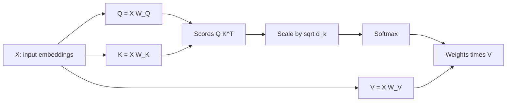

# How Does Attention Work? The Math Behind Q, K, and V

> **Step 3: Generative AI and the Transformer Architecture** · ⏱️ 14 min read · [Read original](https://outcomeschool.com/blog/math-behind-attention-qkv)

## TL;DR
Scaled dot-product attention compares what each word is looking for (Query) with what every word offers (Key), then collects information (Value) from the most relevant words. The blog works through the full computation with a 3-word example, "I love AI".

## Key Concepts
- **Q, K, V** — Query, Key and Value matrices, produced by multiplying the input $X$ with learned weight matrices $W_Q, W_K, W_V$.
- **$d_k$** — dimension of the Key vectors.
- **Attention scores** — $QK^T$.
- **Scaling** — division by $\sqrt{d_k}$.
- **Softmax** — turns each row into probabilities summing to 1.

## How It Works
$$\text{Attention}(Q,K,V)=\text{softmax}\!\left(\frac{QK^T}{\sqrt{d_k}}\right)V$$

**Setup (toy numbers).** Embeddings of size 4: I = [1,0,1,0], love = [0,1,0,1], AI = [1,1,0,0]; $X$ is 3x4. Weight matrices are 4x3, so $d_k = 3$ (in real models they are learned).

**Resulting matrices**
- $Q$: I [2,0,1], love [0,2,1], AI [1,1,1]
- $K$: I [0,1,1], love [2,1,1], AI [1,1,1]
- $V$: I [1,0,1], love [1,2,0], AI [1,1,0]

**Steps**
1. **Scores** $QK^T$ (transpose K so shapes align): rows I [1,5,3], love [3,3,3], AI [2,4,3]. "I" finds "love" most relevant.
2. **Scale** by $\sqrt{3}\approx1.732$: I [0.577, 2.887, 1.732]. Order is preserved, values shrink. Why: large dot products push softmax to extremes (near 0 or 1), making learning hard.
3. **Softmax** per row: I [0.070, 0.707, 0.223]; love [0.333, 0.333, 0.333]; AI [0.168, 0.533, 0.299]. Each row sums to 1.
4. **Weights times V:** outputs I [1.000, 1.637, 0.070], love [1.000, 1.000, 0.333], AI [1.000, 1.365, 0.168].

"I" ends up heavily influenced by the Value of "love" because it gave "love" 70.7% of its attention. Every output now mixes information from all words, weighted by relevance.

Real models use dimensions like 512 or 1024 and run this once per head (multi-head attention).

## Diagram

## Key Takeaways
- Q matches against K to decide relevance; V carries the content that gets mixed.
- Scores are scaled by $\sqrt{d_k}$ so softmax does not saturate.
- Softmax rows sum to 1, giving a per-word attention distribution.
- Output = attention weights x V: each word becomes a context-aware blend.
- Weight matrices are learned; the numbers in the example are only illustrative.
