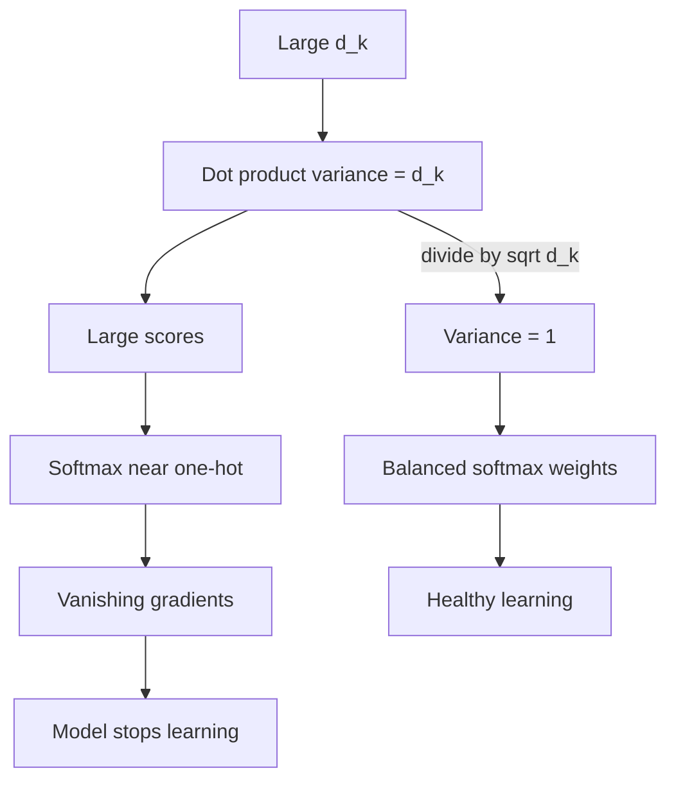

# Why Do We Scale Attention by √dₖ?

> **Step 3: Generative AI and the Transformer Architecture** · ⏱️ 17 min read · [Read original](https://outcomeschool.com/blog/scaling-dot-product-attention)

## TL;DR
Dot products of Query and Key vectors have variance $d_k$, so they grow with dimension and push softmax toward one-hot outputs with vanishing gradients. Dividing by $\sqrt{d_k}$ brings the variance back to exactly 1 and keeps attention well-distributed.

## Key Concepts
- **Formula**: $\text{softmax}\!\left(\frac{QK^\top}{\sqrt{d_k}}\right)V$; $d_k$ = key dimension (real models 64, 128 or larger); the division is the **scaling factor**.
- **Softmax**: $\text{softmax}(x_i)=\dfrac{e^{x_i}}{\sum_j e^{x_j}}$.
- **Variance** — spread of values around the mean (class heights 5.0-5.5 ft = low, 3-7 ft = high).
- **Vanishing gradient** — gradients (training signals) near zero so learning stalls.
- **One-hot** — one value 1.0, rest 0.0.
- Assumption: elements of q and k are independent, mean 0, variance 1 (normalized inputs).

## How It Works

### The problem without scaling
Unscaled $QK^\top$ gets large for large $d_k$. Softmax then gives near 0/1: one word takes almost all attention, model can't learn from several words, gradients vanish, learning stops. (Softmax also must give away all attention even when nothing deserves it — see attention sinks.)

### Why dot products grow with $d_k$
$q\cdot k=\sum_{i=1}^{d_k} q_ik_i$: $d_k$ terms. With $d_k=4$ only 4 terms; with 512, 512 terms — even with cancellation the magnitude grows.

### Variance of the dot product = $d_k$
1. Each product $q_ik_i$ (independent, mean 0, variance 1): mean 0, variance $1\times1=1$.
2. Sum of $d_k$ independent terms of variance 1: $\text{Var}(q\cdot k)=d_k$.

Proof sketch (mean 0 so variance = average of squares). For $d_k=3$, squaring the sum gives $3\times3=9$ terms:
- Group 1, same term squared (a*a, b*b, c*c): 3 terms; $E[q_1^2k_1^2]=E[q_1^2]E[k_1^2]=1\cdot1=1$ each.
- Group 2, cross terms (a*b etc.): 6 terms; $E[q_1k_1q_2k_2]=0\cdot0\cdot0\cdot0=0$ each.
- Variance $=3\cdot1+6\cdot0=3=d_k$. For $d_k=64$: 4096 terms, 64 contribute 1, 4032 contribute 0, variance 64. Exact, not approximate.

### Softmax with large inputs
$e^x$ explodes: e^1=2.718, e^5=148.4, e^10=22,026, e^20=485,165,195, e^50 about 5.18e18.
- [50,10,5] -> about [1.0, 0.0, 0.0].
- [5,1,0.5] -> e: 148.4, 2.718, 1.649, sum 152.780 -> [0.971, 0.018, 0.011] (others not zero, model can still learn).

### Why exactly $\sqrt{d_k}$
Dividing by constant $c$ divides variance by $c^2$ (variance uses squared differences). Check: [2,4,6] has variance 2.67; divided by 2 -> [1,2,3] variance 0.67 = 2.67/4.

$$
\text{Var}\!\left(\frac{q\cdot k}{c}\right)=\frac{d_k}{c^2}=1\;\Rightarrow\;c=\sqrt{d_k}
$$

After scaling: variance $d_k/d_k=1$ regardless of $d_k$. Chosen in "Attention Is All You Need".

### Numbers
- **$d_k=4$**: q=[1,0,1,0], k=[0,1,1,1], dot=1, $\sqrt4=2$, scaled 0.5; both small, scaling matters little.
- **$d_k=64$**, scores [14,10,12]:
  - Unscaled: e^14=1,202,604, e^10=22,026, e^12=162,755, sum 1,387,386 -> [0.867, 0.016, 0.117].
  - Scaled by 8: [1.75, 1.25, 1.5] -> e: 5.755, 3.490, 4.482, sum 13.727 -> [0.419, 0.254, 0.326].

## Diagram

### Cause and effect chain

## Trade-offs & Pitfalls
- Small $d_k$: scaling barely matters; it becomes important as $d_k$ grows.
- Variance result relies on independence and mean 0 / variance 1 assumption.
- Dividing by $c$ divides variance by $c^2$ (not $c$) — why 2 or 10 would be arbitrary.

## Key Takeaways
- Dot product variance equals $d_k$ exactly (under standard assumptions).
- Unscaled large scores saturate softmax (near one-hot) and vanish gradients.
- Dividing by $c$ divides variance by $c^2$, so $c=\sqrt{d_k}$ gives variance 1.
- Example: [14,10,12] -> 86.7% on one word unscaled vs 41.9/25.4/32.6% after /8.
- Scaling is irrelevant for tiny $d_k$ but essential for 64+.
- Choice is mathematically principled, from the original Transformer paper.
