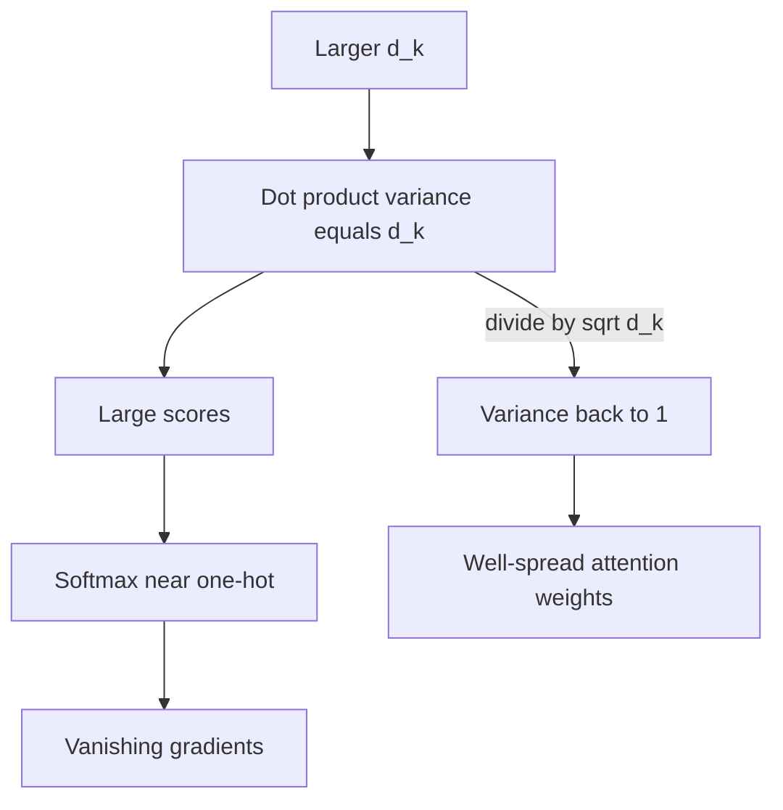

# Why Do We Scale Attention by √dₖ?

> **Step 3: Generative AI and the Transformer Architecture** · ⏱️ 17 min read · [Read original](https://outcomeschool.com/blog/scaling-dot-product-attention)

## TL;DR
The dot product of Query and Key vectors has variance $d_k$, so scores grow with dimension and push softmax into near one-hot outputs with vanishing gradients. Dividing by $\sqrt{d_k}$ brings the variance back to 1.

## Key Concepts
- **Scaling factor** — the $/\sqrt{d_k}$ term in $\text{softmax}(QK^T/\sqrt{d_k})V$.
- **Variance** — how spread out values are from the mean.
- **Vanishing gradient** — near-zero training signal when softmax saturates.
- **One-hot-like softmax** — one weight near 1, the rest near 0.
- **Assumption** — each element of q and k has mean 0 and variance 1, independent.

## How It Works
**Without scaling.** For large $d_k$ (64, 128, ...), scores are large. Softmax then gives almost all attention to one word, the model cannot learn from several words, and gradients vanish.

**Why dot products grow.** $q\cdot k = \sum_{i=1}^{d_k} q_i k_i$ adds $d_k$ terms; more terms means larger magnitude.

**Variance is $d_k$.**
- One product $q_i k_i$: mean 0, variance $1\times1=1$.
- Variance of the sum of $d_k$ independent such terms: $d_k$.
- Proof sketch (with $d_k=3$): with mean 0, variance = average of squares. Squaring the sum gives $d_k^2$ cross terms. The $d_k$ "same-pair" terms each average 1 ($E[q^2]E[k^2]=1$). The remaining mixed terms average 0 (product of zero means). So variance $=d_k$ (for 64: 64 terms contribute 1, 4032 contribute 0).

**Softmax and exponentials.** $e^x$ grows explosively, so scores like [50, 10, 5] give roughly [1, 0, 0].

**Why $\sqrt{d_k}$.** Dividing by constant $c$ divides variance by $c^2$ (check: [2,4,6] has variance 2.67; halved gives 0.67).

$$\text{Var}\!\left(\frac{q\cdot k}{c}\right)=\frac{d_k}{c^2}=1\;\Rightarrow\; c=\sqrt{d_k}$$

**Numbers ($d_k=64$, scores [14, 10, 12]):**

| | Attention weights |
|---|---|
| Unscaled | [0.867, 0.016, 0.117] |
| Scaled (divide by 8) | [0.419, 0.254, 0.326] |

For small $d_k$ (e.g. 4) scaling barely matters. Side note: softmax outputs always sum to 1, which relates to attention sinks.

## Diagram

## Key Takeaways
- Dot product variance equals $d_k$ under zero-mean, unit-variance assumptions.
- Large scores saturate softmax, killing gradients.
- Dividing by $c$ divides variance by $c^2$, so $c=\sqrt{d_k}$ gives variance 1.
- Scaling keeps attention spread across relevant words.
- It is a principled choice, not arbitrary.
