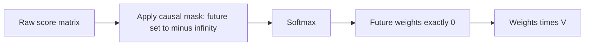

# What is Causal Masking in Attention?

> **Step 3: Generative AI and the Transformer Architecture** · ⏱️ 10 min read · [Read original](https://outcomeschool.com/blog/causal-masking-in-attention)

## TL;DR
Causal masking uses a mask matrix to block future positions in the attention score matrix, so each token attends only to itself and past tokens. This is why a Transformer decoder looks only backward while the encoder reads in both directions.

## Key Concepts
- **Causal mask** — matrix of 1 (allowed) and 0 (blocked); lower-triangular.
- **Information leakage** — letting the model see tokens it is supposed to predict.
- **Attention score matrix** — rows are query tokens, columns are key tokens.
- **−∞ masking** — blocked scores are set to $-\infty$ before softmax so they become exactly 0.
- **Attention sink** — the first token, always visible, soaks up unneeded attention.

## How It Works
**Why mask.** Without it, predicting "love" in "I love teaching AI" could use "teaching" and "AI". Training would look unrealistically good, but future tokens do not exist at inference, so generation breaks. Masking makes training conditions match inference, forcing real language patterns rather than memorized answers.

**With masking**
- "love" sees I
- "teaching" sees I, love
- "AI" sees I, love, teaching

**Implementation (4x4 for 4 tokens)**
1. Compute raw attention scores.
2. Build the mask: row i has 1s for columns up to i, 0s after.
3. Set masked positions to $-\infty$.
4. Apply softmax.

Mask:

| | I | love | teaching | AI |
|---|---|---|---|---|
| I | 1 | 0 | 0 | 0 |
| love | 1 | 1 | 0 | 0 |
| teaching | 1 | 1 | 1 | 0 |
| AI | 1 | 1 | 1 | 1 |

**Effect.** Unmasked softmax gave "teaching" a 0.28 weight on future "AI". After masking, the rows become: I [1.00, 0, 0, 0]; love [0.27, 0.73, 0, 0]; teaching [0.11, 0.24, 0.65, 0]; AI [0.07, 0.08, 0.12, 0.73].

**Why $-\infty$, not 0:** a zero score still gets non-zero probability after softmax ($e^0=1$), allowing partial leakage; $e^{-\infty}=0$ gives exact zero.

Related: sliding window attention limits how far back a token can look.

## Diagram

## Key Takeaways
- Causal masking = each token sees itself and the past only.
- It prevents leakage and aligns training with step-by-step inference.
- Mask is applied before softmax by setting blocked scores to $-\infty$.
- Result is a lower-triangular attention weight matrix with rows summing to 1.
- Decoders are causal; encoders are bidirectional.
