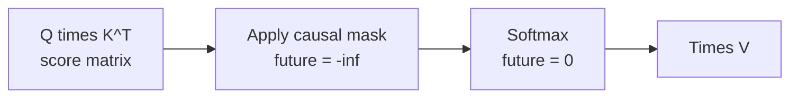
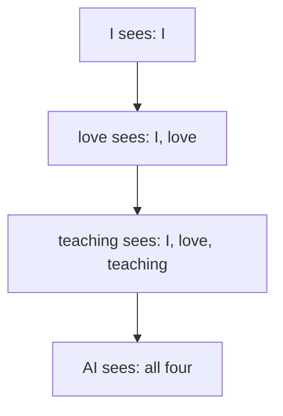

# What is Causal Masking in Attention?

> **Step 3: Generative AI and the Transformer Architecture** · ⏱️ 10 min read · [Read original](https://outcomeschool.com/blog/causal-masking-in-attention)

## TL;DR
Causal masking uses a lower-triangular mask to set future positions' attention scores to $-\infty$ before softmax, so each token sees only itself and earlier tokens. This makes training match inference and prevents information leakage; it's why the decoder looks only backward while the encoder looks both ways.

## Key Concepts
- **Causal masking** — mask matrix blocking future positions in the attention score matrix.
- **Attention score** — how relevant one token is to another; matrix rows = query tokens, columns = key tokens (4x4 for "I love teaching AI").
- **Mask matrix** — 1 = allowed, 0 = blocked (future).
- **Information leakage** — model sees the words it should predict.
- **Attention sink** — every row can always see the first token, so first tokens collect attention that isn't needed elsewhere.

## How It Works

### Why mask
- Without it, predicting "love" could attend to "teaching" and "AI"; predicting "teaching" could see "AI". Model learns shortcuts, unrealistically good training but breaks next-token prediction.
- At inference, future tokens don't exist; relying on them in training fails during step-by-step generation.
- Masking makes training conditions match inference, forcing real language patterns. Without masking: training easier, generation incorrect.
- With masking: "love" sees I; "teaching" sees I, love; "AI" sees I, love, teaching.

### Implementation (mask before softmax)
Score matrix (before masking), rows I, love, teaching, AI over columns I, love, teaching, AI:

| | I | love | teaching | AI |
|---|---|---|---|---|
| I | 2.0 | 1.0 | 3.0 | 0.5 |
| love | 1.5 | 2.5 | 0.5 | 1.0 |
| teaching | 0.2 | 1.0 | 2.0 | 1.5 |
| AI | 0.1 | 0.3 | 0.7 | 2.5 |

Softmax without masking: row love = 0.21, 0.58, 0.08, 0.13 (leaks 0.08 to teaching, 0.13 to AI); row teaching = 0.08, 0.17, 0.47, 0.28 (0.28 to AI). Leakage.

Mask matrix (lower triangular):
```
1 0 0 0
1 1 0 0
1 1 1 0
1 1 1 1
```
Blocked (0) positions become $-\infty$:

| | I | love | teaching | AI |
|---|---|---|---|---|
| I | 2.0 | -inf | -inf | -inf |
| love | 1.5 | 2.5 | -inf | -inf |
| teaching | 0.2 | 1.0 | 2.0 | -inf |
| AI | 0.1 | 0.3 | 0.7 | 2.5 |

After softmax:

| | I | love | teaching | AI |
|---|---|---|---|---|
| I | 1.00 | 0.00 | 0.00 | 0.00 |
| love | 0.27 | 0.73 | 0.00 | 0.00 |
| teaching | 0.11 | 0.24 | 0.65 | 0.00 |
| AI | 0.07 | 0.08 | 0.12 | 0.73 |

Future tokens get exactly 0.

### Why $-\infty$ not 0
$e^{-\infty}=0$, so softmax gives exactly zero weight. Using score 0 gives $e^0=1$, a non-zero probability, letting the model partially attend to the future.

## Diagram

### Mask pipeline


### Visibility by position


## Trade-offs & Pitfalls
- Masking must be applied before softmax; skipping it leaks the future.
- Zero instead of $-\infty$ still leaks.
- Encoder does not use causal masking (reads both directions).
- Causal masking blocks future; sliding window attention limits how far back a token looks — different ways to limit attention.

## FAQ
- Why not zero? softmax would still give non-zero.
- Before or after softmax? Before.
- Why mask if the future doesn't exist at inference? Train/infer match; avoid shortcuts.
- Encoder? No, bidirectional.
- Vs sliding window? Future block vs back-range limit.

## Key Takeaways
- Each token attends only to itself and past tokens.
- Implemented via a lower-triangular mask that sets scores to $-\infty$ before softmax.
- Prevents information leakage; aligns training and inference.
- Decoder is causal; encoder is bidirectional.
- Rows still sum to 1; first token becomes an attention sink.
