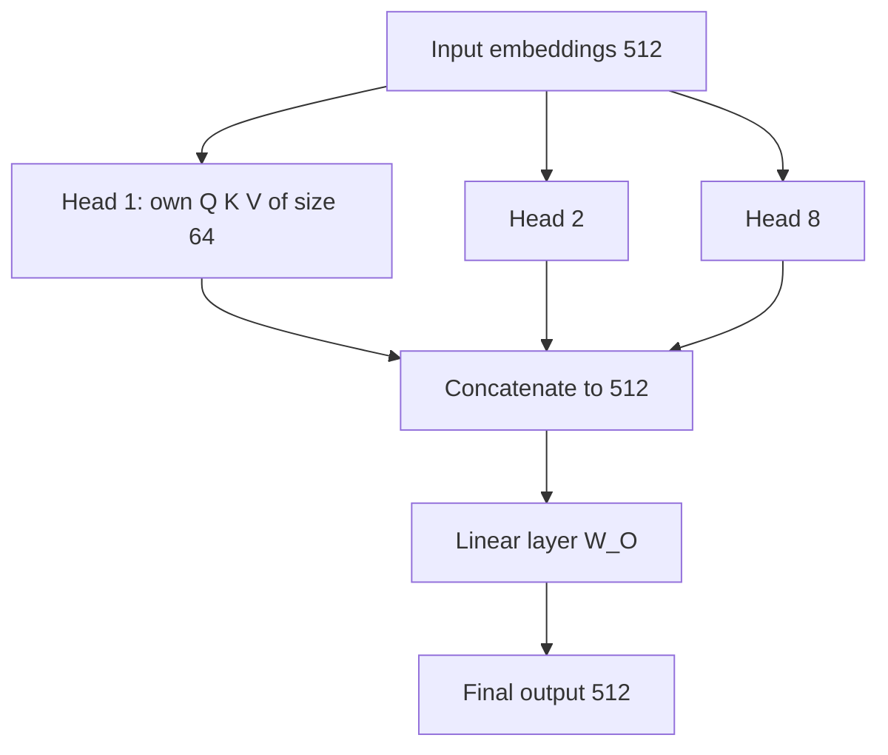

# What is Multi-Head Attention in Transformers?

> **Step 3: Generative AI and the Transformer Architecture** · ⏱️ 15 min read · [Read original](https://outcomeschool.com/blog/multi-head-attention-in-transformers)

## TL;DR
Multi-head attention runs many self-attention operations (heads) in parallel, each with its own Q, K, V projections, then concatenates and mixes their outputs. Each head can capture a different relationship, giving a richer representation than a single head.

## Key Concepts
- **Head** — one independent self-attention.
- **$d_{model}$** — size of each token's vector (e.g. 512).
- **$h$** — number of heads (original Transformer: 8).
- **$d_k = d_{model}/h$** — per-head dimension (512 / 8 = 64).
- **$W_O$** — learned output projection that mixes the concatenated heads.
- **Grouped Query Attention** — variant used by many modern LLMs to cut memory while keeping quality close to MHA.

## How It Works
**Why more than one head.** In "I love AI" there are subject-verb, verb-object and long-range links. A single head learns roughly one type of relationship at a time. Analogy: several expert readers (who, where, why) combine notes.

**Steps ($d_{model}=512$, $h=8$)**
1. Input embeddings of size 512.
2. Split the work: $d_k = 512/8 = 64$.
3. Each head $i$ has its own learned $W_i^Q, W_i^K, W_i^V$ producing 64-dim $Q_i, K_i, V_i$.
4. Each head computes $\text{head}_i=\text{softmax}\!\left(\frac{Q_iK_i^T}{\sqrt{d_k}}\right)V_i$ in parallel.
5. Concatenate: $8\times64=512$, matching $d_{model}$.
6. Project: $\text{MultiHead}=\text{Concat}(\text{head}_1,\dots,\text{head}_h)W_O$.

**Example (2 heads on "I love AI").** Head 1 (subject-verb): I attends love 0.8; love attends I 0.7. Head 2 (verb-object): love attends AI 0.7; AI attends love 0.8. The output for "love" combines both contexts. Heads are not told what to focus on; they learn it in training.

**Where used in a Transformer**
- Encoder multi-head self-attention.
- Decoder masked multi-head self-attention.
- Decoder multi-head cross-attention (Q from decoder; K, V from encoder).

**Advantages:** richer representations, parallel computation, same total cost (smaller per-head dimension), captures short- and long-range patterns, heads can specialize. Modern LLMs use 32, 64 or more heads per layer, which makes inference memory-hungry (hence GQA).

## Diagram

## Key Takeaways
- Multi-head = many self-attentions in parallel plus one mixing step.
- $d_k = d_{model}/h$ keeps total compute about the same as one big head.
- Each head learns its own pattern automatically.
- It is used in encoder self-attention, masked decoder self-attention and cross-attention.
- GQA reduces memory cost of many heads.
