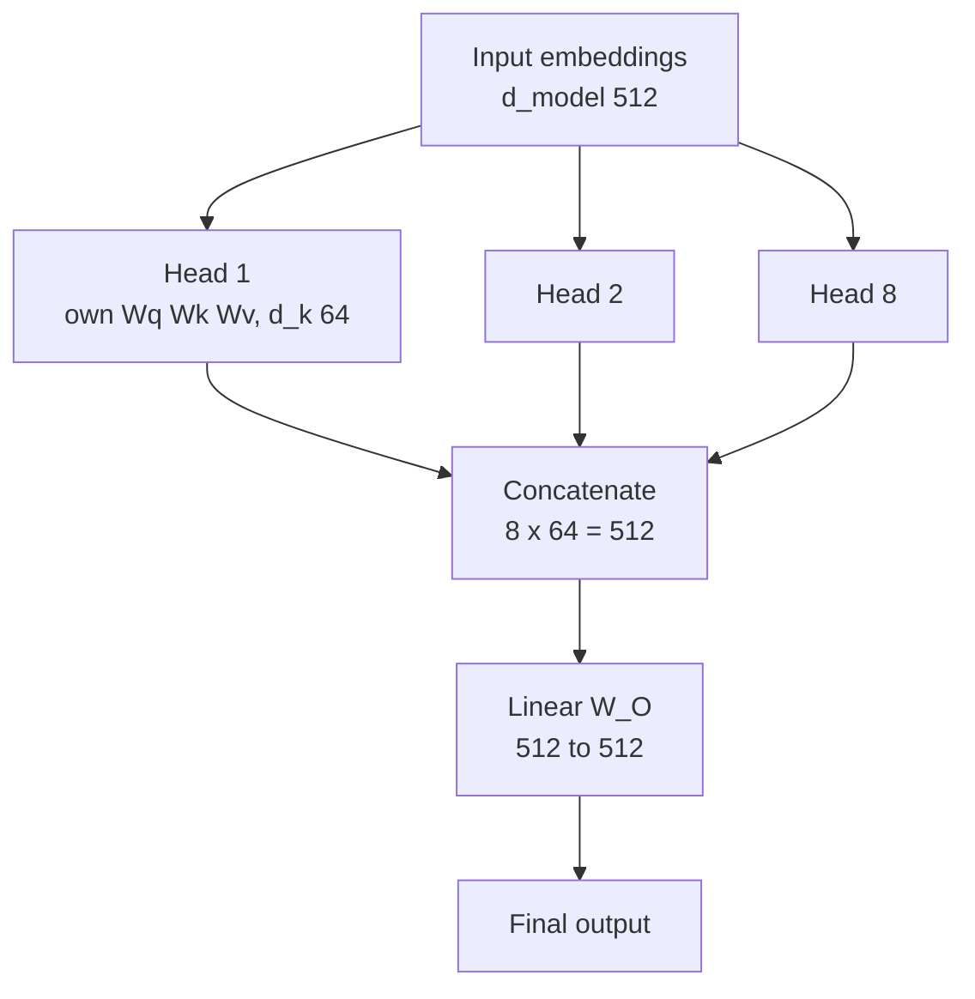

# What is Multi-Head Attention in Transformers?

> **Step 3: Generative AI and the Transformer Architecture** · ⏱️ 15 min read · [Read original](https://outcomeschool.com/blog/multi-head-attention-in-transformers)

## TL;DR
Multi-Head Attention runs several Self Attention "heads" in parallel, each with its own learned Q/K/V projections over a smaller dimension, then concatenates and mixes their outputs with a final linear layer. Each head learns a different relationship pattern, giving a much richer representation at roughly the same cost as one big attention.

## Key Concepts
- **Head** — one independent Self Attention; Multi + Head + Attention = many in parallel. Analogy: several expert readers (who acts, where, why) whose notes are combined.
- **$d_{model}$** — size of each token's vector (e.g. 512); $h$ = number of heads (original: 8).
- **$d_k = d_{model}/h$** — per-head dimension (512/8 = 64).
- **$W_O$** — learned output matrix that mixes the concatenated heads.
- Introduced in "Attention Is All You Need" (2017).
- Self Attention recap: Q, K, V from same sequence; $\text{softmax}(QK^\top/\sqrt{d_k})V$ (multiply Q, K^T for relatedness; divide to stabilise; softmax to probabilities; weighted sum of V). One set = a single head.

## How It Works

### Why multiple heads
"I love AI" hides many relations: I subject, love action, AI object; subject-verb, verb-object, long-range I-AI via love. One head learns only one type of relationship at a time. Multiple heads: one for subject-verb, one for verb-object, one for long-range, etc.

### Steps ($d_{model}=512$, $h=8$)
1. Input embeddings of size $d_{model}$.
2. Per-head dimension $d_k=512/8=64$.
3. Each head $i$ has own learned projections: $Q_i=XW_i^Q$, $K_i=XW_i^K$, $V_i=XW_i^V$ (separate weights let heads learn different patterns).
4. Each head runs attention independently, in parallel: $\text{head}_i=\text{softmax}\!\left(\frac{Q_iK_i^\top}{\sqrt{d_k}}\right)V_i$.
5. Concatenate: $8\times64=512=d_{model}$ (output dim matches input).
6. $\text{MultiHead}=\text{Concat}(\text{head}_1,\dots,\text{head}_h)\,W_O$ (512 -> 512).

### Example ("I love AI", 2 heads, illustrative numbers)
Head 1 (subject-verb):

| from \ to | I | love | AI |
|---|---|---|---|
| I | 0.100 | 0.800 | 0.100 |
| love | 0.700 | 0.200 | 0.100 |
| AI | 0.300 | 0.400 | 0.300 |

Head 2 (verb-object):

| from \ to | I | love | AI |
|---|---|---|---|
| I | 0.300 | 0.400 | 0.300 |
| love | 0.100 | 0.200 | 0.700 |
| AI | 0.100 | 0.800 | 0.100 |

For "love": Head 1 output = 0.7 V1(I) + 0.2 V1(love) + 0.1 V1(AI); Head 2 output = 0.1 V2(I) + 0.2 V2(love) + 0.7 V2(AI). Concat then times $W_O$ gives a representation with both contexts. Nobody assigns focus: heads learn it automatically in training.

### Where used in a Transformer
1. Encoder Multi-Head Self Attention (every token sees every token).
2. Decoder Masked Multi-Head Self Attention (only itself and earlier; future masked).
3. Decoder Multi-Head Cross Attention (Q from decoder, K and V from encoder).

## Diagram

### Multi-head flow

## Advantages and Trade-offs
- Richer representations (many relationships at once).
- Parallel computation, fast on GPUs.
- Same total cost: each head uses $d_{model}/h$, so total is similar to one big attention.
- Better learning of short- and long-range patterns; specialisation (syntax, meaning, position, long-range links).
- Original Transformer: 8 heads; modern LLMs: 32, 64 or more per layer.
- More heads make inference memory-hungry (KV cache), so many modern LLMs use Grouped Query Attention, which keeps quality close to MHA with far less memory (a KV-cache compression technique built into the model design).

## FAQ
- More compute than one head? Not much, smaller per-head dimension.
- Do we assign head roles? No, learned.
- Why final linear layer? $W_O$ mixes heads' side-by-side outputs into one representation.
- Why GQA? Memory at inference.

## Key Takeaways
- Multi-head = h parallel attentions with own Q/K/V projections, concatenated and mixed by $W_O$.
- $d_k=d_{model}/h$, so concatenation restores $d_{model}$.
- Heads specialise automatically; nobody assigns focus.
- Cost similar to single full-dimension attention.
- Used in encoder self-attention, masked decoder self-attention, and cross-attention.
- GQA reduces inference memory in modern LLMs.
