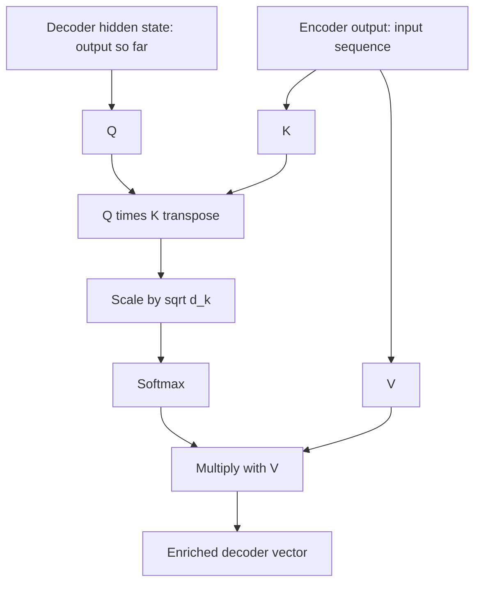

# What is Cross Attention in Transformers?

> **Step 3: Generative AI and the Transformer Architecture** · ⏱️ 16 min read · [Read original](https://outcomeschool.com/blog/cross-attention-in-transformers)

## TL;DR
Cross attention lets one sequence (the decoder's output so far) look at a different sequence (the encoder's output) by using its own Queries against the other's Keys and Values. It is the bridge between encoder and decoder, and the math is identical to self attention; only the source of Q, K, V differs.

## Key Concepts
- **Cross attention** — Q from one sequence, K and V from another.
- **Decoder hidden state** — source of Q.
- **Encoder output** — source of K and V, computed once and reused for every generated token.
- **Rectangular attention matrix** — output length x input length.

## How It Works
**Why needed.** Translating "How are you" to "Cómo estás": while producing each Spanish word the model must consult the English input. The sequences differ in length (3 vs 2), which cross attention handles naturally. Analogy: a student writing an answer (Query) while checking a reference book (Key and Value).

**Self vs cross attention**

| Aspect | Self Attention | Cross Attention |
|---|---|---|
| Q source | Same sequence | Output sequence (decoder) |
| K, V source | Same sequence | Input sequence (encoder) |
| Masking | Usually masked in decoder | Not masked (whole input is known) |
| Matrix shape | Square (N x N) | Rectangular (output x input) |
| Purpose | Relations within one sequence | Connect two sequences |
| Common use | Encoder layers, decoder self-attention | Encoder-decoder bridge, multimodal |

The decoder uses both: self attention over what it has generated, then cross attention over the encoder output.

**Steps**
1. Encoder output gives $K = \text{Enc}\,W_K$, $V = \text{Enc}\,W_V$ (once).
2. Decoder hidden state gives $Q = H\,W_Q$.
3. Scores $QK^T$, scale by $\sqrt{d_k}$, softmax.
4. Multiply by $V$.

$$\text{Attention}(Q,K,V)=\text{softmax}\!\left(\frac{QK^T}{\sqrt{d_k}}\right)V$$

**Example.** After "Cómo", attention over How/are/you is 0.05/0.50/0.45; output = $0.05V_{How}+0.50V_{are}+0.45V_{you}$. The vocabulary prediction gives estás 0.70, gracias 0.20, Hola 0.10, so "estás" is chosen. The full 2x3 matrix shows Cómo attending mostly to How (0.8).

**Where used:** encoder-decoder Transformers (translation, summarization, QA), Stable Diffusion (image features are Q, text embeddings are K and V), Flamingo (text Q, image K and V), Whisper (decoder attends over audio features), multimodal models generally.

## Diagram

## Key Takeaways
- Cross attention: Q from decoder, K and V from encoder.
- Same formula as self attention; only the sources differ.
- Not masked, matrix is rectangular, and K/V are computed once and reused.
- Works alongside decoder self attention, not instead of it.
- Used wherever two information sources combine: translation, text-to-image, speech-to-text.
