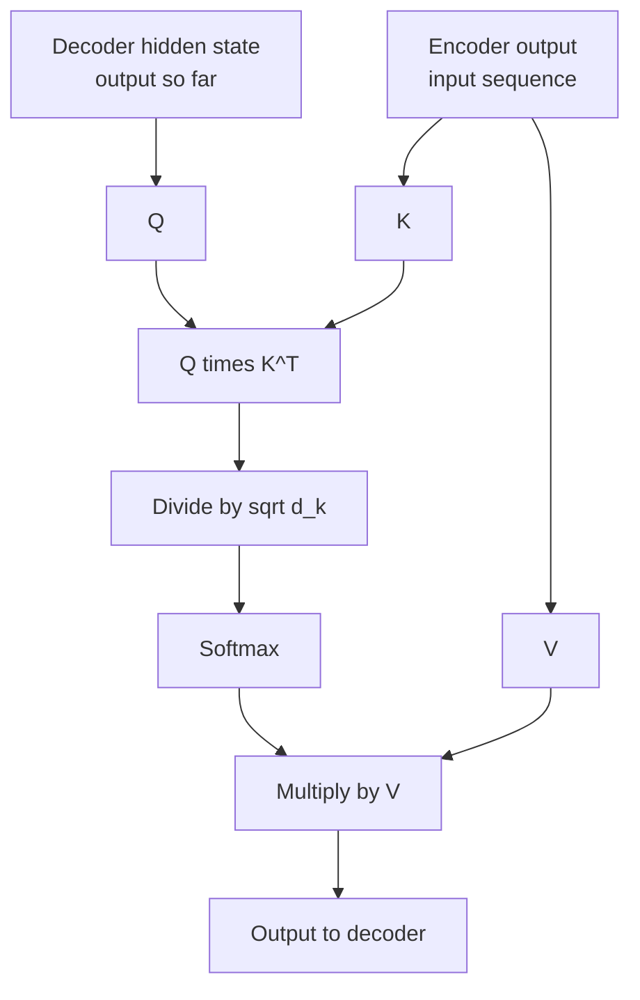
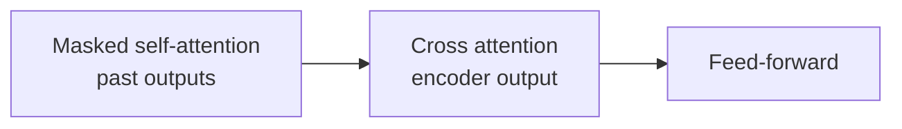

# What is Cross Attention in Transformers?

> **Step 3: Generative AI and the Transformer Architecture** · ⏱️ 16 min read · [Read original](https://outcomeschool.com/blog/cross-attention-in-transformers)

## TL;DR
Cross Attention lets one sequence (the decoder's output so far) read from a different sequence (the encoder's output). Queries come from the decoder; Keys and Values come from the encoder. The formula equals Self Attention; only the source of Q, K, V differs. It bridges encoder and decoder and links modalities.

## Key Concepts
- **Cross Attention** — one sequence's Queries against another sequence's Keys and Values. "Cross" = information crosses sequences. Analogy: writing an exam answer from your thoughts (Query) while consulting a reference book (Key/Value).
- **Q** — what the decoder looks for now. **K** — what each input token offers. **V** — information each input token carries.
- Example: translating "How are you" (3 words) to "Cómo estás" (2 words); sequences needn't have equal length.

## How It Works

### Self vs Cross
| Aspect | Self Attention | Cross Attention |
|---|---|---|
| Source of Q | Same sequence | Output sequence (decoder) |
| Source of K | Same sequence | Input sequence (encoder) |
| Source of V | Same sequence | Input sequence (encoder) |
| Masking | Usually masked in decoder | Not masked |
| Attention matrix | Square (N x N) | Rectangular (output length x input length) |
| Purpose | Relationships within one sequence | Connect two different sequences |
| Common use | Encoder layers, decoder self-attention | Encoder-decoder bridge, multi-modal models |

Points to note:
1. Decoder uses both: Self Attention on words already generated, then Cross Attention on the encoder output. They work together.
2. Not masked: the whole input is already known, so every output word may see every input word.
3. K and V computed once: the encoder reads the input a single time; the decoder reuses the same K and V at each step (efficient).

### Steps
1. Encoder output -> $K=\text{Enc}\,W_K$, $V=\text{Enc}\,W_V$ (once, reused).
2. Decoder hidden states of tokens so far -> $Q=H_{dec}W_Q$.
3. Scores $=QK^\top$.
4. Scale by $\sqrt{d_k}$ (keeps softmax and gradients stable).
5. Softmax: each row sums to 1.
6. Multiply by V: new vector per decoder position, enriched with relevant input info; decoder uses it to predict the next word.

$$\text{Attention}(Q,K,V)=\text{softmax}\!\left(\frac{QK^\top}{\sqrt{d_k}}\right)V$$

Same math as Self Attention; difference is where Q, K, V come from.

### Example
Decoder has produced "Cómo", predicts the next.
- Encoder gives K, V for How, are, you (once).
- Query from "Cómo" so far; dot with 3 Keys; scale; softmax gives How 0.050, are 0.500, you 0.450.
- Output $=0.05V(\text{How})+0.5V(\text{are})+0.45V(\text{you})$.
- Decoder scores Spanish vocabulary: estás 0.70, gracias 0.20, Hola 0.10 -> picks "estás" (one word carries are + you). Repeat until sentence complete.

Full attention matrix (2 rows x 3 columns, rectangular):

| | How | are | you |
|---|---|---|---|
| Cómo | 0.800 | 0.100 | 0.100 |
| estás | 0.050 | 0.500 | 0.450 |

### Where used
- Encoder-decoder Transformers: translation, summarization, QA.
- **Stable Diffusion**: image features = Query, text embeddings = Key and Value (conditions image generation on the prompt).
- **Flamingo** (DeepMind): text tokens = Query, image features = Key/Value.
- **Whisper** (OpenAI): decoder attends over audio features.
- Multi-modal models generally.

### Importance
Real tasks combine two sources (input/output language, prompt/image, audio/text). Without it the decoder would guess; with it the decoder directly picks the relevant input info each step: one sequence guides the generation of another.

## Diagrams

### Cross Attention flow

### Decoder block ordering

## Trade-offs & Pitfalls
- Matrix is not square — a key sign of Cross vs Self Attention.
- Cross Attention does not replace Self Attention.
- Formula unchanged; only sources differ.

## Key Takeaways
- Q from decoder, K and V from encoder.
- Same formula as Self Attention.
- Not masked; rectangular attention matrix (output length x input length).
- K and V computed once and reused at every decoding step.
- Decoder uses Self then Cross Attention.
- Powers translation, Stable Diffusion, Flamingo, Whisper and multimodal models.
