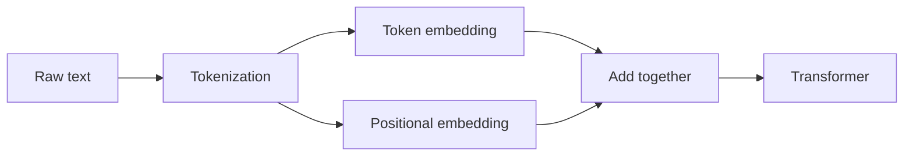

# Positional Embeddings in LLMs

> **Step 3: Generative AI and the Transformer Architecture** · ⏱️ 1 min read · [Read original](https://outcomeschool.substack.com/p/positional-embeddings-in-llms)

## TL;DR
LLMs process tokens in parallel, so they have no built-in sense of word order. Positional embeddings are added to inject each token's position into the model.

## Key Concepts
- **Positional embedding** — information about a token's position in the sequence, given to the model.
- **Token embedding** — vector representation of the token's meaning.
- **Tokenization** — converting raw text into tokens and mapping them to numbers.

## How It Works
Unlike RNNs, which read sequentially, Transformers see all tokens at once. Without position information the model cannot tell "Outcome School" from "School Outcome".

Before input reaches the Transformer:
1. **Tokenization** — text to tokens to numbers.
2. **Token embedding + positional embedding** — the two are combined so each token carries both meaning and position.

## Diagram

## Key Takeaways
- Parallel processing means no inherent word order.
- Positional embeddings tell the model where each token sits.
- Input to the Transformer is token embedding plus positional embedding.
