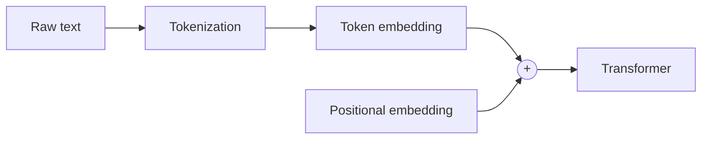

# Positional Embeddings in LLMs

> **Step 3: Generative AI and the Transformer Architecture** · ⏱️ 1 min read · [Read original](https://outcomeschool.substack.com/p/positional-embeddings-in-llms)

## TL;DR
LLMs process tokens in parallel rather than sequentially, so they have no built-in notion of word order. Positional embeddings are added to token embeddings to tell the model each token's position.

## Key Concepts
- **Positional embedding** — information about a token's position added to its representation.
- **Tokenization** — converting raw text into smaller units (tokens) mapped to numbers.
- **Token embedding** — vector for each token.

## How It Works
- Unlike RNNs (sequential), Transformers see all tokens at once, so order is invisible without help.
- Example: without position info the model can't tell "Outcome School" from "School Outcome".
- Pre-processing before the Transformer:
  1. Tokenization (text -> tokens -> numbers).
  2. Token embedding + positional embedding.

## Diagram

### Input preparation

## Key Takeaways
- Parallel processing loses word order.
- Positional embeddings restore position information.
- Input = token embedding + positional embedding.
- Without them "Outcome School" and "School Outcome" look identical.
