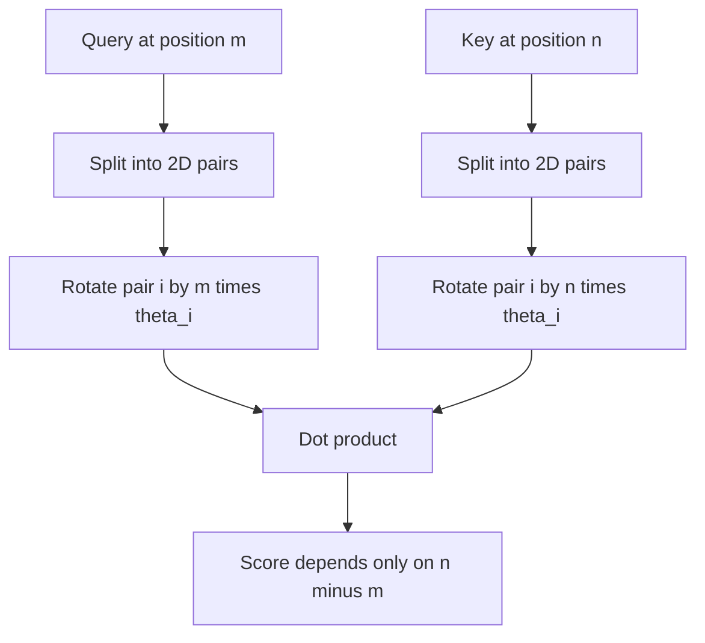
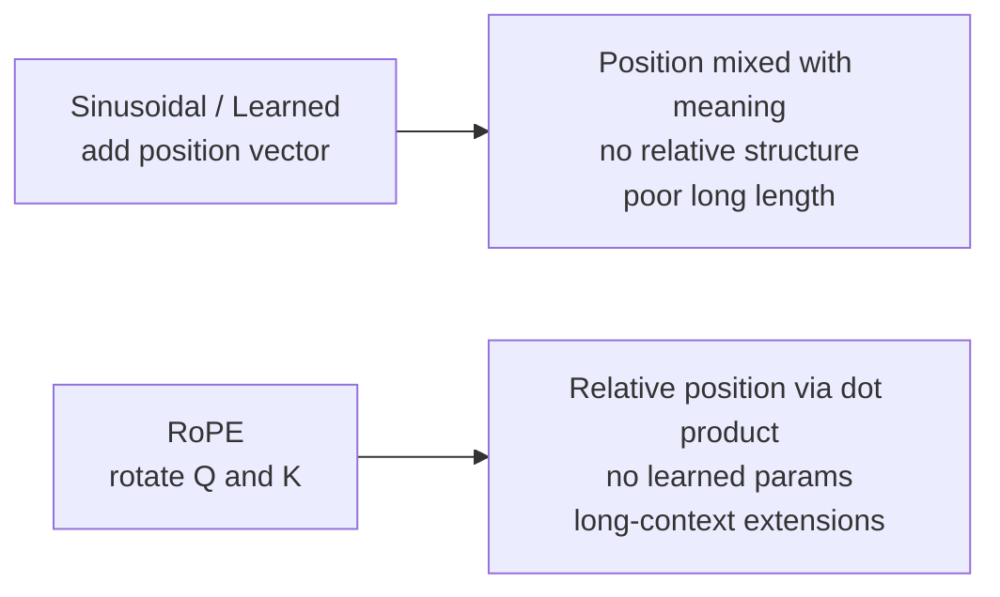

# What is RoPE (Rotary Position Embedding)? The Math Behind It

> **Step 3: Generative AI and the Transformer Architecture** · ⏱️ 16 min read · [Read original](https://outcomeschool.com/blog/math-behind-rope-rotary-position-embedding)

## TL;DR
RoPE injects position by rotating each Query and Key vector by an angle proportional to the token's position, instead of adding a position vector. Because rotations compose, the attention dot product depends only on the relative distance between tokens. It adds no learned parameters and is standard in modern LLMs.

## Key Concepts
- **RoPE** = Rotary + Position + Embedding: rotation as the encoding mechanism.
- **Rotation matrix** $R_\theta$ — rotates a 2D vector while preserving its length.
- **Frequency $\theta_i$** — per-pair fixed rotation speed.
- **Orthogonality** — $R_m^\top=R_{-m}$.
- Clock analogy: each dimension pair is a clock hand at its own speed; attention cares about how many hours apart two hands are, not where each points.

## How It Works

### Why position is needed
Transformers process tokens in parallel; "The cat chased the dog" and "The dog chased the cat" look identical to a raw Transformer.

### Older approaches and problems
- **Sinusoidal** (original paper): fixed sine/cosine vector per position, added to token embedding.
- **Learned positional embeddings**: separate learned vector per position, added.
- Problems: (1) addition mixes position into word meaning so they compete in one vector; (2) no built-in relative distance (positions 5 and 10 vs 105 and 110 must be learned separately); (3) struggle with longer sequences (trained on 2048, given 8192: learned embeddings have nothing; sinusoidal can theoretically extrapolate but works poorly in practice).

### 2D rotation
$$\begin{pmatrix}x'\\y'\end{pmatrix}=\begin{pmatrix}\cos\theta&-\sin\theta\\\sin\theta&\cos\theta\end{pmatrix}\begin{pmatrix}x\\y\end{pmatrix}$$
Only direction changes; length stays.

### Applying to Q and K
- Q, K have many dims (often 64 or 128): split into 2D pairs (d=64 -> 32 pairs; d=8 -> 4 pairs). For a token at position $m$, each pair $i$ is rotated by $m\theta_i$.
- Frequencies: $\theta_i=10000^{-2(i-1)/d}$ for $i=1..d/2$. First pair $\theta_1=1$ (fastest); with $d=128$ the last is about 0.0001 (slowest). Like sinusoidal's many frequencies but applied as rotations.
- This formula is what YaRN and NTK-aware scaling tune for long context.
- Rotated Q at $m$ is $R_mQ$; K at $n$ is $R_nK$.
- Pairing: paper uses consecutive pairs $(q_1,q_2),(q_3,q_4)$; LLaMA/Mistral pair $(q_i,q_{i+d/2})$ (first half with second half). Equivalent (permutation of dimensions).
- Applied only to Q and K; V untouched (position effect comes from $Q\cdot K$; V is just content).

### Why relative position falls out
$$ (R_mQ)^\top(R_nK)=Q^\top R_m^\top R_nK=Q^\top R_{-m}R_nK=Q^\top R_{n-m}K $$
The $m$ rotation cancels; the score depends only on $n-m$. Example: in "The cat sat on the mat" cat is at 2, mat at 6 (distance 4); in "Yesterday, the cat sat on the mat" cat 3, mat 7 (distance 4) — same relationship. With absolute positions the model would relearn each pair (2,6), (3,7), (100,104)...; RoPE learns it once. This property comes out of the math for free.

### Numeric check
$Q=[1,0]$, $\theta=\pi/4$.
- $m=1,n=2$: $R_1Q=[0.707,0.707]$; $K=[1,0]$ with angle $\pi/2$: $R_2K=[0,1]$. Score $=0.707\cdot0+0.707\cdot1=0.707$.
- $m=2,n=3$: $R_2Q=[0,1]$; $R_3K$ (angle $3\pi/4$) $=[-0.707,0.707]$. Score $=0\cdot(-0.707)+1\cdot0.707=0.707$.
- Same relative distance 1, same score.

### Real-world use
LLaMA family, Mistral and Mixtral, Qwen, DeepSeek, Gemma. Foundation for long-context extension (YaRN, Position Interpolation, NTK-aware scaling): a model trained on 4K can be used at 32K or 128K; not possible with learned embeddings.

## Diagrams

### RoPE in attention

### Older methods vs RoPE

## Trade-offs & Pitfalls
- RoPE has no learned parameters (unlike learned embeddings).
- Not rotating V is intentional.
- Rotation doesn't change vector length.
- Extending context needs techniques built on RoPE (YaRN, PI, NTK-aware).

## Key Takeaways
- RoPE rotates Q and K by position-dependent angles instead of adding vectors.
- Score $=Q^\top R_{n-m}K$: purely relative.
- Dimensions split into pairs with frequencies $10000^{-2(i-1)/d}$.
- Only Q and K are rotated; no extra learned parameters.
- Standard in LLaMA, Mistral, Qwen, DeepSeek, Gemma.
- Enables long-context extension methods.
