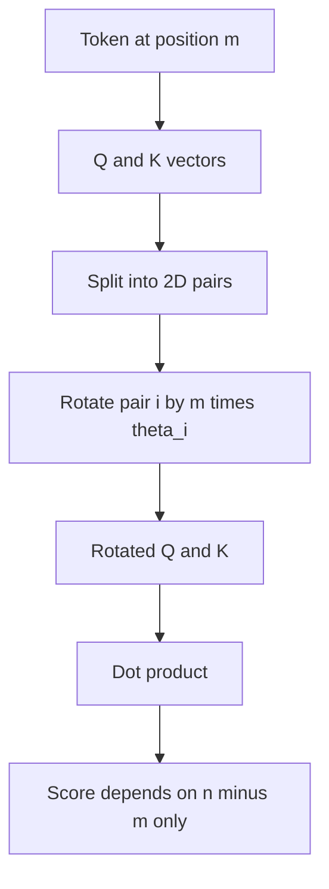

# What is RoPE (Rotary Position Embedding)? The Math Behind It

> **Step 3: Generative AI and the Transformer Architecture** · ⏱️ 16 min read · [Read original](https://outcomeschool.com/blog/math-behind-rope-rotary-position-embedding)

## TL;DR
RoPE injects position by rotating the Query and Key vectors by an angle that depends on token position, instead of adding a position vector. Because of how rotations combine, the attention score depends only on the relative distance between tokens.

## Key Concepts
- **RoPE** — Rotary Position Embedding; rotation as the encoding mechanism.
- **Rotation matrix** — rotates a 2D vector by $\theta$ without changing its length.
- **Frequency $\theta_i$** — per-pair rotation rate.
- **Sinusoidal encoding** — fixed sin/cos vector added to embeddings (original paper).
- **Learned positional embeddings** — a trained embedding per position, added to token embeddings.

## How It Works
**Why position is needed.** "The cat chased the dog" and "The dog chased the cat" look identical to a parallel Transformer.

**Older approaches' problems:** they add position to the meaning vector (mixing and competing); they lack built-in relative-distance structure; they struggle at longer lengths than trained (sinusoidal can extrapolate in theory, but not well in practice).

**2D rotation**

$$\begin{pmatrix}x'\\y'\end{pmatrix}=\begin{pmatrix}\cos\theta&-\sin\theta\\\sin\theta&\cos\theta\end{pmatrix}\begin{pmatrix}x\\y\end{pmatrix}$$

**Applying to Q and K.** Split the vector (e.g. 64 dims) into 32 pairs; rotate pair $i$ at position $m$ by $m\theta_i$, where

$$\theta_i=10000^{-2(i-1)/d},\quad i=1,\dots,d/2$$

Early pairs rotate fast ($\theta_1=1$), later pairs slowly (about 0.0001 for $d=128$). Clock-hand analogy: compare how far apart hands are, not their absolute time. Only Q and K are rotated; V is untouched. LLaMA/Mistral pair first-half with second-half dimensions, which is an equivalent permutation. YaRN and NTK-aware scaling tune these frequencies.

**Why relative.** Rotation matrices are orthogonal ($R_m^T=R_{-m}$):

$$(R_mQ)\cdot(R_nK)=Q^TR_m^TR_nK=Q^TR_{n-m}K$$

The score depends only on $n-m$. So "cat" and "mat" 4 words apart relate identically wherever they sit; the model learns it once.

**Numeric check ($\theta=\pi/4$, $Q=K=[1,0]$).** Positions (1,2): score 0.707. Positions (2,3): score 0.707. Same relative distance, same score.

**Used by:** LLaMA, Mistral/Mixtral, Qwen, DeepSeek, Gemma. Foundation for long-context methods (YaRN, Position Interpolation, NTK-aware scaling). RoPE adds no learned parameters.

## Diagram

## Key Takeaways
- RoPE rotates Q and K by position-dependent angles instead of adding vectors.
- Dot product of rotated vectors depends only on relative distance.
- Each 2D pair has its own frequency; V is not rotated.
- No extra learned parameters.
- Standard in modern LLMs and the basis of long-context extensions.
