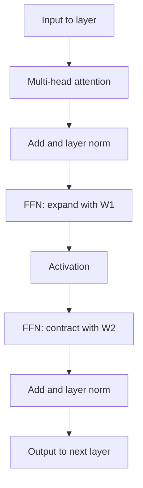

# What is the Feed-Forward Network in LLMs?

> **Step 3: Generative AI and the Transformer Architecture** · ⏱️ 21 min read · [Read original](https://outcomeschool.com/blog/feed-forward-networks-in-llms)

## TL;DR
The Feed-Forward Network (FFN) is a small network inside every Transformer layer that processes each token independently after attention. It acts as the model's knowledge store and holds about two-thirds of the layer's parameters.

## Key Concepts
- **Feed-forward** — data flows one way, input to output, no loops.
- **Expand-then-contract** — dimension grows (typically 4x $d_{model}$) then shrinks back.
- **Activation function** — adds non-linearity (ReLU, GELU, SwiGLU).
- **Pattern detectors** — hidden neurons that fire for particular patterns (geography, grammar, math).
- **Mixture of Experts (MoE)** — the single FFN replaced by many expert FFNs chosen by a router.

## How It Works
**Role.** Attention is the meeting where words talk to each other; the FFN is each word going back to its desk to refine notes using stored knowledge. Attention moves information across tokens; FFN transforms information within a token. Each Transformer layer = multi-head attention + FFN, each wrapped in residual connection and layer norm (original post-norm; modern LLMs typically pre-norm). Tokens are processed in parallel but independently by the FFN.

**Formula (two linear layers around an activation)**

$$\text{FFN}(x)=\text{ReLU}(xW_1+b_1)W_2+b_2$$

1. Expand: $xW_1+b_1$ (e.g. 4096 to 16384 at 4x).
2. Activation.
3. Contract: back to $d_{model}$.

**Expand-then-contract.** GPT-3: 12288 to 49152 to 12288. LLaMA 2 7B: 4096 to 11008 to 4096 (not 4x because of SwiGLU). The bigger middle gives "room to think" (small sticky note, big whiteboard, small sticky note).

**Why activations.** Without them two linear layers collapse into one linear map, unable to model language.

| Function | Notes |
|---|---|
| ReLU | $\max(0,x)$; creates sparsity; original Transformer |
| GELU | Smooth version; GPT, BERT |
| SwiGLU | Gated, uses a third matrix $V$: $(\text{Swish}(xW_1)\odot xV)W_2$; hidden size cut to about 2.7x to keep parameters similar (LLaMA 2 7B: 11008/4096 is about 2.69x; 70B is about 3.5x) |

**What it learns.** Much of the stored knowledge lives in FFN weights. For "The capital of France is", neurons recognizing "capital of France" help push toward "Paris" (really distributed across many neurons and layers). Librarian (attention) versus books (FFN).

**Parameter share.** Attention is about $4d_{model}^2$; FFN is about $8d_{model}^2$, so FFN is about $8/12\approx66\%$. For GPT-3 (175B), roughly 110-115B parameters sit in FFNs. With GQA or MQA the FFN share is even larger.

**MoE.** A router sends each token to a few experts (typically 2 of 8 or 64); the rest stay idle. Large total capacity with low per-token compute.

## Diagram

## Key Takeaways
- FFN = two linear layers with an activation, expanding then contracting.
- It applies stored knowledge to each token independently after attention.
- About 66% of a Transformer layer's parameters sit in the FFN.
- Activation functions evolved ReLU, then GELU, then SwiGLU (gated, three matrices).
- MoE replaces one FFN with many specialized expert FFNs plus a router.
