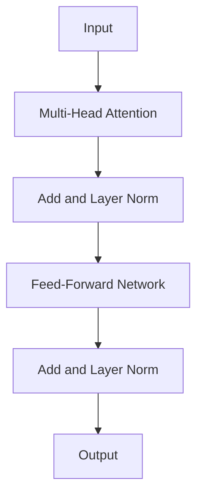
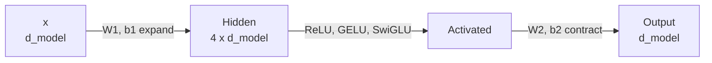
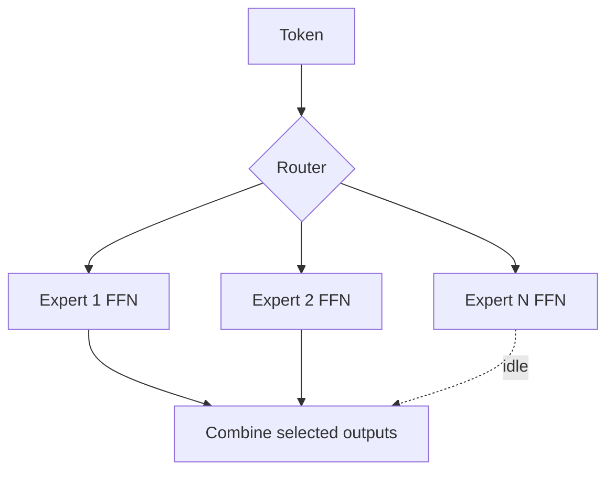

# What is the Feed-Forward Network in LLMs?

> **Step 3: Generative AI and the Transformer Architecture** · ⏱️ 21 min read · [Read original](https://outcomeschool.com/blog/feed-forward-networks-in-llms)

## TL;DR
The Feed-Forward Network (FFN) is a two-layer neural network in every Transformer layer. After attention mixes information across tokens, the FFN processes each token independently: expand to a larger dimension, apply a non-linearity, contract back. It stores most of the model's knowledge and holds about two-thirds of its parameters.

## Key Concepts
- **Feed-forward** — data flows one way, input to output, no loops (unlike RNNs). Analogy: attention = team meeting; FFN = each member refining notes at their own desk.
- **FFN structure in Transformers** — two linear transforms with an activation between (W1 input-to-hidden, W2 hidden-to-output), not classic separate input/hidden/output layers (see MLP).
- **Expand-then-contract** — $d_{model}$ to about $4d_{model}$ then back.
- **Activation function** — adds non-linearity (ReLU, GELU, SwiGLU).
- **Pattern detector** — each hidden neuron fires for patterns (geography, grammar, math, code).
- **MoE expert** — one of several FFNs chosen by a router.
- In one line: attention moves information across tokens; FFN transforms information within a token.

## How It Works

### Placement
Each Transformer layer = Multi-Head Attention -> Add & Norm -> FFN -> Add & Norm. Attention processes tokens together; FFN applies the same network to each token separately (in practice batched in parallel as a matrix multiplication). The shown post-norm is the original; modern LLMs (GPT, LLaMA) typically use pre-layer norm for stability. GPT-3 has 96 such layers.

### Steps
1. Expand: $h=xW_1+b_1$ (e.g. 4096 -> 16384, 4x).
2. Activate: ReLU/GELU.
3. Contract: $y=\text{act}(h)W_2+b_2$ (back to input dim).

$$
\text{FFN}(x)=\text{ReLU}(xW_1+b_1)W_2+b_2
$$

### Expand-then-contract numbers
- GPT-3 (175B): $d_{model}=12288$ -> 49152 -> 12288.
- LLaMA 2 (7B): 4096 -> about 11008 (not 4x since SwiGLU) -> 4096.
- Why: the bigger hidden space gives room to think (sticky note -> whiteboard -> sticky note); contraction returns to size the rest of the model expects. Furniture-factory analogy: raw planks in, big workshop of specialists, compact finished piece out.

### Activation functions
- Without one, two linear maps collapse into one linear map, only straight-line patterns.
- **ReLU** $=\max(0,x)$: ReLU(5)=5, ReLU(-3)=0, ReLU(0)=0. Creates sparsity (many neurons inactive), neurons specialise. Original Transformer used it.
- **GELU**: smoother, gradually reduces small negatives; used in GPT, BERT; reduces explicit sparsity but tends to improve performance.
- **SwiGLU**: gating mechanism, used in LLaMA; tends to perform better.

  $$
  \text{SwiGLU}(x)=(\text{Swish}(xW_1)\odot(xV))W_2
  $$

  Three matrices ($W_1$, $V$, $W_2$), $\odot$ = element-wise product. To keep parameters similar, hidden dim cut from 4x to about 2.7x (LLaMA 2 7B: 11008/4096 = 2.69x). Not strict: LLaMA 2 70B has 28672 with $d_{model}$ 8192 = about 3.5x.
- Evolution: ReLU -> GELU -> SwiGLU; core idea (non-linearity) unchanged.

### What the FFN learns
- Much stored knowledge sits in FFN weights: facts, patterns, associations. Library analogy: attention = librarian relating books; FFN = the books.
- "The capital of France is": after attention gives context, neurons recognising "capital of France" fire and push the output toward "Paris". (Simplified: knowledge is distributed across many neurons and layers.)
- Attention = relationships; FFN = facts and patterns applied per token.

### Parameter share
Attention $\approx4d^2$ (Q, K, V, O each $d\times d$); FFN $\approx2\cdot d\cdot4d=8d^2$. FFN share $=8/(8+4)\approx66\%$. In GPT-3 (175B) roughly 110-115B parameters are FFN (rest: embeddings, layer norms, final projection). With GQA/MQA the K, V matrices are smaller, so FFN share is even larger. A 70B model has about 46B in FFNs.

### Mixture of Experts
Standard: every token uses the same FFN. MoE: FFN replaced by multiple FFN experts; a small router sends each token to a few (typically 2 out of 8 or 64); others idle. Experts specialise; huge total parameters for knowledge but only a fraction used per token, keeping compute low.

### Why FFNs matter
- Without it: no stored knowledge.
- Refines attention output ("who relates to whom" + "what I know about this").
- Activation gives non-linearity; without it the whole Transformer would be linear.
- Holds most parameters (capacity).
- Per-token independent so highly parallel and efficient.

## Diagrams

### Transformer layer

### Inside the FFN

### Mixture of Experts

## Trade-offs & Pitfalls
- SwiGLU's third matrix forces shrinking hidden size (about 2.7x) to hold the parameter count; ratio varies by model size.
- Knowledge is distributed, not one neuron per fact.
- MoE: big capacity, low per-token compute.
- Smoother activations lose ReLU's explicit sparsity.

## FAQ
- Attention vs FFN? Across tokens vs within a token.
- Does FFN look at other tokens? No, independent (batched in parallel).
- Remove activation? Then collapses to linear.
- Why less than 4x with SwiGLU? Third matrix; keeps params similar.
- GQA effect? Fewer attention params, so larger FFN share.

## Key Takeaways
- FFN = expand (about 4x), non-linearity, contract; per-token.
- Activation (ReLU -> GELU -> SwiGLU) provides non-linearity.
- FFN is the knowledge store; about 66% of layer parameters.
- Attention moves information across tokens; FFN transforms within a token.
- SwiGLU uses three matrices and about 2.7x hidden size.
- MoE swaps the single FFN for routed expert FFNs.
