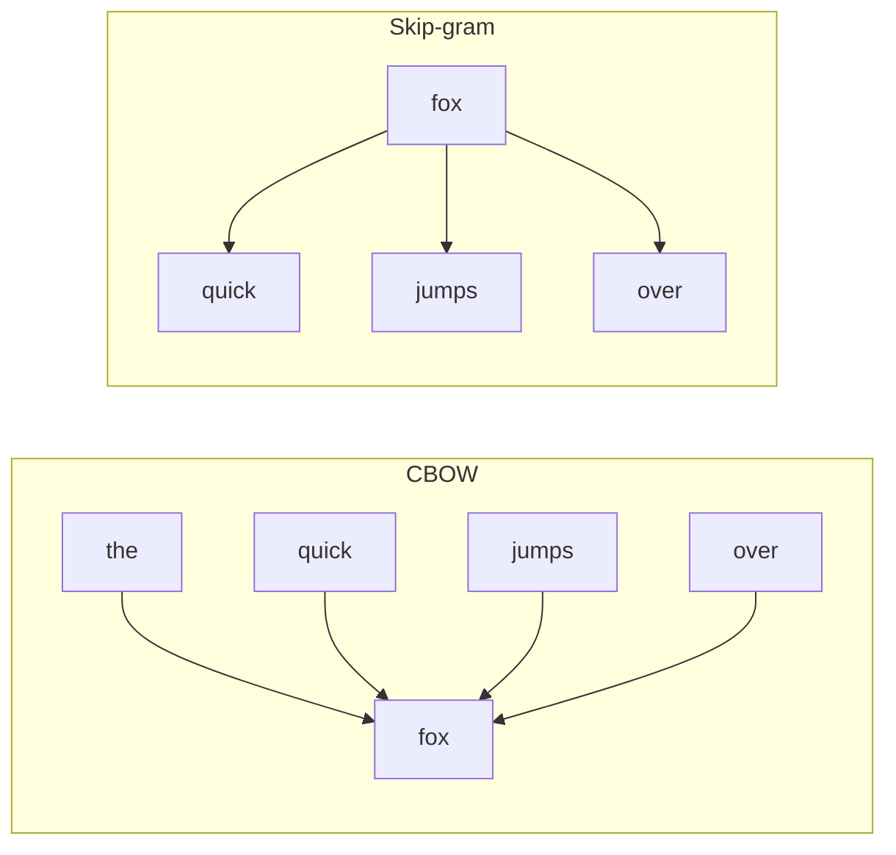
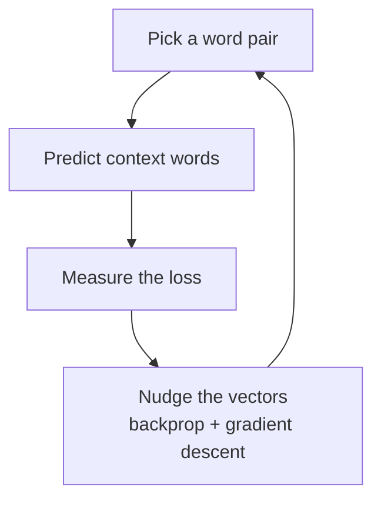

# How does Word2Vec work?

> **Step 3: Generative AI and the Transformer Architecture** · ⏱️ 19 min read · [Read original](https://outcomeschool.com/blog/word2vec)

## TL;DR
Word2Vec turns each word into a short list of numbers (a vector, usually 100 or 300 numbers) so similar words get similar vectors. It learns them from raw text by predicting words from their neighbors (CBOW or Skip-gram), based on the idea that a word is known by the company it keeps. It gives one fixed vector per word, which newer contextual embeddings improve on.

## Key Concepts
- **Vector** — a list of numbers. **Word vector / word embedding** — short list of numbers representing a word; same thing.
- **One-hot encoding** — vocabulary-sized list with a single 1 and rest 0.
- **Context / context window** — words around a target word / how many words each side we look at.
- **CBOW (Continuous Bag of Words)** — context words predict the middle target word.
- **Skip-gram** — one target word predicts its context words.
- **Loss (error)** — measure of how wrong a prediction is.
- **Negative sampling** — speed trick so training need not check every word every time.
- **Contextual embeddings** — vectors that change with the full sentence (from Transformers).

## How It Works

### Why we need it
- Computers understand only numbers.
- Unique IDs (cat=1, dog=2, king=3) are random and carry no meaning.
- One-hot (vocabulary cat, dog, king, queen: cat = [1,0,0,0], dog = [0,1,0,0], ...) has two problems:
  1. Huge lists: hundreds of thousands of slots, all 0 except one; wasteful.
  2. Every word is equally far from every other: "king" is as different from "queen" as from "banana"; no meaning.
- Word2Vec gives short vectors (100 or 300 numbers) whose numbers carry meaning.

### What we aim for
Toy 4-number vectors: king = [0.9, 0.7, 0.1, 0.8], queen = [0.9, 0.1, 0.1, 0.8], man = [0.5, 0.9, 0.2, 0.1], woman = [0.5, 0.2, 0.2, 0.1], apple = [0.1, 0.1, 0.9, 0.0]. King and queen look similar, man and woman similar, apple is different. We do not set these numbers; Word2Vec learns them from large text without explicit programming.

### Core idea: a word is known by the company it keeps
- J. R. Firth: "You shall know a word by the company it keeps." Meaning comes from surrounding words.
- "The cat drank the milk" / "The dog drank the milk": similar surroundings, so cat and dog are similar. Coffee and tea appear near "drink", "hot", "cup", "morning", so they are similar.
- Similar contexts imply similar meaning; Word2Vec learns this from millions of sentences.
- Context window example: sentence "The quick brown fox jumps over the dog", target "fox", window of 2 each side: left (quick, brown), right (jumps, over).

### Word vector as a point in space
- With 2 numbers, each word is a point on a plane: king and queen near each other, man and woman near each other, apple and banana together.
- Similar meaning = close; different = far. Real vectors have 100 or 300 dimensions, same idea. Closeness is measured with cosine similarity.

### CBOW vs Skip-gram
| | CBOW | Skip-gram |
|---|---|---|
| Task | context words predict the target | target predicts context words |
| Example | "The ___ drank the milk" gives "cat" | "cat" gives "drank", "milk" |
| Speed | faster | slower |
| Strength | frequent words | rare words; often more popular |

Pick by use case.

### Skip-gram walk-through
Sentence "The cat drank the milk", target "drank", window size 1:
1. Find context words: "cat" (left), "the" (right). Training pairs: (drank, cat), (drank, the).
2. Slide the window (next target "the") and repeat for every word in millions of sentences, giving a huge pair list.
3. Feed pairs into a small network: target in, predicted context out. The prediction itself does not matter; the learned word vectors do.

### How the vectors are learned
1. Start with random vectors (meaningless).
2. Feed a pair, e.g. ("drank", "cat"); the network uses the current vector of "drank" to predict neighbors.
3. Prediction is mostly wrong at first; measure the loss.
4. Backpropagation plus gradient descent nudge the vector numbers slightly to improve.
5. Repeat millions of times; loss shrinks and similar words end up close.
- Real implementations use speed tricks such as negative sampling.

### Word math
- king - man + woman ≈ queen. Difference king-man is roughly "royalty"; adding woman gives the royal version of woman.
- Arrow man to king has the same direction and length as woman to queen: relationships become directions.
- Others: Paris:France = Tokyo:Japan (capital to country); walking:walked = swimming:swam (present to past).

### Code (Gensim)
```python
from gensim.models import Word2Vec
sentences = [["the","cat","drank","the","milk"], ["the","dog","drank","the","milk"],
             ["the","king","ruled","the","land"], ["the","queen","ruled","the","land"]]
model = Word2Vec(sentences, vector_size=100, window=2, min_count=1, sg=1)
king_vector = model.wv["king"]
similar_words = model.wv.most_similar("king")
```
- `vector_size=100`: numbers per word. `window=2`: 2 words each side. `min_count=1`: keep even single-occurrence words (tiny data). `sg=1`: Skip-gram (`sg=0`: CBOW).
- `model.wv["king"]` gives the vector; `most_similar` gives the closest words.
- The library handles training, backpropagation and gradient descent. With four sentences the vectors are not meaningful; use millions in practice.

### Where it is used
- Search engines ("cheap phone" also finds "affordable mobile").
- Recommendations (related products).
- Spam detection (email meaning).
- Translation (map words across languages by meaning).
- Text grouping (similar articles, reviews, documents).

## Diagram(s)

### CBOW vs Skip-gram


### Training loop


## Trade-offs & Pitfalls
- **One vector per word**: "bank" (river vs money) mixes both meanings.
- **Ignores the sentence**: a word's vector is always the same, whatever the sentence.
- **No new words**: an unseen word has no vector.
- Fix: contextual embeddings from Transformer models (the basis of LLMs); "bank" gets different vectors in "river bank" and "money bank".
- Still used today: simple, fast, good for many tasks; newer methods build on its idea of meaningful word vectors.

## FAQ
- CBOW or Skip-gram? → Depends on use case; CBOW faster/frequent words, Skip-gram better for rare words and more popular (Gensim `sg=1` vs `sg=0`).
- How many numbers per vector? → Usually 100 or 300, set by `vector_size`; one-hot needs one slot per vocabulary word.
- Unseen word? → No, no vector at all.
- Word2Vec vs contextual embeddings? → Fixed vector per word vs vector that changes with the full sentence.
- Still used? → Yes, simple, fast and effective.

## Key Takeaways
- Word2Vec maps words to short dense vectors (100 or 300 numbers) where similar meaning means close.
- It fixes one-hot's huge size and lack of meaning.
- Core idea: a word is known by the company it keeps (context window).
- CBOW predicts target from context (fast, frequent words); Skip-gram predicts context from target (better for rare words).
- Vectors start random and improve via loss, backpropagation and gradient descent over millions of pairs; the prediction task is only a means to get the vectors.
- Relationships become directions: king - man + woman ≈ queen.
- Limits: one vector per word, no sentence context, no unseen words; contextual embeddings fix this.
