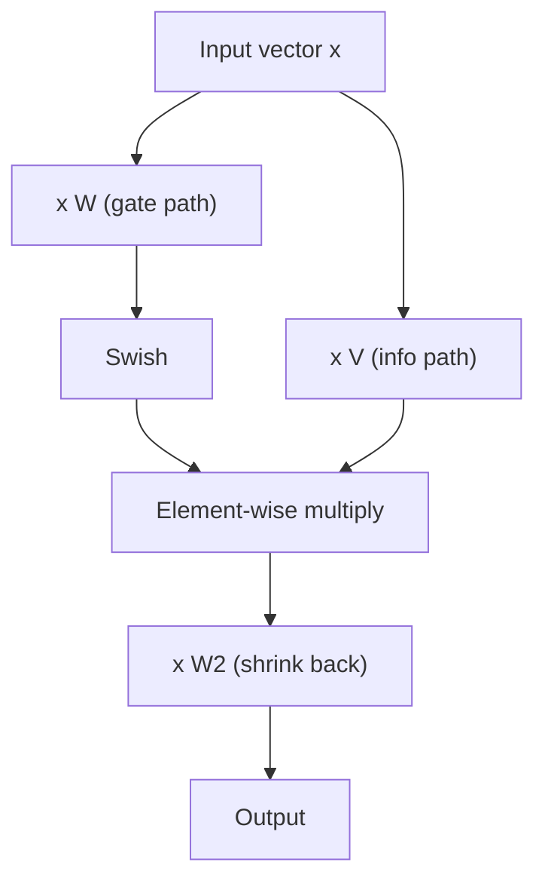
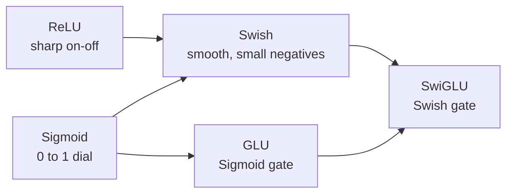

# How does SwiGLU work?

> **Step 3: Generative AI and the Transformer Architecture** · ⏱️ 16 min read · [Read original](https://outcomeschool.com/blog/swiglu)

## TL;DR
SwiGLU is a building block in the feed-forward network (FFN) of modern LLMs that decides how much of each piece of information passes. It makes two paths from the input, turns one into a smooth "gate" with Swish, and multiplies it element-wise with the other path. It gave better quality than ReLU at the same size and compute, so LLaMA, PaLM and Mistral use it.

## Key Concepts
- **Feed-forward network (FFN)** — per-word part of a Transformer block: expand the vector, activate, shrink back. SwiGLU replaces the middle "activate" step.
- **Activation function** — rule mapping one number to another; adds the "bend" (non-linearity) so stacked layers can learn complex patterns, not just a straight line.
- **ReLU** — keep positive, make negative 0. On-off switch, sharp corner at 0.
- **Sigmoid** — squeezes any number into 0 to 1 (a volume dial).
- **Swish / SiLU** — $x \cdot \text{Sigmoid}(x)$; smooth ReLU-like curve with a small dip below 0. General form has beta: $x \cdot \text{Sigmoid}(\beta x)$; in SwiGLU beta is usually 1. PyTorch: `F.silu`.
- **Gate** — numbers that decide how much of other numbers pass, via element-wise (position-by-position) multiplication.
- **GLU (Gated Linear Unit)** — two versions of the same input: information and gate (introduced 2016).
- **SwiGLU** — GLU whose gate uses Swish instead of Sigmoid (Noam Shazeer, 2020, "GLU Variants Improve Transformer").

## How It Works

### Where it lives
A Transformer block = Attention (words collect info from each other) then FFN (each word processes alone). SwiGLU sits inside the FFN.

### The FFN in three steps
Each word is a vector (e.g. 4096 numbers).
1. Expand with a weight matrix (e.g. 4096 to about 11,000).
2. Activate every number with an activation function.
3. Shrink with another weight matrix back to the original size.

Analogy: spread a note on a big table, highlight and cross out, write a short summary. SwiGLU changes the "highlight and cross out" step.

### Activation functions leading to Swish
- Stacked linear operations stay linear, so a bend is needed.
- ReLU: $\text{ReLU}(x)=x$ if $x>0$ else 0. Used by the original Transformer. Problem: -0.01 and -100 both become 0 (negative info lost) and the sharp corner makes learning rough.
- Sigmoid: -5 gives 0.007, 0 gives 0.5, 5 gives 0.993.
- Swish: the number sets its own volume. Large positive passes almost fully, large negative is mostly blocked.

| x | Sigmoid(x) | Swish(x) | ReLU(x) |
|---|---|---|---|
| -5 | 0.007 | -0.033 | 0 |
| -2 | 0.119 | -0.238 | 0 |
| -1 | 0.269 | -0.269 | 0 |
| 0 | 0.5 | 0 | 0 |
| 1 | 0.731 | 0.731 | 1 |
| 2 | 0.881 | 1.762 | 2 |
| 5 | 0.993 | 4.967 | 5 |

For large positive x Swish is almost ReLU; for negatives it lets a small negative value through, with no sharp corner.

### Gate and GLU
Water-tank-with-taps analogy: taps control flow, they do not create water. Example: info [8, 5, 6] times gate [1.0, 0.0, 0.5] gives [8, 0, 3] (pass, block, half).

GLU steps: (1) $xW$ gives information, (2) $xV$ with a different matrix gives the gate part, (3) Sigmoid on the gate so values are 0 to 1, (4) element-wise multiply.

$$
\text{GLU}(x) = (xW) \odot \text{Sigmoid}(xV)
$$

The gate is learned and input-dependent (different words open different taps), unlike ReLU's fixed "block negatives" rule.

### SwiGLU

$$
\text{SwiGLU}(x) = \text{Swish}(xW) \odot (xV)
$$

$$
\text{FFN}(x) = \big(\text{Swish}(xW) \odot (xV)\big)\,W_2
$$

Third matrix $W_2$ shrinks back. In LLaMA code: `w1` = gate, `w3` = up (info path), `w2` = down (shrink). Shazeer tried many gate functions; smooth ones (Swish, GELU) did best.

### Worked example
- Gate path $xW$: [2, -1, 0.5]; info path $xV$: [3, 4, -2].
- Swish on gate: 2 x 0.881 = 1.762; -1 x 0.269 = -0.269; 0.5 x 0.622 = 0.311.
- Multiply: 1.762 x 3 = 5.286; -0.269 x 4 = -1.076; 0.311 x -2 = -0.622. Result [5.286, -1.076, -0.622]; then $W_2$ shrinks it.
- Position 1: strong gate, info passes strongly. Position 2: negative gate, held back and flipped to small negative. Position 3: small gate, little passes.

### Code (PyTorch, LLaMA structure)
```python
class SwiGLUFeedForward(nn.Module):
    def __init__(self, dim, hidden_dim):
        super().__init__()
        self.w1 = nn.Linear(dim, hidden_dim, bias=False)  # gate
        self.w3 = nn.Linear(dim, hidden_dim, bias=False)  # info
        self.w2 = nn.Linear(hidden_dim, dim, bias=False)  # shrink
    def forward(self, x):
        return self.w2(F.silu(self.w1(x)) * self.w3(x))
```
Parameter budget: normal FFN has 2 matrices with hidden size $4 \times dim$; SwiGLU has 3, so hidden is about $\tfrac{2}{3} \times 4 \times dim$ to keep parameters about equal. LLaMA 7B: dim 4096, hidden_dim 11008.

### Why it works better
1. Better results than ReLU at same size and compute (Shazeer's experiments), the main reason.
2. Input-based filtering via learned gate.
3. Smooth learning: no sharp corner, negatives still send a small learning signal in training.
4. Multiplying two learned paths builds richer feature combinations.

Not fully understood; Shazeer wrote that success is attributed "to divine benevolence".

### ReLU vs GELU vs SwiGLU
GELU is a smooth activation shaped like Swish (BERT, GPT-2).

| Point | ReLU | GELU | SwiGLU |
|---|---|---|---|
| Shape | Sharp corner at 0 | Smooth | Smooth gate times info |
| Negative values | All become 0 | Small values pass | Controlled by learned gate |
| FFN weight matrices | 2 | 2 | 3 |
| Gate | No | No | Yes, learned and input-based |
| Compute cost | Lowest | Low | Slightly higher, offset by smaller hidden size |
| Used in | Original Transformer | BERT, GPT-2 | LLaMA, PaLM, Mistral |

## Diagram(s)

### SwiGLU feed-forward flow


### Activation function lineage


## Trade-offs & Pitfalls
- Three weight matrices instead of two: compute slightly higher; offset by shrinking hidden size to about 2/3.
- Total parameters stay about the same, so SwiGLU does not add parameters overall.
- The theoretical reason for its success is not fully understood; evidence is empirical.
- SwiGLU is not the same as SiLU: SiLU (Swish) is only the gate activation, SwiGLU is the full gated unit.

## Key Takeaways
- SwiGLU lives in the Transformer FFN, replacing the ReLU/GELU activation step.
- Formula: $\text{FFN}(x) = (\text{Swish}(xW) \odot (xV))W_2$.
- SwiGLU = Swish + GLU: a GLU with a Swish gate instead of Sigmoid.
- The gate is learned and input-dependent; ReLU's rule is fixed.
- Swish is a smooth ReLU that lets small negatives through and keeps gradients flowing.
- Hidden size is cut to about 2/3 of 4 x dim to offset the third matrix (LLaMA 7B: 4096 to 11008).
- Introduced by Shazeer in 2020; used in LLaMA, PaLM, Mistral.
- Swish = SiLU = `F.silu` (beta = 1); in LLaMA `w1` gate, `w3` up, `w2` down.
