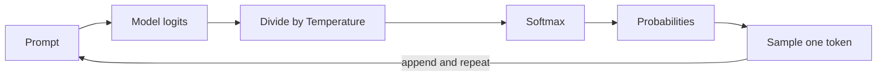

# How does Temperature control LLM output?

> **Step 4: How LLMs Generate Text** · ⏱️ 17 min read · [Read original](https://outcomeschool.com/blog/how-does-temperature-control-llm-output)

## TL;DR
Temperature is a knob that controls how random or predictable an LLM's output is. It divides the model's raw scores (logits) before softmax: low values sharpen the distribution toward the top token, high values flatten it so weaker tokens get a real chance.

## Key Concepts
- **Logits** — raw scores the model gives every possible next token.
- **Softmax** — converts scores to probabilities that sum to 1; sensitive to gaps between scores.
- **Sampling** — the "lucky draw" picking a token according to probabilities.
- **Temperature** — usually 0 to 2, default often 1.
- **Greedy decoding** — always picking the top token (Temperature 0).
- **Top-p** — another randomness control that removes weak tokens from the draw.

## How It Works
**Picking the next token:** scores to probabilities to sampling. For "The sky is": blue 4.0, clear 3.0, falling 1.0, banana 0.0 become 0.70 / 0.26 / 0.03 / 0.01. The pick is appended and the process repeats (autoregressive).

**Where Temperature acts.** Before softmax:

$$p_i=\frac{e^{z_i/T}}{\sum_j e^{z_j/T}}$$

$T<1$ widens the gaps (scores amplified); $T>1$ narrows them. Temperature never changes the ranking, only how far ahead the top token is.

| Temperature | blue | clear | falling | banana |
|---|---|---|---|---|
| 0.1 | 1.00 | 0.00 | 0.00 | 0.00 |
| 0.5 | 0.88 | 0.12 | 0.00 | 0.00 |
| 1 | 0.70 | 0.26 | 0.03 | 0.01 |
| 2 | 0.51 | 0.31 | 0.11 | 0.07 |

**Low vs high**
- Low: focused, predictable, reliable but can be repetitive.
- High: creative and varied but can derail; one odd token (e.g. "banana") conditions everything after it, so very high values produce nonsense.

**Special values.** $T=1$: original probabilities. $T=0$: greedy decoding (implementations skip division and pick the top token). Even at 0 output can differ slightly due to hardware rounding.

**Name:** from physics: cold means particles fixed (ice), hot means jumping around (steam).

**Choosing a value**

| Use case | Temperature |
|---|---|
| Code, maths, facts | 0 to 0.2 |
| Summarizing | 0.2 to 0.5 |
| Customer support | 0.3 to 0.7 |
| General chat | 0.7 to 1 |
| Stories, poems | 0.8 to 1.2 |
| Brainstorming | 1 to 1.5 |

Rule: one correct answer means low; many good answers means high. Ranges are starting points.

**Common mistakes**
1. Thinking it makes the model smarter; it only changes how it picks from what it knows.
2. Going very high (above about 1.5) for creativity.
3. Expecting identical output at $T=0$; save outputs if exact reuse is needed.
4. Changing Temperature and Top-p together.

## Diagram

## Key Takeaways
- Temperature = divide logits by $T$ before softmax.
- Low $T$ gives focused output; high $T$ gives diverse, riskier output.
- $T=0$ is greedy decoding; $T=1$ is the model's natural distribution.
- It does not add knowledge or correctness.
- Tune Temperature or Top-p, not both at once.
