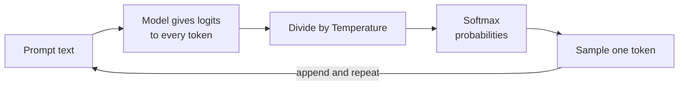
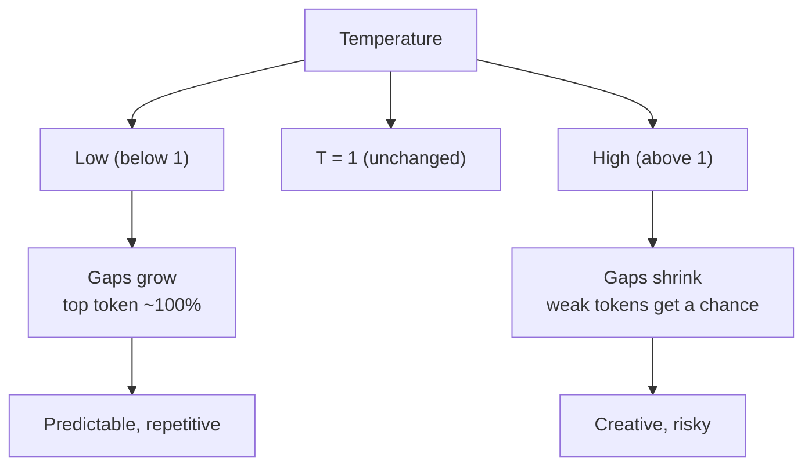

# How does Temperature control LLM output?

> **Step 4: How LLMs Generate Text** · ⏱️ 17 min read · [Read original](https://outcomeschool.com/blog/how-does-temperature-control-llm-output)

## TL;DR
Temperature is one number that divides the model's raw scores (logits) before softmax. Low values sharpen the distribution (safe, predictable output); high values flatten it (creative, risky output). It never changes token ranking, adds knowledge, or makes the model smarter.

## Key Concepts
- **Token** — a word or part of a word; the LLM writes one at a time.
- **Logits** — raw scores the model gives every possible next token (higher = better fit).
- **Softmax** — converts scores to positive probabilities that sum to 1; cares about the *gaps* between scores.
- **Sampling** — picking a token randomly according to the probabilities ("lucky draw" from a box of slips).
- **Autoregressive generation** — pick a token, append it, repeat while looking at everything so far.
- **Temperature** — knob (usually 0 to 2, default often 1) controlling randomness.
- **Greedy decoding** — Temperature 0: always pick the top-scoring token.

## How It Works
### Score, probability, draw
1. Model scores every token (real vocab > 100,000 tokens). Example for "The sky is": blue 4.0, clear 3.0, falling 1.0, banana 0.0.
2. Softmax gives probabilities: 0.70, 0.26, 0.03, 0.01.
3. Sample one token (not always the top one), append, repeat.

### Where Temperature enters
Applied to scores just before softmax:

$$
\text{New Score} = \frac{\text{Score}}{T}
$$

- $T=1$: no change (model's natural, as-trained behavior).
- $T<1$ (e.g. 0.5): scores multiplied, gaps grow, top token dominates.
- $T>1$ (e.g. 2): scores shrunk, gaps shrink, probability spreads out.
- Temperature changes the number of "slips" per token; it does **not** change the order (blue is always top).

### Worked example
| Temperature | blue | clear | falling | banana |
|---|---|---|---|---|
| 0.1 | 1.00 | 0.00 | 0.00 | 0.00 |
| 0.5 | 0.88 | 0.12 | 0.00 | 0.00 |
| 1 | 0.70 | 0.26 | 0.03 | 0.01 |
| 2 | 0.51 | 0.31 | 0.11 | 0.07 |

Code essence: `scaled = [s/T for s in scores]`, then `exp`, then divide by the sum (softmax), round to 2 decimals.

### Low vs high vs special values
| Setting | Output | Pro | Con |
|---|---|---|---|
| Low (0.1 to 0.2) | Focused, nearly identical each run | Reliable | Boring, repetitive (ten similar story ideas) |
| High (above 1, e.g. 1.5 to 2) | Creative, varied, sometimes wrong | Good for brainstorming, stories | One bad token ("banana") derails the rest since later tokens build on it; very high gives nonsense |
| T = 1 | Original probabilities | Natural behavior | - |
| T = 0 | Greedy decoding | Always top token | Cannot divide by 0, so software skips the draw; output may still differ slightly between runs (chip rounding differences) |

### Why "Temperature"
Physics analogy: cold water = particles fixed (ice) = model stuck on top choice; hot = particles jump (steam) = model jumps among choices. Borrowed from a physics formula.

### Which value to use
| Use case | Temperature | Why |
|---|---|---|
| Code | 0 to 0.2 | Correct, not creative |
| Maths and facts | 0 to 0.2 | One right answer |
| Summarizing | 0.2 to 0.5 | Stay close to original |
| Customer support | 0.3 to 0.7 | Friendly but accurate |
| General chat | 0.7 to 1 | Natural |
| Stories, poems | 0.8 to 1.2 | Creative |
| Brainstorming | 1 to 1.5 | Many different ideas |

Rule: one correct answer = low; many good answers = high. Ranges are starting points; try values. In an API it is just `temperature=0.2` in the generate call.

## Diagram(s)
### Where Temperature sits in the pipeline

### Effect of Temperature on the distribution

## Trade-offs & Pitfalls
1. Temperature does **not** make the model smarter or more correct; it only changes how it picks from what it knows (links to hallucination).
2. Very high Temperature (above ~1.5) quickly yields nonsense; creativity needs only slightly high.
3. Temperature 0 is "almost always same", not guaranteed; to get identical output, save and reuse it.
4. Do not change Temperature and Top-p together (Top-p removes weak tokens from the draw; both change randomness, so you cannot tell which caused the change).

## FAQ
- Does Temperature change which token ranks highest? → No, only how far ahead the top is.
- Temperature vs Top-p? → Temperature divides scores (sharper/flatter); Top-p removes weak tokens.
- Can lower Temperature make it more accurate? → No, only more focused.
- Default? → Often 1 (no change); range usually 0 to 2.

## Key Takeaways
- Temperature = divide logits by T before softmax.
- Low T sharpens, high T flattens; ranking never changes.
- T=1 is the model's native distribution; T=0 is greedy decoding.
- Facts/code: 0 to 0.2; chat: 0.7 to 1; creative: 0.8 to 1.5.
- It adds no knowledge and does not fix hallucination.
- Even T=0 is not perfectly deterministic.
- Tune Temperature or Top-p, not both at once.
