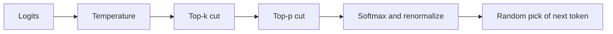

# How do Top-k and Top-p Sampling work?

> **Step 4: How LLMs Generate Text** · ⏱️ 19 min read · [Read original](https://outcomeschool.com/blog/how-do-top-k-and-top-p-sampling-work)

## TL;DR
Top-k keeps only the k most likely tokens and samples from them. Top-p (nucleus) keeps the smallest set of top tokens whose probabilities add up to at least p and samples from that. Both cut off the silly low-probability tail while keeping variety.

## Key Concepts
- **Logits** — raw per-token scores from the LLM; softmax turns them into probabilities that sum to 100%.
- **Sampling / decoding strategy** — the step and rule used to pick the next token from the probabilities.
- **Greedy decoding** — always pick the top token; simple and fast but boring, repetitive, and can loop.
- **Pure sampling** — pick from all tokens by probability; varied, but the long tail occasionally yields nonsense ("The cat sat on the democracy") that derails the rest of the reply.
- **Top-k** — keep a fixed number k of top tokens (common: 10 to 50).
- **Top-p / Nucleus sampling** — keep the smallest top group covering at least p (common: 0.9 to 0.95); introduced in 2019 in "The Curious Case of Neural Text Degeneration".
- **Renormalization** — rescale kept probabilities so they sum to 100% again.

## How It Works
**Top-k (k = 3)** on "The cat sat on the": mat 40, floor 25, sofa 15, bed 10, roof 5, rest 5.
1. Sort by probability.
2. Keep the top 3 (mat, floor, sofa = 80%).
3. Renormalize: 50%, 31.25%, 18.75%.
4. Sample randomly.

**Problem with Top-k:** k is fixed. For "The capital of France is" (Paris 95%), k = 3 forces weak tokens like "the" and "a" in. For "My favourite colour is" (many ~10% options), k = 3 cuts off equally good colours.

**Top-p (p = 0.9)** on the same example:
1. Sort by probability.
2. Add up from the top until the running total reaches p (mat 40, floor 65, sofa 80, bed 90 -> stop).
3. Drop the rest (roof and the tail).
4. Renormalize by 90: 44.4%, 27.8%, 16.7%, 11.1%.
5. Sample.

The group size adapts: one token for "Paris", many for the colour question. In code, a token is dropped when the cumulative sum before it already reached p.

### Top-k vs Top-p
| | Top-k | Top-p |
|---|---|---|
| What is fixed | Number of tokens | Total probability covered |
| Kept group size | Always k | Changes per token |
| Model very sure | Still keeps k, some weak | Keeps very few, maybe one |
| Model unsure | May cut good tokens | Keeps many |
| Cost | Cheaper (find top k) | Sort plus running total |

### With Temperature
Temperature divides scores before softmax (low = sharp, high = flat). Top-k and Top-p do not reshape probabilities, they only cut the list. Typical order: scores -> temperature -> top-k -> top-p -> probabilities -> pick. Common defaults: k = 50, p = 0.95.

## Diagram

## Key Takeaways
- Greedy is boring; pure sampling is risky; Top-k and Top-p sit between them.
- k = 1 or p near 0 gives greedy; huge k or p = 1.0 gives pure sampling.
- Top-k uses a fixed count; Top-p adapts to the model's confidence at every token.
- Temperature shapes probabilities; Top-k/Top-p shrink the candidate list.
- Factual or code tasks: small k or p 0.9 with low temperature. Creative tasks: larger k or p 0.95 with higher temperature.
- When unsure, Top-p is the safer default.
