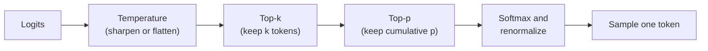
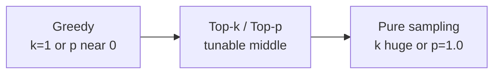

# How do Top-k and Top-p Sampling work?

> **Step 4: How LLMs Generate Text** · ⏱️ 19 min read · [Read original](https://outcomeschool.com/blog/how-do-top-k-and-top-p-sampling-work)

## TL;DR
Top-k keeps the k most likely tokens and samples among them; Top-p (nucleus) keeps the smallest set of top tokens whose probabilities sum to at least p and samples among them. Both cut the unreliable tail of the vocabulary while keeping variety; Top-p adapts its group size to the model's confidence, Top-k does not.

## Key Concepts
- **Vocabulary** — all tokens the LLM knows (tens of thousands+).
- **Logits / softmax** — raw scores to probabilities summing to 100%.
- **Sampling / decoding strategy** — the step and rule used to pick the next token.
- **Greedy decoding** — always pick the highest-probability token.
- **Pure sampling** — pick randomly from the full distribution.
- **Top-k** — keep k highest-probability tokens (common 10 to 50), a setting, not learned.
- **Top-p / Nucleus sampling** — keep smallest top group covering at least p (common 0.9 to 0.95); introduced 2019 in "The Curious Case of Neural Text Degeneration".
- **Renormalization** — rescale kept probabilities to sum to 100%.

## How It Works
Running example, "The cat sat on the": mat 40%, floor 25%, sofa 15%, bed 10%, roof 5%, all others 5% total.

### Two extremes
| Strategy | Pro | Con |
|---|---|---|
| Greedy | Simple, fast | Boring, repetitive, identical answers, loops ("I think that I think that..."); most likely token each step is not the most natural sentence |
| Pure sampling | Variety | The long tail (5% spread over thousands of tokens) gets picked ~5% of the time: "banana", "democracy". One silly token derails the rest of a hundreds-of-token reply |

Need: keep variety, cut bad tokens.

### Top-k (k = 3)
1. Sort by probability.
2. Keep top k: mat, floor, sofa (total 80%).
3. Renormalize: mat 40/80 = 50%, floor 25/80 = 31.25%, sofa 15/80 = 18.75%.
4. Sample.

Code: `torch.topk` then `softmax` on the k values (gives renormalization for free, identical to softmax-all then rescale) then `torch.multinomial`.

Analogy: waiter who only looks at the 3 most popular dishes.

**Problem: fixed k ignores confidence.**
- "The capital of France is": Paris 95%, the 2%, a 1%, located 1%. k=3 forces weak "the", "a" in, so sometimes "...France is the".
- "My favourite colour is": blue 12, red 11, green 11, black 10, purple 10, yellow 9, white 9, pink 8, others 20. k=3 cuts equally good black/purple/yellow, so answers feel limited.

### Top-p (p = 0.9)
1. Sort descending.
2. Add running total from top until it reaches p: mat 40, floor 65, sofa 80, bed 90, stop.
3. Keep mat, floor, sofa, bed; drop roof and rest.
4. Renormalize by 90%: 44.4%, 27.8%, 16.7%, 11.1%.
5. Sample.

Same p=0.9 on the two situations: France: Paris alone (95%) crosses 90%, so a group of 1. Colours: eight tokens reach only 80%, so keep going lower until 90%, a big group. Group size adapts.

Code: softmax, sort descending, `cumsum`; `before = cumulative - sorted_probs`; zero out tokens where `before >= p` (keeps the token that crosses p); divide by sum; `multinomial`.

Analogy: waiter who covers dishes making up 90% of orders.

### Top-k vs Top-p
| | Top-k | Top-p |
|---|---|---|
| Fixed | Number of tokens | Total probability |
| Group size | Always k | Varies per token |
| Model very sure | Still keeps k, some weak | Very few, sometimes one |
| Model unsure | Cuts off good ones | Keeps many |
| Other name | none | Nucleus sampling |
| Common values | 10 to 50 | 0.9 to 0.95 |
| Work | Less (find top k) | More (sort + running total) |

### With Temperature
- Temperature reshapes probabilities (low = sharp, high = flat); Top-k/Top-p do not reshape, they only cut the list.
- Typical order: scores, Temperature, Top-k, Top-p, probabilities, pick. Common defaults k=50, p=0.95.
- APIs expose `top_k`, `top_p`, `temperature`; no need to write sampling code.
- Spectrum: k very large or p=1.0 gives pure sampling; k=1 or p near 0 gives greedy.

### When to use
- Factual, code, summaries: small k (~10) or p ~0.9 plus low temperature.
- Creative: larger k (~50) or p ~0.95 plus slightly higher temperature.
- Unsure: Top-p is the safer default (adapts per token); that is why nearly every API exposes Top-p while Top-k is not always available.

## Diagram(s)
### Decoding pipeline

### Greedy to pure sampling spectrum

## Trade-offs & Pitfalls
- Greedy: repetitive loops. Pure sampling: nonsense tail tokens compound.
- Top-k: fixed size too big when confident, too small when uncertain.
- Top-p: costs more compute (sort + cumulative sum).

## FAQ
- Together? → Yes, order Temperature, Top-k, Top-p, pick.
- top_p = 1.0? → Filter does nothing (pure sampling).
- Top-p better? → Safer default since adaptive; Top-k cheaper.
- Same as temperature? → No; temperature changes shape, top-k/p change list size.

## Key Takeaways
- Sampling picks from probabilities; strategy decides which tokens are eligible.
- Top-k keeps a fixed count; Top-p keeps a fixed probability mass.
- Always renormalize after cutting.
- Top-p adapts to model confidence; Top-k cannot.
- Temperature shapes, Top-k/Top-p truncate; they compose.
- Greedy and pure sampling are the endpoints of the same dial.
- Default to Top-p (0.9 to 0.95) when unsure.
