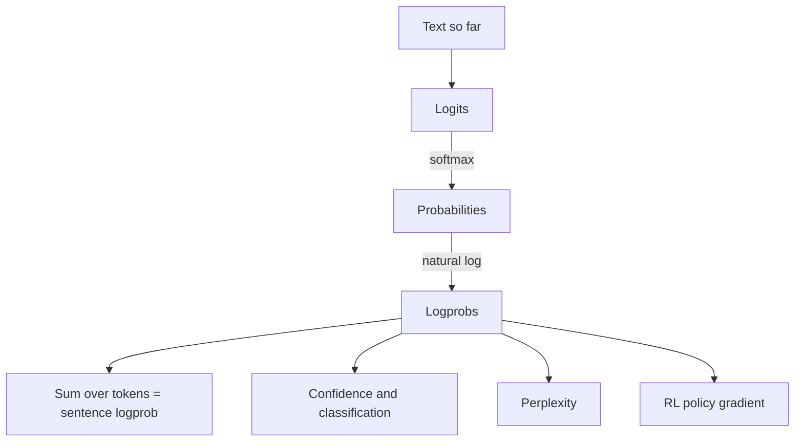

# What are Log Probabilities (Logprobs) in LLMs?

> **Step 4: How LLMs Generate Text** · ⏱️ 15 min read · [Read original](https://outcomeschool.com/blog/logprobs-in-llms)

## TL;DR
A logprob is the natural log of the probability an LLM gives a token. Logprobs turn products of tiny probabilities into sums, avoiding underflow, and they power confidence estimation, classification scores, perplexity, hallucination checks, and RL training.

## Key Concepts
- **Logits** — raw token scores; softmax converts them into probabilities summing to 1.
- **Natural log (ln)** — base e (about 2.718). Log of 1 is 0; log of a number in (0,1) is negative; $\ln(ab) = \ln a + \ln b$.
- **Logprob** — $\text{logprob} = \ln(\text{probability})$. Always 0 or negative; near 0 means very sure, more negative means less sure.
- **Underflow** — multiplying many small probabilities rounds to 0 on a computer.
- **Top logprobs** — logprobs of the few most likely tokens at a step, not only the picked one.
- **Perplexity** — how surprised a model is by text; lower is better.

## How It Works
### Why logprobs
A sentence's probability is the product of token probabilities. After 400 tokens of 0.1 each, plain multiplication gives 0.0 (wrong), while summing logprobs gives -921.03 (correct and storable).

### Example: "I love" then "to read books"
| Token | Prob | Logprob |
|---|---|---|
| to | 0.5 | -0.69 |
| read | 0.2 | -1.61 |
| books | 0.6 | -0.51 |

Product is 0.06; sum of logprobs is -2.81; $e^{-2.81} \approx 0.06$.

### API fields
`logprobs: true` returns each written token's logprob; `top_logprobs: N` also returns the top N alternatives at each step.

### Where logprobs are used
1. **Confidence** — $p = e^{\text{logprob}}$. Average logprob over an answer can route unsure answers to human review.
2. **Classification** — ask for one word ("Positive"/"Negative"), read top-2 logprobs for a score (e.g. 0.95) and apply a threshold such as 0.8.
3. **Perplexity** — $\text{perplexity} = e^{-\text{avg logprob}}$. For the example, avg is about -0.94, so perplexity is about 2.56 (as unsure as choosing among about 2.56 equal options). Perfect certainty gives 1.
4. **Hallucination risk** — a very low logprob on a key token (name, date, number) is a warning sign; not proof of error, and a confident answer can still be wrong.
5. **RL training** — policy gradient pushes token logprobs up for positive reward and down for negative: objective is reward times the sum of answer-token logprobs. Logprobs also measure drift from the original model.

## Diagram

## Key Takeaways
- Logprob = ln(probability); 0 means certain, very negative means unlikely.
- Adding logprobs replaces multiplying probabilities and prevents underflow.
- Convert back with $e^{\text{logprob}}$.
- Perplexity = $e^{-\text{avg logprob}}$; lower means the model predicts the text better.
- Low logprobs on key tokens flag answers worth verifying.
- RL fine-tuning raises or lowers logprobs of sampled answers according to reward.
