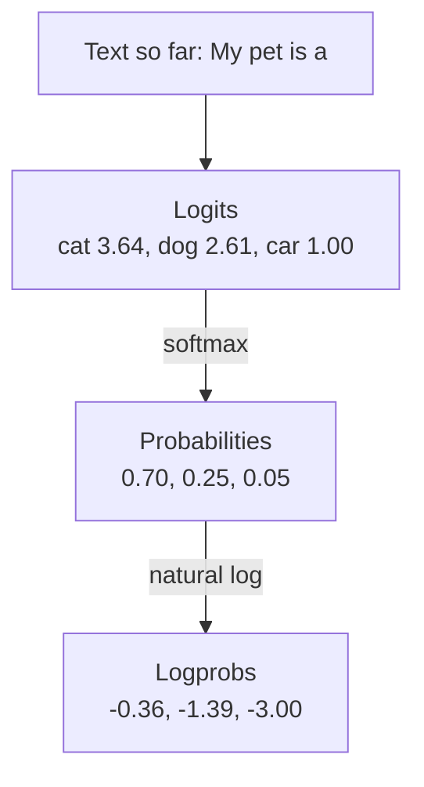
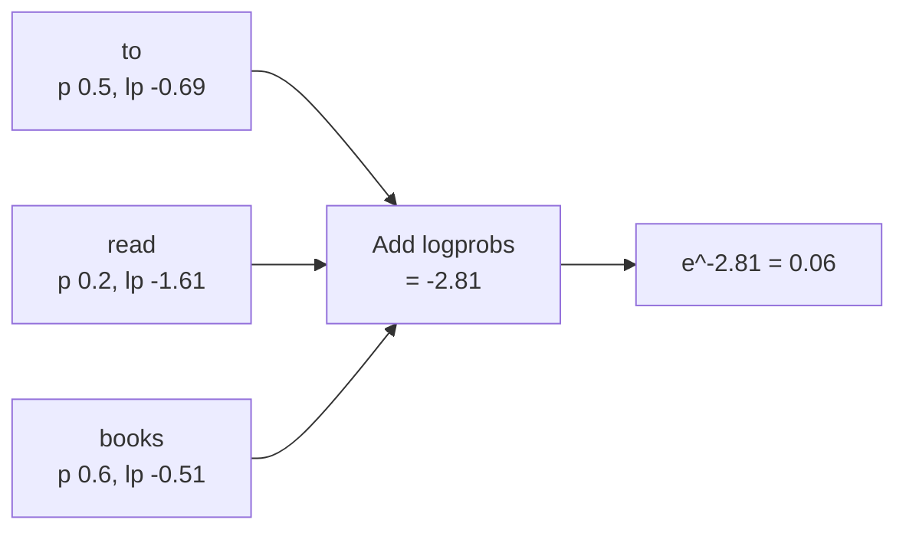
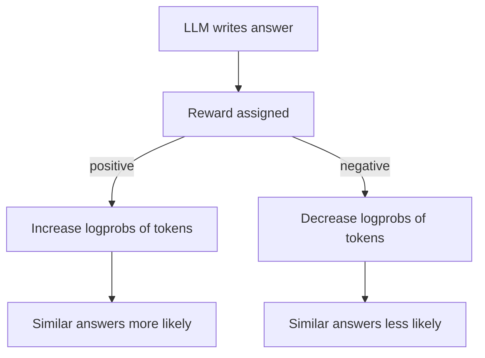

# What are Log Probabilities (Logprobs) in LLMs?

> **Step 4: How LLMs Generate Text** · ⏱️ 15 min read · [Read original](https://outcomeschool.com/blog/logprobs-in-llms)

## TL;DR
A logprob is the natural log of the probability the model assigns to a token: always 0 or negative, closer to 0 = more confident. Logs turn the product of many small probabilities into a sum, avoiding underflow, and enable confidence scoring, classification, perplexity, hallucination hints and RL training.

## Key Concepts
- **Logits** — raw per-token scores; higher = preferred.
- **Softmax** — logits to probabilities summing to 1.
- **Log** — "how many times to multiply the base to reach this number"; LLMs use natural log $\ln$ (base $e \approx 2.718$).
- **Log facts** — $\ln 1 = 0$; log of a number in (0,1) is negative (smaller = more negative); $\log(ab)=\log a+\log b$.
- **Logprob** — $\ln(p)$.
- **Underflow** — floats cannot hold numbers much below about $10^{-308}$; become 0.
- **Top logprobs** — logprobs of the few most likely tokens at a step, not just the picked one.
- **Perplexity** — how surprised a model is by text; lower = more natural.

## How It Works
### From logits to logprobs

$$
\text{logprob}=\ln(p)
$$

Example "My pet is a": cat logit 3.64 gives p 0.70 gives logprob -0.36; dog 2.61 gives 0.25 gives -1.39; car 1.00 gives 0.05 gives -3.00. Code: `np.exp` + division (softmax), then `np.log` (natural log, not base 10).

| Probability | Logprob | Meaning |
|---|---|---|
| 1.0 | 0 | Completely sure |
| 0.9 | -0.11 | Very sure |
| 0.5 | -0.69 | 50-50 |
| 0.25 | -1.39 | Not very sure |
| 0.1 | -2.30 | Unsure |
| 0.01 | -4.61 | Very unsure |
| 0.001 | -6.91 | Almost no chance |

Never positive because p never exceeds 1. Inverse: $p = e^{\text{logprob}}$.

### Why logprobs
- Chance of a whole text = product of token probabilities, which shrinks fast ($0.1^{400}$ is 399 zeros then 1). Plain floats hit 0.0 (underflow).
- Adding logprobs never collapses to 0. Demo: 400 times 0.1 gives product 0.0 (wrong) but logprob sum -921.03 (correct, storable).
- Hence training and API outputs use logprobs (training loss is built from log of a probability; see cross-entropy).

### Sentence probability
"I love" then "to read books": probs 0.5, 0.2, 0.6; logprobs -0.69, -1.61, -0.51.
- Multiply: 0.5 x 0.2 x 0.6 = 0.06.
- Add: -2.81, and $e^{-2.81}=0.06$. Same answer, no underflow.

### Top logprobs / API
- `logprobs: true` returns each written token's logprob; `top_logprobs: N` also returns the top N alternatives per step (picked token, its logprob, list of candidates). Example: cat -0.36, dog -1.39 (strong second), car -3.00 (weak third).

### Uses
1. **Confidence estimation** — $e^{\text{logprob}}$ gives probability (-0.11 = 90%, -2.30 = 10%). Use average logprob over a long answer; auto-show when sure, send to a human when unsure.
2. **Classification** — ask for one word ("Positive"/"Negative"), read top-2 logprobs of first token: Positive -0.05 (0.95), Negative -3.00 (0.05). Gives label plus score; set a threshold (e.g. accept only if over 0.8), route rest to review.
3. **Perplexity** — $$\text{PPL}=e^{-\text{(average logprob)}}$$ Example: sum -2.81, average about -0.94, flip to 0.94, $e^{0.94}\approx 2.56$ = as unsure as choosing among about 2.56 equally likely tokens per step; perfectly sure = 1. Compare models on the same text; lower is better.
4. **Hallucination risk** — "Eiffel Tower built in 1889": logprob -0.02 on "1889" = sure; -2.5 = unsure with other years close behind. Low logprob on names, dates, numbers is a warning sign to check; not proof of error, and a sure answer can still be wrong.
5. **RL training (policy gradient)** — positive reward raises logprobs of the answer's tokens (written more often); negative lowers them. Simplified objective: reward x (sum of answer-token logprobs) maximized. Logprobs also compare the trained model with the original to measure drift and keep it from changing too much.

## Diagram(s)
### Token to logprob

### Sentence logprob by addition

### Policy gradient with logprobs

## Trade-offs & Pitfalls
- High logprob does not mean correct; low logprob does not prove wrong.
- Use natural log (`np.log`), not base 10.

## FAQ
- Can a logprob be positive? → No; 0 means certainty.
- Logprob to probability? → $e^{\text{logprob}}$.
- Logits vs logprobs? → Logits are raw scores; logprobs come after softmax then ln.

## Key Takeaways
- Logprob = ln(probability); 0 is certain, more negative is less sure.
- Summing logprobs replaces multiplying probabilities and avoids underflow.
- Sentence logprob = sum of token logprobs.
- `logprobs` and `top_logprobs` expose confidence and alternatives.
- Perplexity = $e^{-\text{avg logprob}}$; lower is better.
- Logprobs power confidence, classification thresholds, hallucination flags and RL.
- Confidence is a hint, not proof of correctness.
