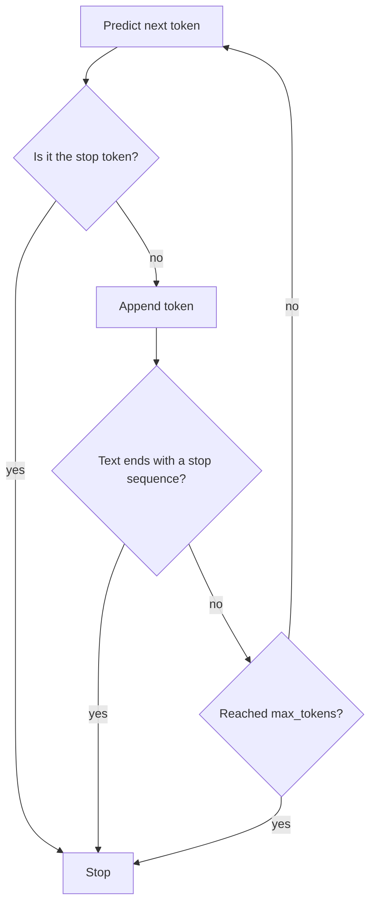
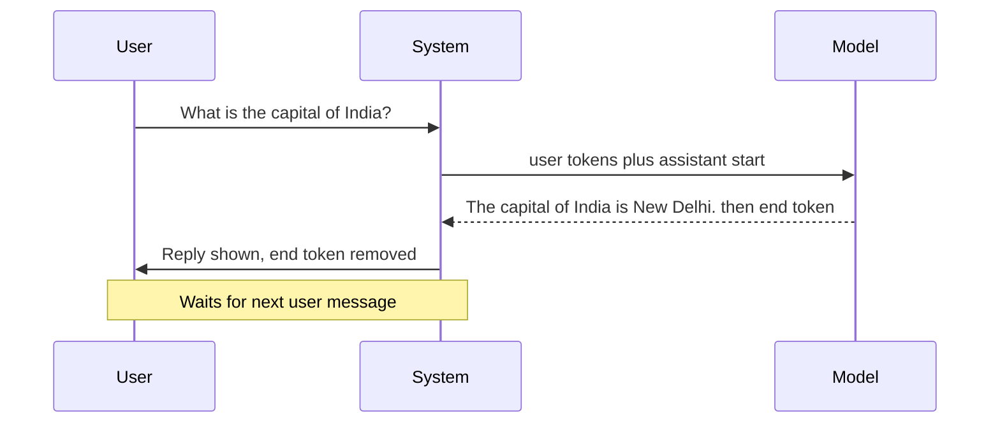

# Stop Tokens in LLMs

> **Step 4: How LLMs Generate Text** · ⏱️ 19 min read · [Read original](https://outcomeschool.com/blog/stop-tokens-in-llms)

## TL;DR
A stop (EOS) token is a special vocabulary token meaning "the text ends here". The model learns to emit it from training data where every document ends with it; the generation loop stops when it appears. It works alongside user-set stop sequences and a max-token limit as three brakes.

## Key Concepts
- **Token** — piece of text (word, subword, character, space, punctuation); the model sees numbers, not text. Example: "I love learning." becomes ["I", " love", " learning", "."] (space belongs to the token).
- **Vocabulary** — full list of tokens, each with a serial number.
- **Prompt** — input text.
- **Autoregressive generation** — model feeds its own output back as input (auto = self, regressive = going back to what was produced).
- **Stop Token / EOS (End Of Sequence)** — hidden marker meaning the whole response ends (a "." only ends a sentence).
- **Stop sequence** — any text the user asks the system to watch for in output.
- **max_tokens / max_new_tokens** — hard cap on generated tokens.
- **finish_reason / stop_reason** — API field saying which brake fired.

## How It Works
### Generation loop and why it needs a stop
"The capital of India is" -> " New" -> " Delhi" -> "." -> (stop token). Basic loop `while True: predict, append` has no exit; the model would go on about Delhi's history, weather, etc.

Two ways to stop: fixed limit (wastes tokens if answer is 5 tokens and limit 100; cuts off if answer needs 200) or let the model say "done" (better) via the stop token.

Loop with stop token: if `next_token == STOP_TOKEN: break`, token not appended, so never shown. At each step the stop token is scored like any token: very low at "The capital of India is", highest after "New Delhi.".

Common names:
| Token | Used by |
|---|---|
| `<\|endoftext\|>` | GPT-2, many older models |
| `</s>` | Llama 2 and derivatives |
| `<\|eot_id\|>` | Llama 3 |
| `<\|im_end\|>` | Qwen, many chat models |
| `<end_of_turn>` | Gemma |

### How the model learns it
- Training data: a stop token is appended to every document (articles, books, code, conversations).
- Objective is next-token prediction; at the end of a document the correct next token is the stop token, so misses get corrected, billions of times.
- It also marks document boundaries, so text after it is a fresh start.
- Model learns that complete-feeling text (story ended, question answered, code closed) is followed by the stop token. Learned, not a hard rule (child learning "happily ever after" then close the book).
- Chat models get an extra training round on user/assistant conversations where every assistant reply ends with a stop token, handing the turn back.

### Stop token vs stop sequence
| | Stop Token | Stop Sequence |
|---|---|---|
| What | One special vocab token | Any text we choose |
| Decided | During model training | By us at use time |
| Produced by | The model | Model unaware of it |
| Checked by | Generation loop | Code around the model |
| Shown? | No, removed | Usually removed |
| Example | `</s>`, `<end_of_turn>` | "\n", "Q:", "###" |

- API example: `stop=["\n", "Q:"]`. Needed because after "Q: What is 2+2? A:" the model answers "4" then keeps writing "Q: What is 3+3?" by pattern continuation; stop token gets no high score. Stop sequence "Q:" catches it.
- Implementation: after each append, detokenize and `ends_with_any(text, stop_sequences)`.
- Both work together: stop token always active; stop sequence is an extra.

### Three brakes
1. Stop token (natural brake).
2. Stop sequence (brake we add).
3. Max token limit (emergency brake) for loops, bad models, unusual prompts.

`finish_reason`: `stop`/`end_turn` = model ended or stop sequence hit; `length`/`max_tokens` = cut by limit. Frequent `length` = limit too small.

### Chat models
Special tokens mark speakers and turn ends: `<|user|>` ... `<|end|>` `<|assistant|>` ... `<|end|>`. Every assistant reply ends with the end token in training; at inference the system sees it, stops, removes it, shows reply, waits for user. Llama 3: `<|eot_id|>`; Qwen: `<|im_end|>`. Some models have several stop tokens: Llama 3 uses `<|end_of_text|>` (end of document) and `<|eot_id|>` (end of chat turn); both stop generation.

## Diagram(s)
### Generation loop with three brakes

### Chat turn

## Trade-offs & Pitfalls
1. Wrong stop token for the model (e.g. setup waits for `</s>` but model emits `<|eot_id|>`): model never stops and writes the user's next message. Seen with Llama 3 release; set correct stop token in generation settings.
2. Max limit too small: answer cut mid-sentence; check `finish_reason`, raise limit if `length`.
3. Fine-tuning data missing the stop token: model rambles after every answer.
4. Special tokens shown to users (`<|endoftext|>`, `</s>`): enable `skip_special_tokens=True`.

## FAQ
- Shown in final answer? → No, hidden unless special tokens not stripped.
- Stop token = EOS? → Yes.
- Model more than one stop token? → Yes (Llama 3).
- `finish_reason` length? → Limit cut it; model never emitted stop.

## Key Takeaways
- Stop token is a learned vocabulary token, not a rule; the model emits it like any token.
- Training appends it to every document; chat tuning ends every assistant reply with it.
- Stop sequences are user-defined text checked outside the model.
- Always set max_tokens as the emergency brake.
- `finish_reason` tells which brake fired.
- Match the stop token to the model, or it won't stop.
- Include stop tokens in fine-tuning data.
