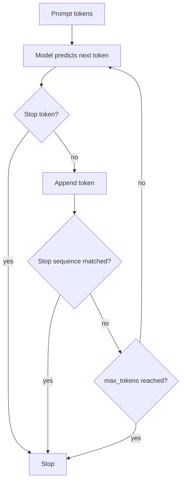

# Stop Tokens in LLMs

> **Step 4: How LLMs Generate Text** · ⏱️ 19 min read · [Read original](https://outcomeschool.com/blog/stop-tokens-in-llms)

## TL;DR
An LLM generates one token at a time in a loop that has no natural exit. A stop token is a special vocabulary token the model learns to emit when its answer is complete, which ends generation. Stop sequences and a max token limit act as extra brakes.

## Key Concepts
- **Autoregressive generation** — the model feeds its own output back as input to pick the next token, repeatedly.
- **Stop token (EOS)** — special hidden token meaning "text ends here"; produced by the model, never shown in the final output.
- **Stop sequence** — any text the user asks the system to watch for; the surrounding code cuts generation when it appears.
- **max_tokens / max_new_tokens** — hard cap on generated tokens; the emergency brake.
- **finish_reason / stop_reason** — API field saying why generation ended (`stop`/`end_turn` vs `length`/`max_tokens`).
- Examples of stop tokens: `<|endoftext|>` (GPT-2), `</s>` (Llama 2), `<|eot_id|>` (Llama 3), `<|im_end|>` (Qwen), `<end_of_turn>` (Gemma).

## How It Works
### Why stopping is needed
The basic loop (predict next token, append, repeat) never ends by itself. A fixed token limit alone wastes tokens on short answers and truncates long ones, so the model must be able to say "I am done".

### How the model learns it
A stop token is appended to the end of every training document. When predicting the next token at a document's end, the model is corrected until it predicts the stop token. It learns what a "complete" text looks like, not a hard rule. It also marks document boundaries. Chat training ends each assistant reply with a turn-end token, handing the turn back to the user.

### Stop token vs stop sequence
| | Stop token | Stop sequence |
|---|---|---|
| What | One special vocabulary token | Any text we choose |
| Decided | During training | By us at use time |
| Produced by | The model | Model unaware of it |
| Checked by | Generation loop | Code around the model |
| Examples | `</s>`, `<end_of_turn>` | `"\n"`, `"Q:"`, `"###"` |

Example: for a Q/A prompt the model may keep inventing "Q: What is 3 + 3?"; stop sequence `"Q:"` catches that.

### Three brakes
Generation ends at whichever comes first: stop token (natural), stop sequence (added), max token limit (emergency).

### Common mistakes
1. Wrong stop token for the model (e.g. waiting for `</s>` when Llama 3 emits `<|eot_id|>`), so the model keeps writing the user's next message.
2. Max token limit too small, so answers get cut off; check `finish_reason`.
3. Forgetting the stop token in fine-tuning data, so the model rambles.
4. Showing the stop token to the user; use `skip_special_tokens=True`.

Some models have several stop tokens (Llama 3 has `<|end_of_text|>` for documents and `<|eot_id|>` for chat turns).

## Diagram

## Key Takeaways
- The generation loop has no exit unless a stop token, stop sequence, or limit ends it.
- Stop tokens are learned from data (appended to every training document), not hand-coded rules.
- Stop sequences are user-defined and enforced outside the model.
- `max_tokens` is the backup brake; `finish_reason: length` means the answer was truncated.
- Use the exact stop token the model was trained with, and include it in fine-tuning data.
