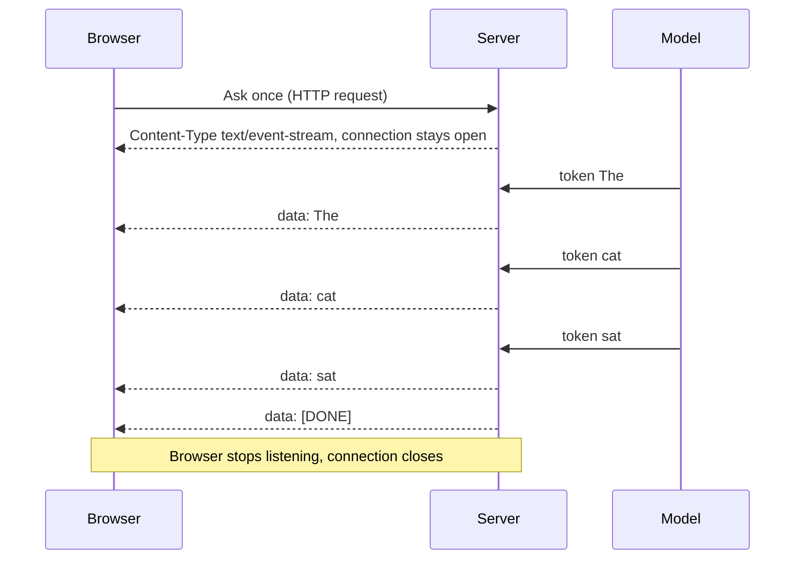
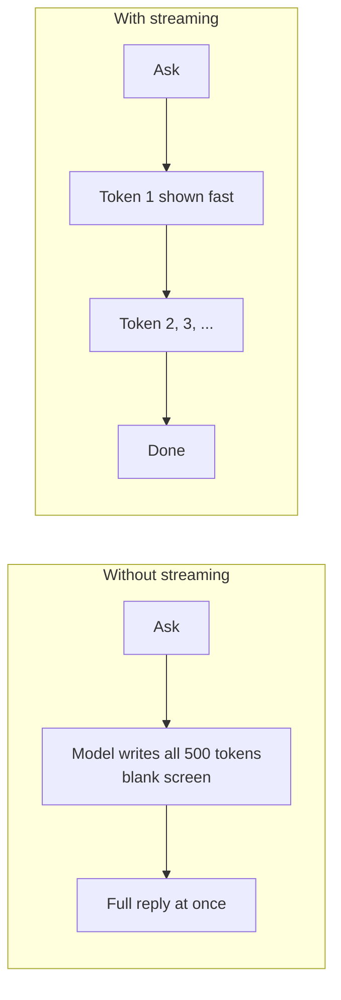

# How does Token Streaming work?

> **Step 4: How LLMs Generate Text** · ⏱️ 20 min read · [Read original](https://outcomeschool.com/blog/how-does-token-streaming-work)

## TL;DR
Token streaming sends the reply piece by piece as each token is generated, instead of waiting for the full reply. The server keeps one HTTP connection open (Server-Sent Events, `Content-Type: text/event-stream`), pushes each token as a `data:` line followed by a blank line, and ends with `[DONE]`. It makes time to first token tiny and the app feel alive.

## Key Concepts
- **Token** — small chunk of text (cat = 1 token, running often 2); tokenization e.g. BPE.
- **Autoregressive decoding** — each new token is produced from all previous tokens (auto = step by step on its own, regressive = looks back). Not all models do this (diffusion language models generate in parallel).
- **Time to first token (TTFT)** — how long the user waits before the first piece appears; set mainly by the **prefill** phase (model reads whole prompt).
- **Request-response model** — browser asks once, server replies once, connection closes.
- **SSE (Server-Sent Events)** — one-way server-to-browser events over a single open HTTP connection.
- **HTTP** — rules browsers and servers use to talk.
- **Content-Type** — label on a response saying what data it is (`text/html`, `application/json`, `text/event-stream`).
- **`[DONE]` marker** — final event signalling end of stream.
- **WebSocket** — two-way connection, both sides can send anytime.

## How It Works
### Why stream
- Without streaming, a 500-token answer means a blank screen until all 500 are produced; the first word seen is effectively the last produced. User thinks the app is stuck.
- With streaming, the first token is sent the moment it is ready; user reads while the rest is written. Two wins: words appear live, and the wait before the first word is short.
- Streaming does **not** change how the model generates; only when tokens are sent.

### SSE and the open connection
- Normal HTTP: open connection, request, full response, close (one phone call, one answer, hang up).
- SSE: browser asks once; server keeps the line open and pushes piece after piece until done.
- Server sets `Content-Type: text/event-stream`; "stream" tells the browser to stay open and read pieces as they arrive.

### Message format
Each event is a line starting `data: ` plus content, separated by a blank line (the blank line marks the end of an event):
```
data: The

data: cat

data: sat

data: [DONE]

```
In real systems the content is usually a small JSON holding the token plus extra info; same wrapping rule.

### Full walkthrough ("The cat sat")
1. Browser opens one HTTP connection and sends the question; it stays open.
2. Server starts response with `text/event-stream`.
3. Model produces "The"; server wraps it in `data:` and pushes immediately.
4. Browser extracts and appends it (small TTFT).
5. Next tokens "cat", "sat" follow the same path; the browser keeps appending, giving the live typing effect.
6. Server sends `data: [DONE]`; browser stops listening and the connection closes. Without it the browser could not tell finished from still-coming.

### SSE vs WebSockets
| Point | SSE | WebSockets |
|---|---|---|
| Direction | One-way, server to browser | Two-way |
| Built on | Plain HTTP | Separate protocol layered on HTTP |
| Setup | Simple | More complex |
| Best for | Streaming a reply, live updates | Chat rooms, games, live collaboration |
| Reconnect | Automatic | You handle it |

Token streaming needs only server-to-browser after the initial question, so SSE fits.

### Real world
ChatGPT and Claude word-by-word replies are token streaming over SSE. Behind them sits a serving engine (e.g. vLLM) producing tokens fast for many users. The same pattern powers coding assistants, writing tools, support bots.

## Diagram(s)
### Server to screen


### With vs without streaming


## Trade-offs & Pitfalls
- SSE cannot receive messages from the browser on the same stream (one-way); use WebSockets only when truly two-way.
- Skipping `[DONE]` leaves the client unsure whether the reply ended.
- Streaming improves perceived latency, not generation speed.

## FAQ
- Does streaming change generation? → No, only when tokens are sent.
- Streamed piece a plain word? → Usually JSON with extra info.
- No `[DONE]`? → Browser cannot know the reply finished.
- SSE reconnects automatically? → Yes (WebSockets: you handle it).
- Only chat apps? → No, any LLM app.

## Key Takeaways
- LLMs already generate token by token, so streaming just forwards each token immediately.
- Main benefit: tiny time to first token and a responsive feel.
- SSE = one HTTP connection kept open, `text/event-stream`.
- Format: `data: ...` plus blank line per event; `data: [DONE]` ends.
- SSE is one-way, simpler, auto-reconnecting; WebSockets for two-way needs.
- TTFT is dominated by prefill.
- Streaming doesn't change model output, only delivery timing.
