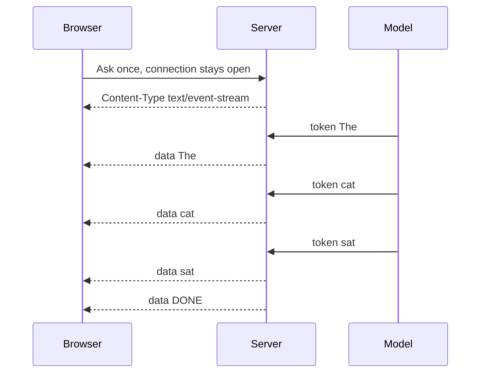

# How does Token Streaming work?

> **Step 4: How LLMs Generate Text** · ⏱️ 20 min read · [Read original](https://outcomeschool.com/blog/how-does-token-streaming-work)

## TL;DR
Token streaming sends an LLM's reply to the user piece by piece as each token is generated, instead of waiting for the full reply. It is carried over Server-Sent Events (SSE) on a single open HTTP connection, which makes the app feel fast because the time to first token is tiny.

## Key Concepts
- **Token streaming** — server sends tokens as they are produced; gives the live-typing effect.
- **Autoregressive decoding** — the model writes one token at a time, each based on all previous ones; this is what makes streaming possible.
- **Time to first token (TTFT)** — how long the user waits before seeing anything. Without streaming it equals the whole generation time; with streaming it is just the prefill plus the first token.
- **SSE (Server-Sent Events)** — one-way channel where the server keeps pushing events over one open connection after one browser request.
- **`Content-Type: text/event-stream`** — response label telling the browser to keep the connection open and read pieces as they arrive.
- **`data:` line + blank line** — the event format; the blank line marks the end of each event.
- **`[DONE]` marker** — final event signalling the stream is finished.

## How It Works
1. Browser opens one HTTP connection and sends the question; it stays open for the whole reply.
2. Server starts the response with `Content-Type: text/event-stream`.
3. Model produces token 1; the server immediately wraps it as `data: The` plus a blank line and pushes it.
4. Browser appends it to the screen; the user sees the first word almost instantly.
5. Repeat for each token (`cat`, `sat`, ...); the browser keeps appending.
6. Server sends `data: [DONE]`; the browser stops listening and the connection closes.

In real systems the content after `data:` is usually JSON holding the token plus extra info.

### SSE vs WebSockets
| | SSE | WebSockets |
|---|---|---|
| Direction | One-way, server to browser | Two-way |
| Built on | Plain HTTP | Separate protocol layered on HTTP |
| Setup | Simple | More complex |
| Best for | Streaming a reply, live updates | Chat rooms, games, collaboration |
| Reconnect | Automatic | Handled by us |

Token streaming only needs the server to push after one initial request, so SSE fits naturally.

### Real world
ChatGPT and Claude word-by-word replies, coding assistants, writing tools, and support bots all use this pattern. A serving engine like vLLM sits behind them producing tokens fast.

## Diagram

## Key Takeaways
- Streaming works because LLMs already generate one token at a time.
- Its main benefit is a very short time to first token, not faster total generation.
- SSE = one request, one long-lived HTTP connection, many `data:` events separated by blank lines.
- `text/event-stream` tells the browser to stay in streaming mode; `[DONE]` ends it.
- SSE is simpler than WebSockets and sufficient when traffic is server-to-browser only.
